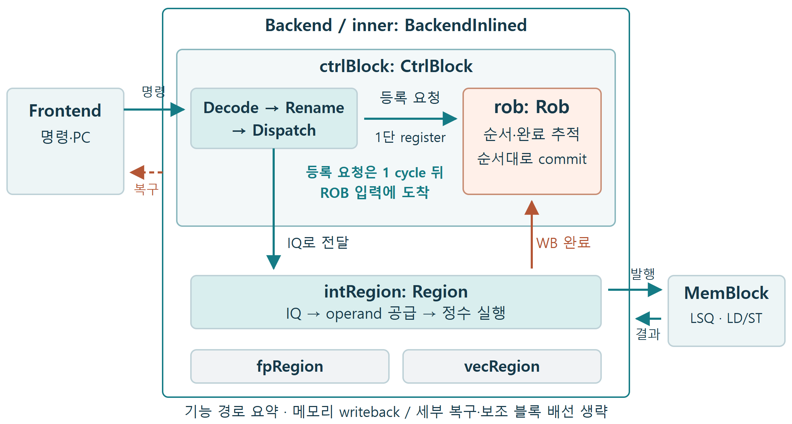
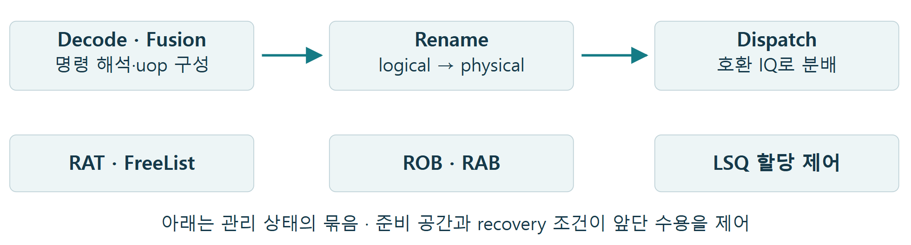
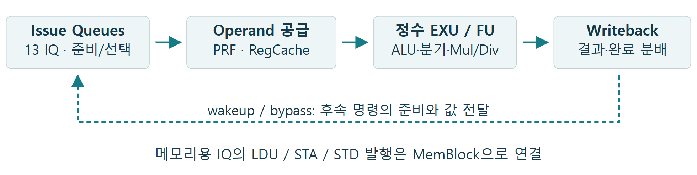
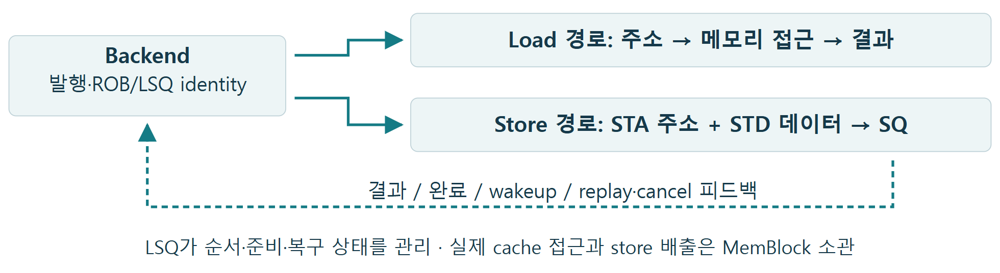
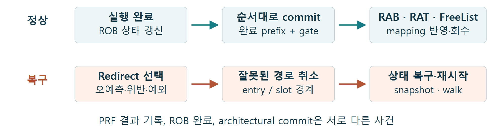

# Backend Overview

XiangShan Backend의 역할과 주요 흐름을 다섯 질문으로 살펴봅니다. 정수 경로를 중심으로 구조·실행·메모리 연동·commit·복구를 요약합니다.

Kunminghu V3 · DefaultConfig(1) · f85a1f71da8c1522035744c71e2cb266bfed1a7d 
고정 소스 기준의 기능 개요 · 상세 조건과 근거는 뒤쪽 참고 자료에 정리

## 읽는 순서

1. [Backend는 코어에서 어떤 역할을 맡는가?](#q1)
2. [명령은 실행 전에 어떤 준비를 거치는가?](#q2)
3. [정수 명령은 어디서 기다리고 어떻게 실행되는가?](#q3)
4. [Load와 Store는 Backend 안에서 모두 처리되는가?](#q4)
5. [실행 결과는 언제 확정되고, 잘못된 경로는 어떻게 복구하는가?](#q5)

[참고 자료: 상세 조건과 소스 근거](#references)

## 1. Backend는 코어에서 어떤 역할을 맡는가?

**그림 1.** XSCore의 형제 블록과 Backend의 주요 자식만 표시했다. FP·Vector는 위치만 남기고 전용 설명은 생략한다.

[SVG 원본](assets/backend-overview/figure-01.svg)

**핵심 결론**

Frontend가 공급한 명령의 의존성과 순서를 관리하고 실행을 조직한다. 메모리 명령은 형제 블록인 MemBlock과 협력해 처리한다.

### 내 수정 사항

**변경 내용**

- 기존 동작: (작성)
- 수정한 동작: (작성)

**변경 이유**

- 해결하려는 문제·설계 의도: (작성)

**검증 결과**

- 검증 방법·조건: (작성)
- 확인된 결과: (작성)
- 미확인 사항·추가 검증: (작성)

[상세 조건·소스 근거 ↗](#ref-1)

[목차로 돌아가기](#contents)

## 2. 명령은 실행 전에 어떤 준비를 거치는가?

**그림 2.** 위쪽은 Decode→Rename→Dispatch 전진 경로다. 아래 상태 블록은 위 블록과 일대일 소속 관계를 뜻하지 않는다.

[SVG 원본](assets/backend-overview/figure-02.svg)

**핵심 결론**

Decode는 실행 표현을 만들고, Rename은 레지스터 이름과 자원을 할당하며, Dispatch는 실행 가능한 IQ로 보낸다. 자원이 부족하면 앞단 수용을 멈춘다.

### 내 수정 사항

**변경 내용**

- 기존 동작: (작성)
- 수정한 동작: (작성)

**변경 이유**

- 해결하려는 문제·설계 의도: (작성)

**검증 결과**

- 검증 방법·조건: (작성)
- 확인된 결과: (작성)
- 미확인 사항·추가 검증: (작성)

[상세 조건·소스 근거 ↗](#ref-2)

[목차로 돌아가기](#contents)

## 3. 정수 명령은 어디서 기다리고 어떻게 실행되는가?

**그림 3.** 기능 흐름을 묶은 그림이다. wakeup은 준비 정보, bypass는 값 전달이며 파이프라인 단계와 latency는 생략했다.

[SVG 원본](assets/backend-overview/figure-03.svg)

**핵심 결론**

IQ가 준비된 명령을 선택하고 operand 경로가 값을 공급한다. 정수 연산 결과는 PRF·wakeup·ROB 완료 경로로 나뉘며, 발행 실패는 재선택으로 이어질 수 있다.

### 내 수정 사항

**변경 내용**

- 기존 동작: (작성)
- 수정한 동작: (작성)

**변경 이유**

- 해결하려는 문제·설계 의도: (작성)

**검증 결과**

- 검증 방법·조건: (작성)
- 확인된 결과: (작성)
- 미확인 사항·추가 검증: (작성)

[상세 조건·소스 근거 ↗](#ref-3)

[목차로 돌아가기](#contents)

## 4. Load와 Store는 Backend 안에서 모두 처리되는가?

**그림 4.** 발행·결과·피드백의 경계를 묶어 표시했다. 메모리 내부 cache/TLB와 각 replay 경로는 전개하지 않았다.

[SVG 원본](assets/backend-overview/figure-04.svg)

**핵심 결론**

Backend는 명령·의존성·발행을 관리하고 MemBlock은 메모리 접근과 큐 상태를 처리한다. Load 재실행, Store 준비·배출, ROB commit은 각각 다른 조건을 따른다.

### 내 수정 사항

**변경 내용**

- 기존 동작: (작성)
- 수정한 동작: (작성)

**변경 이유**

- 해결하려는 문제·설계 의도: (작성)

**검증 결과**

- 검증 방법·조건: (작성)
- 확인된 결과: (작성)
- 미확인 사항·추가 검증: (작성)

[상세 조건·소스 근거 ↗](#ref-4)

[목차로 돌아가기](#contents)

## 5. 실행 결과는 언제 확정되고, 잘못된 경로는 어떻게 복구하는가?

**그림 5.** 정상 commit과 복구를 별도 경로로 그렸다. snapshot/walk, LSQ 복구와 Frontend 재시작은 각자의 완료 조건을 가진다.

[SVG 원본](assets/backend-overview/figure-05.svg)

**핵심 결론**

실행은 순서 밖에서 끝날 수 있지만 architectural commit은 순서를 지킨다. Redirect는 유효한 경계를 남기고 추측 상태를 복구한 뒤 올바른 경로를 재개한다.

### 내 수정 사항

**변경 내용**

- 기존 동작: (작성)
- 수정한 동작: (작성)

**변경 이유**

- 해결하려는 문제·설계 의도: (작성)

**검증 결과**

- 검증 방법·조건: (작성)
- 확인된 결과: (작성)
- 미확인 사항·추가 검증: (작성)

[상세 조건·소스 근거 ↗](#ref-5)

[목차로 돌아가기](#contents)

## 참고 자료: 상세 조건과 소스 근거

[A. 기준 설정과 실제 경계](#ref-1)[B. CtrlBlock과 기본 자원](#ref-2)[C. 정수 Region과 operand 경로](#ref-3)[D. Backend–MemBlock 연동과 정지](#ref-4)[E. Commit·redirect·복구의 정확한 범위](#ref-5)

### A. 기준 설정과 실제 경계

[본문 1절로 돌아가기](#q1)

기준은 **kunminghu-v3 / DefaultConfig(1)**, 커밋 ` f85a1f71da8c1522035744c71e2cb266bfed1a7d `다. 별도 YAML·command-line override를 적용하지 않은 Chisel 소스 기준이며 생성 RTL 계층이나 물리 배치를 확인한 문서가 아니다.

Backend는 inner: BackendInlined를 감싸고 그 안에 CtrlBlock, Int/FP/Vector Region과 보조 블록을 둔다. BackendInlined는 inline 대상으로 선언되어 소스 경로가 그대로 emitted RTL 경로가 된다고 가정하지 않는다. FP·Vector 전용 설명을 생략해도 공유 제어 조건은 남는다.

#### 소스 근거

- [Configs.scala:70–91](https://github.com/OpenXiangShan/XiangShan/blob/f85a1f71da8c1522035744c71e2cb266bfed1a7d/src/main/scala/top/Configs.scala#L70-L91)
- [Parameters.scala:48–186](https://github.com/OpenXiangShan/XiangShan/blob/f85a1f71da8c1522035744c71e2cb266bfed1a7d/src/main/scala/xiangshan/Parameters.scala#L48-L186)
- [BackendParams.scala:419–491](https://github.com/OpenXiangShan/XiangShan/blob/f85a1f71da8c1522035744c71e2cb266bfed1a7d/src/main/scala/xiangshan/backend/BackendParams.scala#L419-L491)
- [XSCore.scala:59–76](https://github.com/OpenXiangShan/XiangShan/blob/f85a1f71da8c1522035744c71e2cb266bfed1a7d/src/main/scala/xiangshan/XSCore.scala#L59-L76)
- [Backend.scala:196–256](https://github.com/OpenXiangShan/XiangShan/blob/f85a1f71da8c1522035744c71e2cb266bfed1a7d/src/main/scala/xiangshan/backend/Backend.scala#L196-L256)

### B. CtrlBlock과 기본 자원

[본문 2절로 돌아가기](#q2)

| 자원 | 기준 값 | 단위 |
| --- | --- | --- |
| Decode / Rename | 8 / 8 | mop 입력 / uop lane |
| ROB / RAB | 160 / 352 | physical entry / mapping record |
| ROB / RAB commit 폭 | 8 / 8 | entry lane / mapping record lane |
| Rename snapshot | 4 | snapshot entries |

Fusion은 실행 표현의 변환, ROB Compression은 순서·완료 metadata의 묶음이다. 따라서 각 폭을 ISA instructions/cycle과 동일시하지 않는다. Rename의 RAT·FreeList와 Dispatch의 IQ 수용, ROB/RAB 및 LSQ 여유·recovery 조건이 앞단 진행을 함께 제어한다.

#### 소스 근거

- [CtrlBlock.scala:498–594](https://github.com/OpenXiangShan/XiangShan/blob/f85a1f71da8c1522035744c71e2cb266bfed1a7d/src/main/scala/xiangshan/backend/CtrlBlock.scala#L498-L594)
- [DecodeStage.scala:48–59](https://github.com/OpenXiangShan/XiangShan/blob/f85a1f71da8c1522035744c71e2cb266bfed1a7d/src/main/scala/xiangshan/backend/vector/Decoder/DecodeStage.scala#L48-L59)
- [Rename.scala:291–310](https://github.com/OpenXiangShan/XiangShan/blob/f85a1f71da8c1522035744c71e2cb266bfed1a7d/src/main/scala/xiangshan/backend/rename/Rename.scala#L291-L310)
- [LSQWrapper.scala:351–508](https://github.com/OpenXiangShan/XiangShan/blob/f85a1f71da8c1522035744c71e2cb266bfed1a7d/src/main/scala/xiangshan/mem/lsqueue/LSQWrapper.scala#L351-L508)
- [Parameters.scala:48–186](https://github.com/OpenXiangShan/XiangShan/blob/f85a1f71da8c1522035744c71e2cb266bfed1a7d/src/main/scala/xiangshan/Parameters.scala#L48-L186)

### C. 정수 Region과 operand 경로

[본문 3절로 돌아가기](#q3)

Int Region은 13 IQ, 총 238 entries다. IQ0–2는 각각 ALU와 BJU를 함께 연결하고, IQ3–5는 ALU, IQ6–8은 load, IQ9–10은 store 주소, IQ11–12는 store 데이터 발행을 담당한다. IQ 수는 동시 실행 가능한 ISA 명령 수가 아니다.

정수 PRF는 224×64-bit, 4 banks다. 각 bank에 12 read 채널이 있고 write 입력은 전체 9 streams다. IQ에서 나오는 25 operand 요청 위치는 고정 port와 psrc bank에 따라 중재된다. RegCache·forward/bypass를 쓰는 source는 PRF 요청과 구분한다. Read grant만으로 uop 수락을 확정하지 않으며 WB 예약·cancel·downstream ready도 검사한다.

#### 소스 근거

- [Parameters.scala:342–552](https://github.com/OpenXiangShan/XiangShan/blob/f85a1f71da8c1522035744c71e2cb266bfed1a7d/src/main/scala/xiangshan/Parameters.scala#L342-L552)
- [Region.scala:40–59](https://github.com/OpenXiangShan/XiangShan/blob/f85a1f71da8c1522035744c71e2cb266bfed1a7d/src/main/scala/xiangshan/backend/Region.scala#L40-L59)
- [ExeUnit.scala:60–68](https://github.com/OpenXiangShan/XiangShan/blob/f85a1f71da8c1522035744c71e2cb266bfed1a7d/src/main/scala/xiangshan/backend/exu/ExeUnit.scala#L60-L68)
- [WbArbiter.scala:40–78](https://github.com/OpenXiangShan/XiangShan/blob/f85a1f71da8c1522035744c71e2cb266bfed1a7d/src/main/scala/xiangshan/backend/datapath/WbArbiter.scala#L40-L78)
- [Regfile.scala:145–204](https://github.com/OpenXiangShan/XiangShan/blob/f85a1f71da8c1522035744c71e2cb266bfed1a7d/src/main/scala/xiangshan/backend/regfile/Regfile.scala#L145-L204)
- [DataPath.scala:57–60](https://github.com/OpenXiangShan/XiangShan/blob/f85a1f71da8c1522035744c71e2cb266bfed1a7d/src/main/scala/xiangshan/backend/datapath/DataPath.scala#L57-L60)

### D. Backend–MemBlock 연동과 정지

[본문 4절로 돌아가기](#q4)

기준 구성은 load 3 pipelines, store 주소 2 pipelines, store 데이터 2 pipelines다. LSQ 할당 제어는 CtrlBlock, 실제 LSQ 저장·접근 경로는 MemBlock에 있다. 주소와 데이터는 이미 할당된 LSQ identity로 결합되며 store의 주소/data 준비, 권한·예외 확인, 순서 경계와 Sbuffer ready는 별도 조건이다.

IQ/OG 미수용에 따른 재선택, MemBlock이 수락한 load의 local replay, 순서 위반의 global redirect를 구분한다. 모든 cache/TLB 대기가 Frontend 재시작을 일으키는 것은 아니다. Store의 pendingPtr·precommit·scommit은 실제 ROB retirement와 동의어가 아니다.

#### 소스 근거

- [MemBlock.scala:511–513](https://github.com/OpenXiangShan/XiangShan/blob/f85a1f71da8c1522035744c71e2cb266bfed1a7d/src/main/scala/xiangshan/mem/MemBlock.scala#L511-L513)
- [LSQWrapper.scala:385–508](https://github.com/OpenXiangShan/XiangShan/blob/f85a1f71da8c1522035744c71e2cb266bfed1a7d/src/main/scala/xiangshan/mem/lsqueue/LSQWrapper.scala#L385-L508)
- [Region.scala:172–199](https://github.com/OpenXiangShan/XiangShan/blob/f85a1f71da8c1522035744c71e2cb266bfed1a7d/src/main/scala/xiangshan/backend/Region.scala#L172-L199)
- [NewStoreQueue.scala:1990–2011](https://github.com/OpenXiangShan/XiangShan/blob/f85a1f71da8c1522035744c71e2cb266bfed1a7d/src/main/scala/xiangshan/mem/lsqueue/NewStoreQueue.scala#L1990-L2011)
- [Rob.scala:1113–1134](https://github.com/OpenXiangShan/XiangShan/blob/f85a1f71da8c1522035744c71e2cb266bfed1a7d/src/main/scala/xiangshan/backend/rob/Rob.scala#L1113-L1134)

### E. Commit·redirect·복구의 정확한 범위

[본문 5절로 돌아가기](#q5)

ROB는 WB 완료를 추적하고 오래된 완료 prefix를 commit한다. 실제 retirement는 ` isCommit && commitValid `로 보며 예외·redirect·walk·trace 등의 gate도 통과해야 한다. ROB Compression에서는 former/latter 완료를 분리해 추적하지만 정상 retirement는 entry 단위다. RAB는 mapping record를 architectural RAT에 반영하고 FreeList 회수와 연결한다.

분기·메모리 redirect 후보는 슬롯 순서로 선택하고 ROB flush는 별도 우선 경로다. ` isFormer `와 self/after 경계에 따라 같은 entry의 일부만 보존할 수 있다. Snapshot 또는 architectural 기준을 복원하고 surviving mapping을 forward walk하며, LSQ pointer도 별도 복구한다. PRF 전체 데이터를 과거 값으로 되감는 과정이 아니다.

이 개요의 그림은 기능 연결을 요약한 것이다. 전체 latency·IPC·합성 timing/면적을 측정한 자료가 아니며, 세부 설명은 Issue Queue·Int Regfile·ROB Compression 문서에서 이어서 볼 수 있다.

#### 소스 근거

- [Rob.scala:283–340](https://github.com/OpenXiangShan/XiangShan/blob/f85a1f71da8c1522035744c71e2cb266bfed1a7d/src/main/scala/xiangshan/backend/rob/Rob.scala#L283-L340)
- [RobDeqPtrWrapper.scala:59–101](https://github.com/OpenXiangShan/XiangShan/blob/f85a1f71da8c1522035744c71e2cb266bfed1a7d/src/main/scala/xiangshan/backend/rob/RobDeqPtrWrapper.scala#L59-L101)
- [RobBundles.scala:355–360](https://github.com/OpenXiangShan/XiangShan/blob/f85a1f71da8c1522035744c71e2cb266bfed1a7d/src/main/scala/xiangshan/backend/rob/RobBundles.scala#L355-L360)
- [RedirectGenerator.scala:27–39](https://github.com/OpenXiangShan/XiangShan/blob/f85a1f71da8c1522035744c71e2cb266bfed1a7d/src/main/scala/xiangshan/backend/ctrlblock/RedirectGenerator.scala#L27-L39)
- [Rab.scala:105–105](https://github.com/OpenXiangShan/XiangShan/blob/f85a1f71da8c1522035744c71e2cb266bfed1a7d/src/main/scala/xiangshan/backend/rob/Rab.scala#L105-L105)
- [RenameTable.scala:116–145](https://github.com/OpenXiangShan/XiangShan/blob/f85a1f71da8c1522035744c71e2cb266bfed1a7d/src/main/scala/xiangshan/backend/rename/RenameTable.scala#L116-L145)
- [BaseFreeList.scala:64–85](https://github.com/OpenXiangShan/XiangShan/blob/f85a1f71da8c1522035744c71e2cb266bfed1a7d/src/main/scala/xiangshan/backend/rename/freelist/BaseFreeList.scala#L64-L85)

[목차로 돌아가기](#contents)
