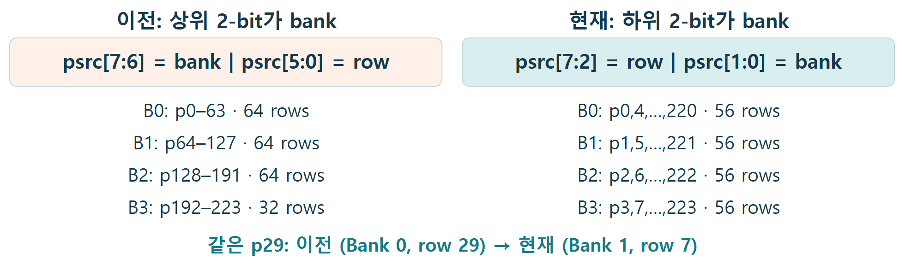
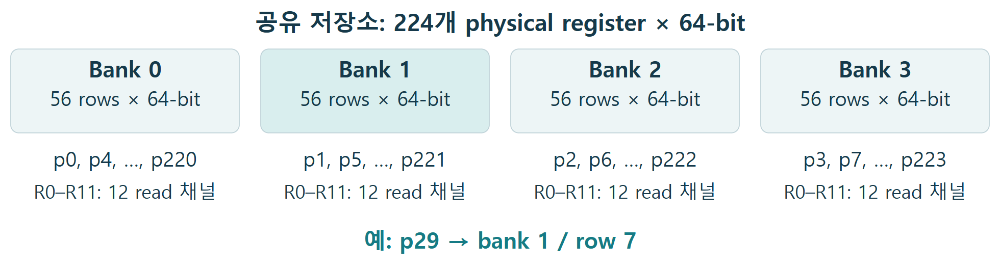
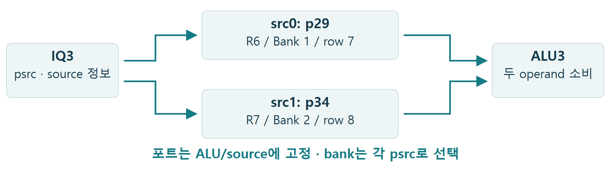
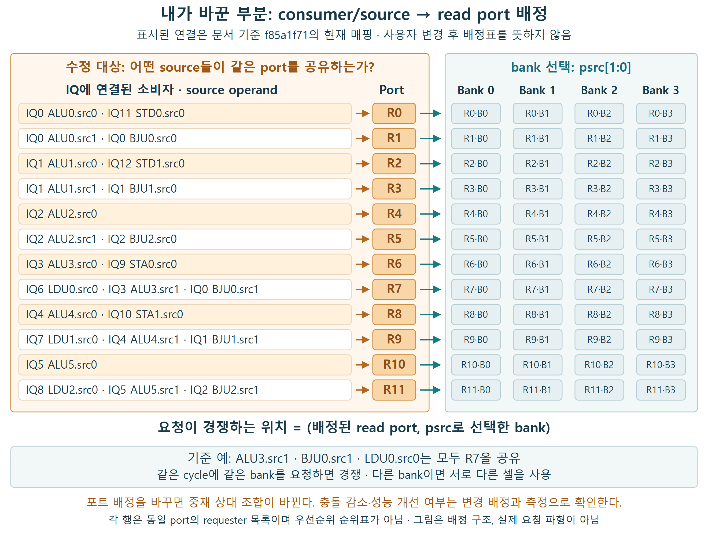
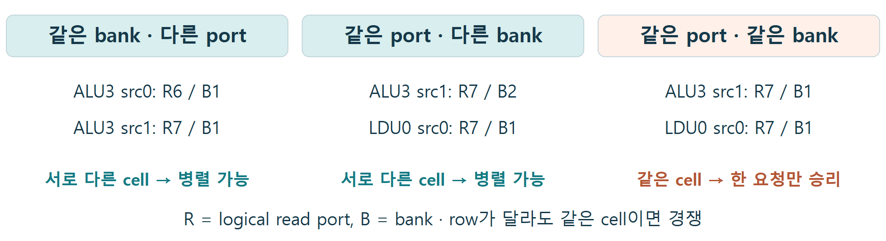
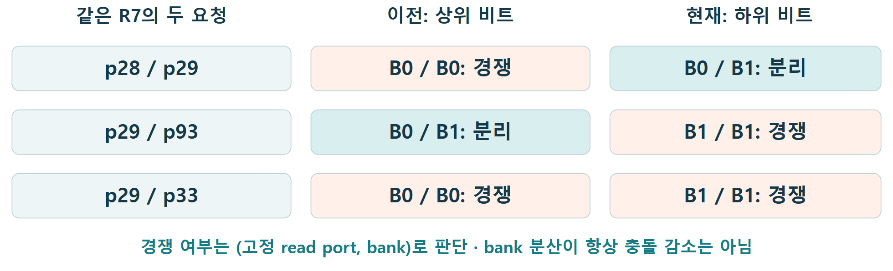
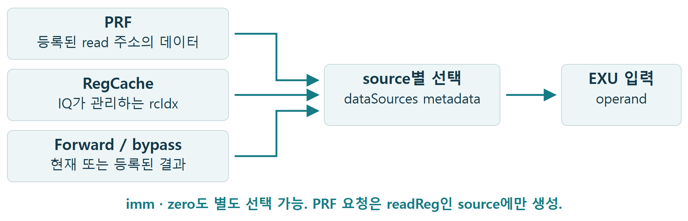
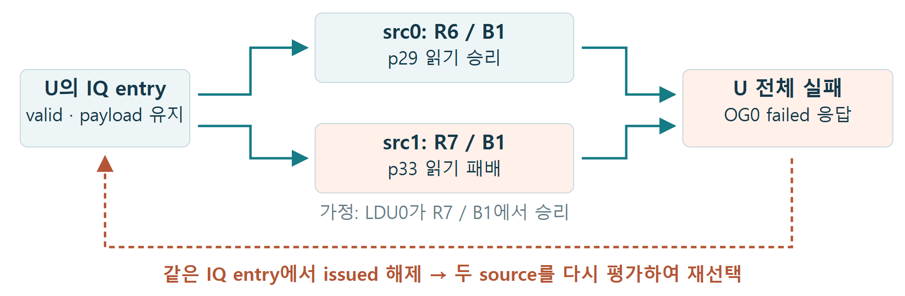
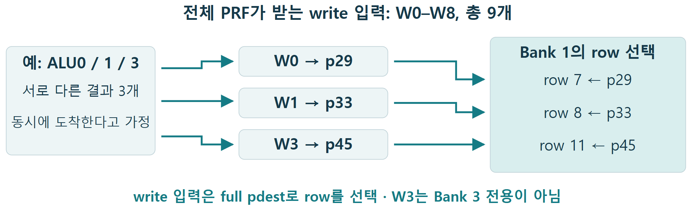

# Int Regfile Study

과거 bank 구조와 인덱싱에서 출발해 변경 이유와 현재 구성을 살펴봅니다. 이어 IQ·EXU 연결 → 읽기 중재와 충돌 → operand 공급·재발행 → writeback 순서로 설명합니다.

XiangShan Kunminghu V3 · DefaultConfig(1)<br>
기준 커밋: f85a1f71da8c1522035744c71e2cb266bfed1a7d<br>
과거 구현 비교는 별도 SHA를 명시합니다. 각 절의 명령열·rename 배치는 독립된 설명용 사례입니다. F: 소스 사실 / A: 설명용 가정 / C: 계산 / M: 추가 측정.

<a id="contents"></a>

## 읽는 순서

1. [과거 bank 인덱싱은 지금과 무엇이 달랐을까?](#q1)
2. [왜 하위 비트 방식으로 바꿨고, 현재 bank는 어떻게 구성될까?](#q2)
3. [IQ에서 선택된 명령은 어느 포트로 값을 읽을까?](#q3)
4. [같은 bank를 읽으면 항상 충돌할까?](#q4)
5. [인덱싱을 바꾸면 read 충돌은 항상 줄어들까?](#q5)
6. [실행 operand는 매번 PRF에서 가져올까?](#q6)
7. [operand 하나만 읽기에 성공하면 어떻게 될까?](#q7)
8. [실행 결과는 어느 bank에 쓰이며, write도 경쟁할까?](#q8)

[참고 자료: 상세 조건과 소스 근거](#references)

<a id="q1"></a>

## 1. 과거 bank 인덱싱은 지금과 무엇이 달랐을까?

<a id="fig-1"></a>



**그림 1.** 이전은 1d6b1b2a의 parent a026e93e, 현재는 문서 기준 f85a1f71이다. 두 경우 모두 224 entries·4 banks·8-bit psrc로 비교한다.

[SVG 원본](assets/int-regfile-study/figure-01.svg)

**명령열 예제**

```text
U: add x10,x2,x3 — x3의 physical source를 p29로 가정
```

p29의 이진값은 00011101이다. 이전은 00 | 011101로 나누어 B0·row29, 현재는 000111 | 01로 나누어 B1·row7을 선택한다. 같은 physical 번호라도 내부 저장 위치의 해석이 달라진다.

**핵심 결론**

과거는 연속 주소 구간을 bank에 배치했고, 현재는 psrc 하위 비트로 interleave한다. 224개 저장소가 64·64·64·32개에서 56개씩으로 균등해졌다.

### 내 수정 사항

**변경 내용**

- 기존 동작: (작성)
- 수정한 동작: (작성)

**변경 이유**

- 해결하려는 문제·설계 의도: (작성)

**검증 결과**

- 검증 방법·조건: (작성)
- 확인된 결과: (작성)
- 미확인 사항·추가 검증: (작성)

[상세 조건·소스 근거 ↗](#ref-history)

[목차로 돌아가기](#contents)

<a id="q2"></a>

## 2. 왜 하위 비트 방식으로 바꿨고, 현재 bank는 어떻게 구성될까?

<a id="fig-2"></a>



**그림 2.** 변경 목적은 불균형한 bank 크기와 일부 설정의 빈 bank 문제를 해결하는 것이다. 그림은 현재 224 entries·4 banks 구성이다.

[SVG 원본](assets/int-regfile-study/figure-02.svg)

**명령열 예제**

```text
주소 경계 확인: p63 → B3 / row15, p64 → B0 / row16
```

현재는 연속 physical 번호가 네 bank에 번갈아 배치되어 56 rows씩 구성된다. 과거 224-entry 구성도 동작 가능한 크기였지만 64·64·64·32로 불균형했다. 빈 bank 오류는 일부 다른 용량 설정에서 생기는 별도 문제다.

**핵심 결론**

저장 용량 224개는 그대로이며 배치가 균등해졌다. bank 인덱싱 변경이 포트 수 증가나 모든 요청의 충돌 감소를 의미하지는 않는다.

### 내 수정 사항

**변경 내용**

- 기존 동작: (작성)
- 수정한 동작: (작성)

**변경 이유**

- 해결하려는 문제·설계 의도: (작성)

**검증 결과**

- 검증 방법·조건: (작성)
- 확인된 결과: (작성)
- 미확인 사항·추가 검증: (작성)

[상세 조건·소스 근거 ↗](#ref-banks)

[목차로 돌아가기](#contents)

<a id="q3"></a>

## 3. IQ에서 선택된 명령은 어느 포트로 값을 읽을까?

<a id="fig-3"></a>



**그림 3.** ALU3 경로 확대. 중간의 중재·주소 register·bypass는 단순화했다. 두 read와 나머지 수용 조건이 통과한 경우다.

[SVG 원본](assets/int-regfile-study/figure-03.svg)

**명령열 예제**

```text
U: add x10, x2, x3 → IQ3 / ALU3
```

```text
가정: x2 → p29, x3 → p34, 목적지 x10 → p45
```

src0는 고정된 R6으로 Bank 1을, src1은 R7으로 Bank 2를 요청한다. IQ는 physical source 정보와 준비 상태를 전달하고, 실제 64-bit 값은 operand 경로가 공급한다.

**핵심 결론**

실행 lane과 source 위치가 포트를 정하고, psrc가 bank를 정한다. 각 ALU는 여러 bank의 값을 읽을 수 있다.

### 내가 바꾼 부분: 소비자/source의 read port 배정

**사용자 설명으로 확인한 변경 범위:** IQ에 연결된 ALU·BJU 등 소비자의 각 source operand를 어느 PRF read port에 배정할지 정하는 방식을 수정했다. 앞 절의 과거 bank 인덱싱 비교는 기준 구현의 이력이며, 사용자가 설명한 이 변경과는 구분한다.

<a id="fig-3-1"></a>



**그림 3-1.** 주황색은 수정 대상인 **consumer/source → read port 매핑**이다. 배정표는 요청에 따라 문서 기준 커밋 `f85a1f71`의 현재 연결을 그대로 표시했다. 사용자의 실제 변경 전·후 연결 차이는 이 그림에서 가정하지 않는다. 오른쪽은 배정된 port와 psrc의 bank 선택을 조합해 접근하는 자원이다.

**그림 읽는 방법**

- `IQ0 BJU0.src1`은 IQ0에 연결된 BJU0의 두 번째 source operand를 뜻한다. IQ 전체가 한 port를 공유하는 것이 아니라, EXU/source별 배정을 본다.
- 기준 코드에서는 `ALU3.src1`, `BJU0.src1`, `LDU0.src0`가 모두 R7에 연결된다. 같은 사이클에 같은 bank를 읽으려 하면 같은 중재 자원을 요구한다.
- 사용자가 수정한 대상은 이 **source별 port 배정과 공유 조합**이다. 이를 바꾸면 어떤 소비자끼리 경쟁하는지가 달라질 수 있다.
- Bank는 별도로 `psrc[1:0]`에서 선택된다. Port 배정 변경과 bank 인덱싱 변경은 서로 다른 설계 항목이다. 동적 포트 선택 여부, 우선순위 변경 여부, port 수 증감은 수정 코드가 확인되기 전에는 단정하지 않는다.

**발표용 설명:** “제가 바꾼 부분은 IQ에 연결된 ALU·BJU 등 각 소비자의 source를 read port에 배정하는 방식입니다. 이 배정은 어떤 소비자들이 같은 port를 공유하고, 같은 bank를 요청할 때 서로 중재하는지를 결정합니다.”

### 내 수정 사항

**변경 내용**

- 기존 동작: (작성)
- 수정한 동작: (작성)

**변경 이유**

- 해결하려는 문제·설계 의도: (작성)

**검증 결과**

- 검증 방법·조건: (작성)
- 확인된 결과: (작성)
- 미확인 사항·추가 검증: (작성)

[상세 조건·소스 근거 ↗](#ref-wiring)

[목차로 돌아가기](#contents)

<a id="q4"></a>

## 4. 같은 bank를 읽으면 항상 충돌할까?

<a id="fig-4"></a>



**그림 4.** 동시 PRF 요청만 비교한 세 경우다. 독립된 cell의 grant가 가능해도 uop 전체 수락 조건은 따로 검사한다.

[SVG 원본](assets/int-regfile-study/figure-04.svg)

**명령열 예제**

```text
U: add x10, x2, x3 → ALU3 / V: ld x11, 0(x4) → LDU0
```

U의 psrc0=p29, psrc1=p33이면 같은 Bank 1이어도 R6·R7을 각각 쓴다. 반면 V의 base도 p29라면 U.src1과 V.src0가 (R7, Bank 1)에서 경쟁한다.<br>
다른 rename 배치에서 U.src1이 p34라면 Bank 2를 사용하므로 그 경쟁은 사라질 수 있다.

**핵심 결론**

읽기 경합의 단위는 (read port, bank) 한 쌍이다. 같은 bank만 보거나, 같은 port만 보고 충돌을 판단하면 안 된다.

### 내 수정 사항

**변경 내용**

- 기존 동작: (작성)
- 수정한 동작: (작성)

**변경 이유**

- 해결하려는 문제·설계 의도: (작성)

**검증 결과**

- 검증 방법·조건: (작성)
- 확인된 결과: (작성)
- 미확인 사항·추가 검증: (작성)

[상세 조건·소스 근거 ↗](#ref-arbitration)

[목차로 돌아가기](#contents)

<a id="q5"></a>

## 5. 인덱싱을 바꾸면 read 충돌은 항상 줄어들까?

<a id="fig-5"></a>



**그림 5.** 두 요청이 모두 readReg이고 같은 port를 쓰는 경우의 주소 계산이다. 실제 grant·재발행 cycle이나 workload 성능을 측정한 표는 아니다.

[SVG 원본](assets/int-regfile-study/figure-05.svg)

**명령열 예제**

```text
U: add x10,x2,x3 → ALU3.src1 / V: ld x11,0(x4) → LDU0.src0
```

두 source는 R7을 공유한다. p28/p29라면 과거의 같은-bank 경쟁이 현재는 분리된다. 반면 p29/p93은 과거엔 분리되지만 현재는 같은 B1에서 경쟁한다. 각 행은 독립된 Rename 배치다.

**핵심 결론**

균등한 bank 용량은 확인할 수 있지만, 충돌률과 IPC 이득은 주소 분포·port 연결·RegCache/bypass·중재를 함께 측정해야 한다.

### 내 수정 사항

**변경 내용**

- 기존 동작: (작성)
- 수정한 동작: (작성)

**변경 이유**

- 해결하려는 문제·설계 의도: (작성)

**검증 결과**

- 검증 방법·조건: (작성)
- 확인된 결과: (작성)
- 미확인 사항·추가 검증: (작성)

[상세 조건·소스 근거 ↗](#ref-history-conflict)

[목차로 돌아가기](#contents)

<a id="q6"></a>

## 6. 실행 operand는 매번 PRF에서 가져올까?

<a id="fig-6"></a>



**그림 6.** source별 선택 경로를 묶은 그림이다. 모든 source가 그림의 모든 경로를 동일하게 지원한다는 뜻은 아니다.

[SVG 원본](assets/int-regfile-study/figure-06.svg)

**명령열 예제**

```text
U0: add x5, x1, x2
```

```text
U1: sub x6, x5, x3
```

U1이 x5를 소비할 때 producer 결과와 metadata가 맞으면 forward/bypass 경로를 사용할 수 있다. 유효한 RegCache 매핑이 있으면 그 값을 사용할 수도 있다. 이 source는 readReg가 아니므로 같은 시도에서 PRF read 요청을 만들지 않는다.

**핵심 결론**

PRF 요청 수는 명령의 source 수와 같지 않다. dataSources가 PRF·RegCache·결과 전달 경로를 source별로 선택한다.

### 내 수정 사항

**변경 내용**

- 기존 동작: (작성)
- 수정한 동작: (작성)

**변경 이유**

- 해결하려는 문제·설계 의도: (작성)

**검증 결과**

- 검증 방법·조건: (작성)
- 확인된 결과: (작성)
- 미확인 사항·추가 검증: (작성)

[상세 조건·소스 근거 ↗](#ref-operand)

[목차로 돌아가기](#contents)

<a id="q7"></a>

## 7. operand 하나만 읽기에 성공하면 어떻게 될까?

<a id="fig-7"></a>



**그림 7.** A: U.src0는 승리, U.src1은 LDU0와의 중재에서 패배. 실제 winner는 등록된 rank에 의존하며 재시도 간격은 가변이다.

[SVG 원본](assets/int-regfile-study/figure-07.svg)

**명령열 예제**

```text
U: add x10, x2, x3 → ALU3; psrc0=p29, psrc1=p33
```

```text
V: ld x11, 0(x4) → LDU0; base=p49
```

V가 (R7, Bank 1)을 얻었다고 가정하면 U는 src0를 읽었어도 OG0에서 실패한다. IQ entry와 Rename·ROB 할당은 보존되고, 다음 시도에서 두 source의 공급 경로와 수용 조건을 다시 평가한다.

**핵심 결론**

한 uop의 필요한 operand가 모두 확보되어야 다음 단계로 간다. 부분 grant는 uop 성공이 아니며, 실패한 entry가 재선택을 기다린다.

### 내 수정 사항

**변경 내용**

- 기존 동작: (작성)
- 수정한 동작: (작성)

**변경 이유**

- 해결하려는 문제·설계 의도: (작성)

**검증 결과**

- 검증 방법·조건: (작성)
- 확인된 결과: (작성)
- 미확인 사항·추가 검증: (작성)

[상세 조건·소스 근거 ↗](#ref-retry)

[목차로 돌아가기](#contents)

<a id="q8"></a>

## 8. 실행 결과는 어느 bank에 쓰이며, write도 경쟁할까?

<a id="fig-8"></a>



**그림 8.** 서로 다른 global write 입력이 이미 선택되었다고 가정한다. DataPath의 write 등록 단계와 row decode를 묶어 표시했다.

[SVG 원본](assets/int-regfile-study/figure-08.svg)

**명령열 예제**

```text
A: add x10, x1, x2 → ALU0 / W0 / pdest=p29
```

```text
B: xor x11, x3, x4 → ALU1 / W1 / pdest=p33
```

```text
C: add x12, x6, x7 → ALU3 / W3 / pdest=p45
```

세 결과는 모두 Bank 1의 서로 다른 row에 저장될 수 있다. 같은 preg에 두 write가 겹치면 저장소의 assertion 대상이다. 같은 WB 그룹을 쓰는 producer 간의 선택은 그 앞단에서 처리한다.

**핵심 결론**

write 입력은 전체 9개이며 full pdest로 목적지를 고른다. 같은 bank의 다른 row 쓰기는 가능하지만, 같은 preg의 중복 쓰기는 허용되지 않는다.

### 내 수정 사항

**변경 내용**

- 기존 동작: (작성)
- 수정한 동작: (작성)

**변경 이유**

- 해결하려는 문제·설계 의도: (작성)

**검증 결과**

- 검증 방법·조건: (작성)
- 확인된 결과: (작성)
- 미확인 사항·추가 검증: (작성)

[상세 조건·소스 근거 ↗](#ref-write)

[목차로 돌아가기](#contents)

<a id="references"></a>

## 참고 자료: 상세 조건과 소스 근거

본문 순서에 맞춰 근거를 배치했다. A는 구현 변경 이력, B는 현재 bank 구성, C–D는 연결과 중재, E는 인덱싱별 충돌 비교, F–H는 operand·재발행·writeback, I는 처리량과 확장 검토다. 과거 비교에는 해당 SHA를 명시하며 설명용 가정과 추가 측정을 구분한다.

[A. 과거 구현·bank 인덱싱 변경 이력](#ref-history)[B. 주소·용량·저장소 구현](#ref-banks)[C. IQ·EXU·source별 고정 포트](#ref-wiring)[D. Bank별 중재·충돌 조건](#ref-arbitration)[E. 인덱싱과 충돌의 관계·검증 범위](#ref-history-conflict)[F. Read 반환·RegCache·bypass](#ref-operand)[G. 부분 grant·실패 응답·재발행](#ref-retry)[H. Writeback·row 갱신·동시 읽기](#ref-write)[I. 처리량과 12–16-wide 확장 검토](#ref-limits)

<a id="ref-history"></a>

### A. 과거 구현·bank 인덱싱 변경 이력

[본문 1절로 돌아가기](#q1)

**비교 범위.** 여기서 “과거”는 Kunminghu V3 계열의 banked read 변경 전후다. 모든 XiangShan 세대가 같은 구조였다는 뜻은 아니다. 날짜는 committer UTC 기준이다.

| 시점 / 기준 | 구조 | 구분할 점 |
| --- | --- | --- |
| c6746a36<br> 4-bank 도입 직전 | IntRFReadArbiter + IntRegFileSplit(bankNum=1) | DataPath의 splitNum은 debugEn이면 1, 아니면 4. 64-bit 값을 4×16-bit로 나눠 같은 raddr로 읽고 Cat하여 복원한다. 주소 bank 4개로 서로 다른 요청을 읽는 구조가 아니다. |
| 2026-01-07 · 5aac7300 | IntRFBankReadArbiter + IntRegFileBank | Bank별 주소·data 인터페이스와 중재 도입. 상위 비트 bank / 하위 비트 row로 연속 주소 구간을 분리한다. |
| 2026-08-17 · 1d6b1b2a (#6357) | 하위 비트 bank / 상위 비트 row | 직전 parent는 a026e93e. bankIndex·bankAddr, IQ bank mask, arbiter 주소, RegfileBank 저장 배열 grouping을 함께 변경했다. 현재 f85a1f71에도 반영되어 있다. |

**F · 과거 식.** addrWidth=ceil(log2(224))=8, bank bits=2다. RegfileBank는 bankEntryNum=1&lt;&lt;(8−2)=64를 계산하고 \[64b, min(64(b+1),224))를 slice했다. IQ는 psrc.head(2)로 bank를 선택했다. arbiter의 좁은 addr로 전달되며 하위 6-bit가 row가 되었다. 따라서 마지막 bank는 32 rows다. row=preg%56인 방식이 아니다.

**F · 현재 식.** PregParams.bankIndex=psrc\[1:0\], bankAddr=psrc\[7:2\]. RegfileBank는 index%4==bank인 원소를 모아 local row 순서를 구성한다. IQ는 bankIndex로 rfBankRen을 만들고 RFReadArbiter는 bankAddr를 명시적으로 전달한다. DataPath는 bank mask를 등록하여 반환 data를 선택한다. 저장 배열의 grouping만 바꾸고 요청 주소·bank mask를 그대로 둘 수 없다.

| physical index | 이전 bank / row | 현재 bank / row |
| --- | --- | --- |
| p29 | B0 / 29 | B1 / 7 |
| p63 | B0 / 63 | B3 / 15 |
| p64 | B1 / 0 | B0 / 16 |
| p93 | B1 / 29 | B1 / 23 |
| p223 | B3 / 31 | B3 / 55 |

**C · 변경 이유와 경계.** 224개는 양쪽 모두 총 224개이며, 새 방식이 32개 레지스터를 추가한 것이 아니다. 일반 N-entry를 modulo B로 배치하면 bank별 크기 차이는 최대 1이고 N이 B의 배수일 때만 동일하다. 개발자는 불균형 bank와 마지막 bank가 비어 생기는 compile 오류를 변경 이유로 명시했다. 예를 들어 가상 N=130, B=4의 이전 slice 길이는 64/64/2/0, 현재는 33/33/32/32다. 이는 식의 계산이며 해당 설정으로 elaboration을 실행한 결과는 아니다. 현재 require는 power-of-two bank, N≥B, addrWidth 일치를 검사한다.

**헷갈리기 쉬운 코드.** 같은 파일의 일반 Regfile(bankNum&gt;1) 분기에는 이전부터 하위 비트 분할 코드가 있었다. 이번 #6357의 비교 대상은 별도 class RegfileBank다. 현재 파일에 IntRegFileSplit helper가 남아 있다는 사실만으로 활성 Int PRF가 그 helper를 사용한다고 해석하지 않는다. 활성 생성은 DataPath의 IntRegFileBank 경로다.

**변경 범위.** #6357은 read 주소 선택과 bank 구성 변경이다. 이 patch는 read port 개수, WB port 개수 또는 full pdest 기반 write decode를 늘리는 변경이 아니다. Commit 메시지의 “Next design”은 당시 제안이며 구현 완료의 근거로 쓰지 않는다. 최신 본문의 13 IQ·12 read 그룹·9 write streams를 모든 과거 시점에 그대로 소급하지 않는다.

#### 소스 근거

- [5aac7300 · 4-bank read 구조 도입 diff](https://github.com/OpenXiangShan/XiangShan/commit/5aac7300a9681072df55fff3d042eae2ae32d015)
- [1d6b1b2a · 상위 비트 → 하위 비트 변경 diff / PR #6357](https://github.com/OpenXiangShan/XiangShan/commit/1d6b1b2a90338845afd07afd135d428c2485c6cb)
- [c6746a36 · IntRegFileSplit:239–287](https://github.com/OpenXiangShan/XiangShan/blob/c6746a36046f4adbf4bb4cdd8fe08d3b6f2c3db7/src/main/scala/xiangshan/backend/regfile/Regfile.scala#L239-L287)
- [a026e93e · 224 entries / 4 banks](https://github.com/OpenXiangShan/XiangShan/blob/a026e93e742bcaa4ce0ea6d6f2ea03544f3fe2ca/src/main/scala/xiangshan/Parameters.scala#L124-L129)
- [a026e93e · RegfileBank:145–183](https://github.com/OpenXiangShan/XiangShan/blob/a026e93e742bcaa4ce0ea6d6f2ea03544f3fe2ca/src/main/scala/xiangshan/backend/regfile/Regfile.scala#L145-L183)
- [a026e93e · 상위 비트 bank 선택](https://github.com/OpenXiangShan/XiangShan/blob/a026e93e742bcaa4ce0ea6d6f2ea03544f3fe2ca/src/main/scala/xiangshan/backend/issue/EntryBundles.scala#L113-L121)
- [a026e93e · bank별 중재·주소 전달](https://github.com/OpenXiangShan/XiangShan/blob/a026e93e742bcaa4ce0ea6d6f2ea03544f3fe2ca/src/main/scala/xiangshan/backend/datapath/RFReadArbiter.scala#L196-L214)
- [f85a1f71 · bankIndex / bankAddr](https://github.com/OpenXiangShan/XiangShan/blob/f85a1f71da8c1522035744c71e2cb266bfed1a7d/src/main/scala/xiangshan/backend/regfile/PregParams.scala#L16-L30)
- [f85a1f71 · modulo bank 구성](https://github.com/OpenXiangShan/XiangShan/blob/f85a1f71da8c1522035744c71e2cb266bfed1a7d/src/main/scala/xiangshan/backend/regfile/Regfile.scala#L164-L188)
- [f85a1f71 · IQ의 bankIndex 사용](https://github.com/OpenXiangShan/XiangShan/blob/f85a1f71da8c1522035744c71e2cb266bfed1a7d/src/main/scala/xiangshan/backend/issue/EntryBundles.scala#L126-L131)
- [f85a1f71 · bankAddr 전달](https://github.com/OpenXiangShan/XiangShan/blob/f85a1f71da8c1522035744c71e2cb266bfed1a7d/src/main/scala/xiangshan/backend/datapath/RFReadArbiter.scala#L207-L222)
- [f85a1f71 · bank mask 등록과 반환 선택](https://github.com/OpenXiangShan/XiangShan/blob/f85a1f71da8c1522035744c71e2cb266bfed1a7d/src/main/scala/xiangshan/backend/datapath/DataPath.scala#L527-L551)

<a id="ref-banks"></a>

### B. 주소·용량·저장소 구현

[본문 2절로 돌아가기](#q2)

**F · 소스 사실.** IntRegFileBank → RegfileBank 경로의 저장 용량은 224 × 64-bit다. bank = psrc\[1:0\], row = psrc\[7:2\]이며 preg 0–223, row 0–55가 유효하다. 8-bit index와 6-bit row 주소가 각각 256 entries, 64 rows의 유효 용량을 뜻하지 않는다.

Bank b는 p(b), p(b+4), …, p(b+220)를 담는다. 각 bank에는 12개 read 주소·data 채널이 있다. 저장소는 Reg(Vec)와 mux로 표현되며, 이 문서는 합성 SRAM macro의 포트 수·배치 결과를 관측한 것이 아니다.

p0은 hasZero 처리로 0을 유지한다. 기본 withReset=false이므로 나머지 preg를 모두 reset 시 0으로 가정하지 않는다. debug read 포트는 실행 operand 처리량에 더하지 않는다.

**C · 주소 계산.** p29=(B1,row7), p33=(B1,row8), p34=(B2,row8), p45=(B1,row11), p49=(B1,row12). 논리 payload 용량은 14,336 bits = 1,792 bytes이며 mux·배선·제어 면적은 제외한 수치다.

인덱싱 변경의 동기와 빈 bank 조건은 참고 자료 A의 변경 이력에서 다룬다. 224 entries의 불균형과 다른 용량에서 생길 수 있는 빈 bank 오류를 구분한다.

#### 소스 근거

- [Parameters.scala:122–128](https://github.com/OpenXiangShan/XiangShan/blob/f85a1f71da8c1522035744c71e2cb266bfed1a7d/src/main/scala/xiangshan/Parameters.scala#L122-L128)
- [BackendParams.scala:419–433](https://github.com/OpenXiangShan/XiangShan/blob/f85a1f71da8c1522035744c71e2cb266bfed1a7d/src/main/scala/xiangshan/backend/BackendParams.scala#L419-L433)
- [DataPath.scala:57–60](https://github.com/OpenXiangShan/XiangShan/blob/f85a1f71da8c1522035744c71e2cb266bfed1a7d/src/main/scala/xiangshan/backend/datapath/DataPath.scala#L57-L60)
- [DataPath.scala:273–307](https://github.com/OpenXiangShan/XiangShan/blob/f85a1f71da8c1522035744c71e2cb266bfed1a7d/src/main/scala/xiangshan/backend/datapath/DataPath.scala#L273-L307)
- [Regfile.scala:145–211](https://github.com/OpenXiangShan/XiangShan/blob/f85a1f71da8c1522035744c71e2cb266bfed1a7d/src/main/scala/xiangshan/backend/regfile/Regfile.scala#L145-L211)
- [Regfile.scala:434–455](https://github.com/OpenXiangShan/XiangShan/blob/f85a1f71da8c1522035744c71e2cb266bfed1a7d/src/main/scala/xiangshan/backend/regfile/Regfile.scala#L434-L455)
- [f85a1f71 · bankIndex / bankAddr](https://github.com/OpenXiangShan/XiangShan/blob/f85a1f71da8c1522035744c71e2cb266bfed1a7d/src/main/scala/xiangshan/backend/regfile/PregParams.scala#L16-L30)
- [Regfile.scala:31–35](https://github.com/OpenXiangShan/XiangShan/blob/f85a1f71da8c1522035744c71e2cb266bfed1a7d/src/main/scala/xiangshan/backend/regfile/Regfile.scala#L31-L35)
- [Regfile.scala:157–215](https://github.com/OpenXiangShan/XiangShan/blob/f85a1f71da8c1522035744c71e2cb266bfed1a7d/src/main/scala/xiangshan/backend/regfile/Regfile.scala#L157-L215)
- [Regfile.scala:290–355](https://github.com/OpenXiangShan/XiangShan/blob/f85a1f71da8c1522035744c71e2cb266bfed1a7d/src/main/scala/xiangshan/backend/regfile/Regfile.scala#L290-L355)
- [EntryBundles.scala:125–136](https://github.com/OpenXiangShan/XiangShan/blob/f85a1f71da8c1522035744c71e2cb266bfed1a7d/src/main/scala/xiangshan/backend/issue/EntryBundles.scala#L125-L136)
- [IssueQueue.scala:851–863](https://github.com/OpenXiangShan/XiangShan/blob/f85a1f71da8c1522035744c71e2cb266bfed1a7d/src/main/scala/xiangshan/backend/issue/IssueQueue.scala#L851-L863)
- [IssueQueue.scala:899–909](https://github.com/OpenXiangShan/XiangShan/blob/f85a1f71da8c1522035744c71e2cb266bfed1a7d/src/main/scala/xiangshan/backend/issue/IssueQueue.scala#L899-L909)
- [RFReadArbiter.scala:210–220](https://github.com/OpenXiangShan/XiangShan/blob/f85a1f71da8c1522035744c71e2cb266bfed1a7d/src/main/scala/xiangshan/backend/datapath/RFReadArbiter.scala#L210-L220)
- [Regfile.scala:179–184](https://github.com/OpenXiangShan/XiangShan/blob/f85a1f71da8c1522035744c71e2cb266bfed1a7d/src/main/scala/xiangshan/backend/regfile/Regfile.scala#L179-L184)
- [DataPath.scala:301–307](https://github.com/OpenXiangShan/XiangShan/blob/f85a1f71da8c1522035744c71e2cb266bfed1a7d/src/main/scala/xiangshan/backend/datapath/DataPath.scala#L301-L307)
- [DataPath.scala:527–549](https://github.com/OpenXiangShan/XiangShan/blob/f85a1f71da8c1522035744c71e2cb266bfed1a7d/src/main/scala/xiangshan/backend/datapath/DataPath.scala#L527-L549)
- [DataPath.scala:301–303](https://github.com/OpenXiangShan/XiangShan/blob/f85a1f71da8c1522035744c71e2cb266bfed1a7d/src/main/scala/xiangshan/backend/datapath/DataPath.scala#L301-L303)
- [Regfile.scala:179–205](https://github.com/OpenXiangShan/XiangShan/blob/f85a1f71da8c1522035744c71e2cb266bfed1a7d/src/main/scala/xiangshan/backend/regfile/Regfile.scala#L179-L205)
- [Parameters.scala:346–413](https://github.com/OpenXiangShan/XiangShan/blob/f85a1f71da8c1522035744c71e2cb266bfed1a7d/src/main/scala/xiangshan/Parameters.scala#L346-L413)
- [Parameters.scala:459–491](https://github.com/OpenXiangShan/XiangShan/blob/f85a1f71da8c1522035744c71e2cb266bfed1a7d/src/main/scala/xiangshan/Parameters.scala#L459-L491)
- [5aac7300 · 4-bank read 구조 도입 diff](https://github.com/OpenXiangShan/XiangShan/commit/5aac7300a9681072df55fff3d042eae2ae32d015)
- [1d6b1b2a · 상위 비트 → 하위 비트 변경 diff / PR #6357](https://github.com/OpenXiangShan/XiangShan/commit/1d6b1b2a90338845afd07afd135d428c2485c6cb)
- [c6746a36 · IntRegFileSplit:239–287](https://github.com/OpenXiangShan/XiangShan/blob/c6746a36046f4adbf4bb4cdd8fe08d3b6f2c3db7/src/main/scala/xiangshan/backend/regfile/Regfile.scala#L239-L287)
- [a026e93e · 224 entries / 4 banks](https://github.com/OpenXiangShan/XiangShan/blob/a026e93e742bcaa4ce0ea6d6f2ea03544f3fe2ca/src/main/scala/xiangshan/Parameters.scala#L124-L129)
- [a026e93e · RegfileBank:145–183](https://github.com/OpenXiangShan/XiangShan/blob/a026e93e742bcaa4ce0ea6d6f2ea03544f3fe2ca/src/main/scala/xiangshan/backend/regfile/Regfile.scala#L145-L183)
- [a026e93e · 상위 비트 bank 선택](https://github.com/OpenXiangShan/XiangShan/blob/a026e93e742bcaa4ce0ea6d6f2ea03544f3fe2ca/src/main/scala/xiangshan/backend/issue/EntryBundles.scala#L113-L121)
- [a026e93e · bank별 중재·주소 전달](https://github.com/OpenXiangShan/XiangShan/blob/a026e93e742bcaa4ce0ea6d6f2ea03544f3fe2ca/src/main/scala/xiangshan/backend/datapath/RFReadArbiter.scala#L196-L214)
- [f85a1f71 · modulo bank 구성](https://github.com/OpenXiangShan/XiangShan/blob/f85a1f71da8c1522035744c71e2cb266bfed1a7d/src/main/scala/xiangshan/backend/regfile/Regfile.scala#L164-L188)
- [f85a1f71 · IQ의 bankIndex 사용](https://github.com/OpenXiangShan/XiangShan/blob/f85a1f71da8c1522035744c71e2cb266bfed1a7d/src/main/scala/xiangshan/backend/issue/EntryBundles.scala#L126-L131)
- [f85a1f71 · bankAddr 전달](https://github.com/OpenXiangShan/XiangShan/blob/f85a1f71da8c1522035744c71e2cb266bfed1a7d/src/main/scala/xiangshan/backend/datapath/RFReadArbiter.scala#L207-L222)
- [f85a1f71 · bank mask 등록과 반환 선택](https://github.com/OpenXiangShan/XiangShan/blob/f85a1f71da8c1522035744c71e2cb266bfed1a7d/src/main/scala/xiangshan/backend/datapath/DataPath.scala#L527-L551)

<a id="ref-wiring"></a>

### C. IQ·EXU·source별 고정 포트

[본문 3절로 돌아가기](#q3)

**F.** IQ0–2는 각각 ALU/BJU 두 출력, IQ3–5는 각 ALU3–5, IQ6–8은 LDU0–2, IQ9–10은 STA0–1, IQ11–12는 STD0–1로 연결된다. 13 IQ의 16 dequeue 위치 가운데 로컬 EXU는 9개, MemBlock 실행 경로는 7개다. 아래 표의 포트는 이 고정된 source 위치에 대응한다.

| Read port | 구성상 요청 위치와 cfg.priority |
| --- | --- |
| R0 | ALU0.src0 (cfg 0), STD0.src0 (cfg 1) |
| R1 | ALU0.src1 (cfg 0), BJU0.src0 (cfg 1) |
| R2 | ALU1.src0 (cfg 0), STD1.src0 (cfg 1) |
| R3 | ALU1.src1 (cfg 0), BJU1.src0 (cfg 1) |
| R4 | ALU2.src0 (cfg 0) |
| R5 | ALU2.src1 (cfg 0), BJU2.src0 (cfg 1) |
| R6 | ALU3.src0 (cfg 0), STA0.src0 (cfg 1) |
| R7 | LDU0.src0 (cfg 0), ALU3.src1 (cfg 1), BJU0.src1 (cfg 2) |
| R8 | ALU4.src0 (cfg 0), STA1.src0 (cfg 1) |
| R9 | LDU1.src0 (cfg 0), ALU4.src1 (cfg 1), BJU1.src1 (cfg 2) |
| R10 | ALU5.src0 (cfg 0) |
| R11 | LDU2.src0 (cfg 0), ALU5.src1 (cfg 1), BJU2.src1 (cfg 2) |

ALU a의 src0는 R(2a), src1은 R(2a+1)이다. 각 포트 그룹은 네 bank에 복제된다. 그룹 크기는 1입력 2개, 2입력 7개, 3입력 3개이며 독립 source 위치는 총 25개다. STD가 FP source를 사용하면 정수 PRF 대신 FP read 경로를 사용한다.

각 요청은 psrc가 가리키는 bank 한 곳에서만 valid가 된다. 25×4개의 연결을 100개 독립 operand 요청으로 세지 않는다. cfg.priority는 input 정렬 기준이며 이후 등록된 age rank와 함께 읽어야 한다.

#### 소스 근거

- [Configs.scala:583–589](https://github.com/OpenXiangShan/XiangShan/blob/f85a1f71da8c1522035744c71e2cb266bfed1a7d/src/main/scala/top/Configs.scala#L583-L589)
- [Parameters.scala:122–128](https://github.com/OpenXiangShan/XiangShan/blob/f85a1f71da8c1522035744c71e2cb266bfed1a7d/src/main/scala/xiangshan/Parameters.scala#L122-L128)
- [Parameters.scala:342–452](https://github.com/OpenXiangShan/XiangShan/blob/f85a1f71da8c1522035744c71e2cb266bfed1a7d/src/main/scala/xiangshan/Parameters.scala#L342-L452)
- [BackendParams.scala:681–739](https://github.com/OpenXiangShan/XiangShan/blob/f85a1f71da8c1522035744c71e2cb266bfed1a7d/src/main/scala/xiangshan/backend/BackendParams.scala#L681-L739)
- [Parameters.scala:342–446](https://github.com/OpenXiangShan/XiangShan/blob/f85a1f71da8c1522035744c71e2cb266bfed1a7d/src/main/scala/xiangshan/Parameters.scala#L342-L446)
- [IssueQueue.scala:851–925](https://github.com/OpenXiangShan/XiangShan/blob/f85a1f71da8c1522035744c71e2cb266bfed1a7d/src/main/scala/xiangshan/backend/issue/IssueQueue.scala#L851-L925)
- [Region.scala:475–549](https://github.com/OpenXiangShan/XiangShan/blob/f85a1f71da8c1522035744c71e2cb266bfed1a7d/src/main/scala/xiangshan/backend/Region.scala#L475-L549)
- [RFReadArbiter.scala:191–223](https://github.com/OpenXiangShan/XiangShan/blob/f85a1f71da8c1522035744c71e2cb266bfed1a7d/src/main/scala/xiangshan/backend/datapath/RFReadArbiter.scala#L191-L223)
- [PregParams.scala:16–30](https://github.com/OpenXiangShan/XiangShan/blob/f85a1f71da8c1522035744c71e2cb266bfed1a7d/src/main/scala/xiangshan/backend/regfile/PregParams.scala#L16-L30)
- [Regfile.scala:145–204](https://github.com/OpenXiangShan/XiangShan/blob/f85a1f71da8c1522035744c71e2cb266bfed1a7d/src/main/scala/xiangshan/backend/regfile/Regfile.scala#L145-L204)
- [RFReadArbiter.scala:186–220](https://github.com/OpenXiangShan/XiangShan/blob/f85a1f71da8c1522035744c71e2cb266bfed1a7d/src/main/scala/xiangshan/backend/datapath/RFReadArbiter.scala#L186-L220)
- [RFReadArbiter.scala:48–104](https://github.com/OpenXiangShan/XiangShan/blob/f85a1f71da8c1522035744c71e2cb266bfed1a7d/src/main/scala/xiangshan/backend/datapath/RFReadArbiter.scala#L48-L104)
- [RFReadArbiter.scala:194–220](https://github.com/OpenXiangShan/XiangShan/blob/f85a1f71da8c1522035744c71e2cb266bfed1a7d/src/main/scala/xiangshan/backend/datapath/RFReadArbiter.scala#L194-L220)
- [DataPath.scala:614–643](https://github.com/OpenXiangShan/XiangShan/blob/f85a1f71da8c1522035744c71e2cb266bfed1a7d/src/main/scala/xiangshan/backend/datapath/DataPath.scala#L614-L643)
- [DataPath.scala:51–55](https://github.com/OpenXiangShan/XiangShan/blob/f85a1f71da8c1522035744c71e2cb266bfed1a7d/src/main/scala/xiangshan/backend/datapath/DataPath.scala#L51-L55)
- [DataPath.scala:658–664](https://github.com/OpenXiangShan/XiangShan/blob/f85a1f71da8c1522035744c71e2cb266bfed1a7d/src/main/scala/xiangshan/backend/datapath/DataPath.scala#L658-L664)
- [RFWBConflictChecker.scala:47–115](https://github.com/OpenXiangShan/XiangShan/blob/f85a1f71da8c1522035744c71e2cb266bfed1a7d/src/main/scala/xiangshan/backend/datapath/RFWBConflictChecker.scala#L47-L115)
- [RFWBConflictChecker.scala:137–180](https://github.com/OpenXiangShan/XiangShan/blob/f85a1f71da8c1522035744c71e2cb266bfed1a7d/src/main/scala/xiangshan/backend/datapath/RFWBConflictChecker.scala#L137-L180)


#### 사용자 변경 대상과 기준 매핑의 근거

- `Parameters.scala:343–445`: IQ별 EXU 구성과 source별 `IntRD(port, priority)` 배정. 이 그림은 `port` 값을 연결 대상으로 사용하며, 설정의 두 번째 숫자를 실행 시 고정 우선순위라고 단정하지 않는다.
- `ExeUnitParams.scala:25`: source별 `rfrPortConfigs` 설정.
- `RFReadArbiter.scala:196–222`: 설정의 port로 요청을 묶고 bank별 요청을 중재하는 연결.
- `DataPath.scala:527–549`: source별 read port 설정과 bank mask를 사용해 반환 데이터를 선택한다.
- 변경 목적과 개선 효과는 사용자 코드·검증 결과로 보완할 항목이다. 현재 그림만으로 충돌률·IPC 개선을 주장하지 않는다.

<a id="ref-arbitration"></a>

### D. Bank별 중재·충돌 조건

[본문 4절로 돌아가기](#q4)

**F.** 각 (port,bank)의 arbiter가 독립적으로 승자를 고른다. ALU3.src1은 R7에 고정되어 있으므로 R4가 비어 있어도 그 포트로 옮기지 않는다. 같은 주소를 요구해도 별도 요청을 자동 coalescing하지 않는다.

OldestArbiter의 현재 grant는 priorityVecReg에서 현재 valid 입력의 rank를 선택한다. 요청의 valid·robIdx·channel을 등록하고 isBeforeWithChannel 비교를 통해 다음 rank를 계산한다. 따라서 현재 cycle의 최연장 명령이 반드시 이긴다거나 LDU가 항상 ALU보다 우선한다고 단정할 수 없다.

입력 ready = !valid || lzdHit다. bank별 ready를 AND하므로 비활성 bank는 요청을 막지 않고 실제로 요청한 bank의 승패가 operand ready에 반영된다.

**A/C · 같은 bank에 ALU 6개.** ALU a의 src0=p(1+8a), src1=p(5+8a), a=0…5로 두면 모두 Bank 1에 있지만 R0–R11을 각각 쓴다. read 중재만 보면 12개 operand가 동시에 통과할 수 있다. IQ 배치·readiness·WB·downstream 조건의 동시 성립은 별도 가정이다.

#### 소스 근거

- [Parameters.scala:342–446](https://github.com/OpenXiangShan/XiangShan/blob/f85a1f71da8c1522035744c71e2cb266bfed1a7d/src/main/scala/xiangshan/Parameters.scala#L342-L446)
- [RFReadArbiter.scala:186–220](https://github.com/OpenXiangShan/XiangShan/blob/f85a1f71da8c1522035744c71e2cb266bfed1a7d/src/main/scala/xiangshan/backend/datapath/RFReadArbiter.scala#L186-L220)
- [RFReadArbiter.scala:48–104](https://github.com/OpenXiangShan/XiangShan/blob/f85a1f71da8c1522035744c71e2cb266bfed1a7d/src/main/scala/xiangshan/backend/datapath/RFReadArbiter.scala#L48-L104)
- [RFReadArbiter.scala:194–220](https://github.com/OpenXiangShan/XiangShan/blob/f85a1f71da8c1522035744c71e2cb266bfed1a7d/src/main/scala/xiangshan/backend/datapath/RFReadArbiter.scala#L194-L220)
- [DataPath.scala:614–643](https://github.com/OpenXiangShan/XiangShan/blob/f85a1f71da8c1522035744c71e2cb266bfed1a7d/src/main/scala/xiangshan/backend/datapath/DataPath.scala#L614-L643)
- [DataPath.scala:51–55](https://github.com/OpenXiangShan/XiangShan/blob/f85a1f71da8c1522035744c71e2cb266bfed1a7d/src/main/scala/xiangshan/backend/datapath/DataPath.scala#L51-L55)
- [DataPath.scala:658–664](https://github.com/OpenXiangShan/XiangShan/blob/f85a1f71da8c1522035744c71e2cb266bfed1a7d/src/main/scala/xiangshan/backend/datapath/DataPath.scala#L658-L664)
- [RFWBConflictChecker.scala:47–115](https://github.com/OpenXiangShan/XiangShan/blob/f85a1f71da8c1522035744c71e2cb266bfed1a7d/src/main/scala/xiangshan/backend/datapath/RFWBConflictChecker.scala#L47-L115)
- [RFWBConflictChecker.scala:137–180](https://github.com/OpenXiangShan/XiangShan/blob/f85a1f71da8c1522035744c71e2cb266bfed1a7d/src/main/scala/xiangshan/backend/datapath/RFWBConflictChecker.scala#L137-L180)
- [RFReadArbiter.scala:201–223](https://github.com/OpenXiangShan/XiangShan/blob/f85a1f71da8c1522035744c71e2cb266bfed1a7d/src/main/scala/xiangshan/backend/datapath/RFReadArbiter.scala#L201-L223)
- [DataPath.scala:614–664](https://github.com/OpenXiangShan/XiangShan/blob/f85a1f71da8c1522035744c71e2cb266bfed1a7d/src/main/scala/xiangshan/backend/datapath/DataPath.scala#L614-L664)
- [EntryBundles.scala:210–240](https://github.com/OpenXiangShan/XiangShan/blob/f85a1f71da8c1522035744c71e2cb266bfed1a7d/src/main/scala/xiangshan/backend/issue/EntryBundles.scala#L210-L240)
- [EntryBundles.scala:453–461](https://github.com/OpenXiangShan/XiangShan/blob/f85a1f71da8c1522035744c71e2cb266bfed1a7d/src/main/scala/xiangshan/backend/issue/EntryBundles.scala#L453-L461)
- [Regfile.scala:145–204](https://github.com/OpenXiangShan/XiangShan/blob/f85a1f71da8c1522035744c71e2cb266bfed1a7d/src/main/scala/xiangshan/backend/regfile/Regfile.scala#L145-L204)
- [DataPath.scala:527–549](https://github.com/OpenXiangShan/XiangShan/blob/f85a1f71da8c1522035744c71e2cb266bfed1a7d/src/main/scala/xiangshan/backend/datapath/DataPath.scala#L527-L549)
- [BypassNetwork.scala:182–216](https://github.com/OpenXiangShan/XiangShan/blob/f85a1f71da8c1522035744c71e2cb266bfed1a7d/src/main/scala/xiangshan/backend/datapath/BypassNetwork.scala#L182-L216)

<a id="ref-history-conflict"></a>

### E. 인덱싱과 충돌의 관계·검증 범위

[본문 5절로 돌아가기](#q5)

**A/C · 비교 조건.** 본문 5절은 두 시점에 확인한 ALU3.src1과 LDU0.src0의 R7 연결을 고정한다. 모두 PRF read를 요청하고 각 psrc가 유효하며 추가 requester는 없다고 가정한다. 같은 (R7,bank)이면 같은 row인지와 관계없이 중재 경쟁이다. 다른 bank의 grant 가능성이 uop 전체 실행 성공을 보장하지는 않는다.

| 주소 패턴 | 이전 | 현재 |
| --- | --- | --- |
| p28 / p29 | B0/B0, row28/29 | B0/B1, row7/7 |
| p29 / p93 | B0/B1, row29/29 | B1/B1, row7/23 |
| p29 / p33 | B0/B0, row29/33 | B1/B1, row7/8 |

Read port는 IQ/EXU source 연결이 정하고 bank는 physical index가 정한다. 서로 다른 port라면 같은 bank도 병렬 읽기가 가능하다. 현재 구조에서 필요한 operand의 grant를 얻지 못한 uop는 OG0 실패 응답으로 같은 IQ entry에서 재선택될 수 있다. 역사 비교 그림이 과거와 현재의 retry 지연까지 같음을 입증하는 것은 아니다.

**M.** Rename의 실제 physical allocation 분포, 반복되는 source 재사용, 각 port의 동시 요청, RC/bypass 비율, 부분 grant 낭비와 accepted uop 수를 함께 관찰해야 한다. Bank 용량 균등화만으로 균등한 접근 확률이나 IPC 향상을 단정하지 않는다. 자료는 commit diff·parent source·현재 source 대조와 주소 산술 검사에 근거하며 RTL simulation·PPA를 측정하지 않았다.

#### 소스 근거

- [a026e93e · ALU3.src1 / LDU0.src0의 R7 연결](https://github.com/OpenXiangShan/XiangShan/blob/a026e93e742bcaa4ce0ea6d6f2ea03544f3fe2ca/src/main/scala/xiangshan/Parameters.scala#L365-L377)
- [a026e93e · 상위 비트 bank mask](https://github.com/OpenXiangShan/XiangShan/blob/a026e93e742bcaa4ce0ea6d6f2ea03544f3fe2ca/src/main/scala/xiangshan/backend/issue/EntryBundles.scala#L113-L121)
- [f85a1f71 · 현재 주소 분해식](https://github.com/OpenXiangShan/XiangShan/blob/f85a1f71da8c1522035744c71e2cb266bfed1a7d/src/main/scala/xiangshan/backend/regfile/PregParams.scala#L16-L30)
- [1d6b1b2a · 변경 범위와 개발자가 명시한 이유](https://github.com/OpenXiangShan/XiangShan/commit/1d6b1b2a90338845afd07afd135d428c2485c6cb)

<a id="ref-operand"></a>

### F. Read 반환·RegCache·bypass

[본문 6절로 돌아가기](#q6)

1. IQ는 XP source이면서 dataSources.readReg인 source에 rfBankRen을 생성한다.
2. OG0에서 해당 (port,bank)의 승자 row 주소가 저장소로 전달된다.
3. RegfileBank가 read 주소를 RegNext로 등록한다. DataPath도 bank mask를 함께 등록한다.
4. 다음 OG1에서 고정 port의 bank별 데이터 중 Mux1H로 해당 bank를 선택한다.
5. BypassNetwork가 source별 dataSources에 따라 PRF, RegCache, forward/bypass 등의 값을 고른다. EXU 입력에는 별도 pipeTo… register가 있다.

PRF read 포트 자체에는 read-enable/valid가 없다. invalid 채널에도 값이 존재할 수 있으므로 유효한 소비는 grant·s1\_valid·dataSources로 판정한다. OG0/OG1의 국소 register 경계를 전체 instruction latency나 commit 시점으로 해석하지 않는다.

**RegCache.** 기준 regCacheEn=true이며 IntRegCache 24 entries, MemRegCache 12 entries다. IQ가 useRegCache·regCacheIdx를 wakeup·replacement·load cancel로 관리한다. DataPath에서 일반 cache tag miss를 새로 검사하는 구조로 설명하지 않는다. 교체 index의 선행 전달과 3-cycle 지연 write 경로가 존재한다.

**Source 전이.** 일반 정수 entry는 wakeup으로 bypass가 되고 이후 reg로 이동할 수 있다. Complex entry는 같은 cycle wakeup을 forward로 사용할 수 있다. 유효 RC 매핑이 있으면 reg 대신 regcache를 쓸 수 있다. 따라서 첫 시도와 retry의 source 경로가 같다고 보장하지 않는다. imm·zero와 일부 bypass2 지원 범위는 FU/EXU 조건을 함께 확인한다.

#### 소스 근거

- [DataSource.scala:5–46](https://github.com/OpenXiangShan/XiangShan/blob/f85a1f71da8c1522035744c71e2cb266bfed1a7d/src/main/scala/xiangshan/backend/datapath/DataSource.scala#L5-L46)
- [BypassNetwork.scala:107–130](https://github.com/OpenXiangShan/XiangShan/blob/f85a1f71da8c1522035744c71e2cb266bfed1a7d/src/main/scala/xiangshan/backend/datapath/BypassNetwork.scala#L107-L130)
- [BypassNetwork.scala:140–161](https://github.com/OpenXiangShan/XiangShan/blob/f85a1f71da8c1522035744c71e2cb266bfed1a7d/src/main/scala/xiangshan/backend/datapath/BypassNetwork.scala#L140-L161)
- [BypassNetwork.scala:184–249](https://github.com/OpenXiangShan/XiangShan/blob/f85a1f71da8c1522035744c71e2cb266bfed1a7d/src/main/scala/xiangshan/backend/datapath/BypassNetwork.scala#L184-L249)
- [Region.scala:498–504](https://github.com/OpenXiangShan/XiangShan/blob/f85a1f71da8c1522035744c71e2cb266bfed1a7d/src/main/scala/xiangshan/backend/Region.scala#L498-L504)
- [BackendParams.scala:48](https://github.com/OpenXiangShan/XiangShan/blob/f85a1f71da8c1522035744c71e2cb266bfed1a7d/src/main/scala/xiangshan/backend/BackendParams.scala#L48)
- [BackendParams.scala:498–519](https://github.com/OpenXiangShan/XiangShan/blob/f85a1f71da8c1522035744c71e2cb266bfed1a7d/src/main/scala/xiangshan/backend/BackendParams.scala#L498-L519)
- [ExeUnitParams.scala:128–129](https://github.com/OpenXiangShan/XiangShan/blob/f85a1f71da8c1522035744c71e2cb266bfed1a7d/src/main/scala/xiangshan/backend/exu/ExeUnitParams.scala#L128-L129)
- [DataPath.scala:330–364](https://github.com/OpenXiangShan/XiangShan/blob/f85a1f71da8c1522035744c71e2cb266bfed1a7d/src/main/scala/xiangshan/backend/datapath/DataPath.scala#L330-L364)
- [EntryBundles.scala:417–427](https://github.com/OpenXiangShan/XiangShan/blob/f85a1f71da8c1522035744c71e2cb266bfed1a7d/src/main/scala/xiangshan/backend/issue/EntryBundles.scala#L417-L427)
- [EntryBundles.scala:490–516](https://github.com/OpenXiangShan/XiangShan/blob/f85a1f71da8c1522035744c71e2cb266bfed1a7d/src/main/scala/xiangshan/backend/issue/EntryBundles.scala#L490-L516)
- [RegCache.scala:42–81](https://github.com/OpenXiangShan/XiangShan/blob/f85a1f71da8c1522035744c71e2cb266bfed1a7d/src/main/scala/xiangshan/backend/regcache/RegCache.scala#L42-L81)
- [RegCache.scala:110–135](https://github.com/OpenXiangShan/XiangShan/blob/f85a1f71da8c1522035744c71e2cb266bfed1a7d/src/main/scala/xiangshan/backend/regcache/RegCache.scala#L110-L135)
- [BypassNetwork.scala:238–267](https://github.com/OpenXiangShan/XiangShan/blob/f85a1f71da8c1522035744c71e2cb266bfed1a7d/src/main/scala/xiangshan/backend/datapath/BypassNetwork.scala#L238-L267)
- [EntryBundles.scala:385–427](https://github.com/OpenXiangShan/XiangShan/blob/f85a1f71da8c1522035744c71e2cb266bfed1a7d/src/main/scala/xiangshan/backend/issue/EntryBundles.scala#L385-L427)
- [EntryBundles.scala:484–516](https://github.com/OpenXiangShan/XiangShan/blob/f85a1f71da8c1522035744c71e2cb266bfed1a7d/src/main/scala/xiangshan/backend/issue/EntryBundles.scala#L484-L516)
- [BypassNetwork.scala:202–241](https://github.com/OpenXiangShan/XiangShan/blob/f85a1f71da8c1522035744c71e2cb266bfed1a7d/src/main/scala/xiangshan/backend/datapath/BypassNetwork.scala#L202-L241)
- [EntryBundles.scala:125–136](https://github.com/OpenXiangShan/XiangShan/blob/f85a1f71da8c1522035744c71e2cb266bfed1a7d/src/main/scala/xiangshan/backend/issue/EntryBundles.scala#L125-L136)
- [IssueQueue.scala:851–909](https://github.com/OpenXiangShan/XiangShan/blob/f85a1f71da8c1522035744c71e2cb266bfed1a7d/src/main/scala/xiangshan/backend/issue/IssueQueue.scala#L851-L909)
- [Region.scala:475–525](https://github.com/OpenXiangShan/XiangShan/blob/f85a1f71da8c1522035744c71e2cb266bfed1a7d/src/main/scala/xiangshan/backend/Region.scala#L475-L525)
- [DataPath.scala:273–307](https://github.com/OpenXiangShan/XiangShan/blob/f85a1f71da8c1522035744c71e2cb266bfed1a7d/src/main/scala/xiangshan/backend/datapath/DataPath.scala#L273-L307)
- [DataPath.scala:527–549](https://github.com/OpenXiangShan/XiangShan/blob/f85a1f71da8c1522035744c71e2cb266bfed1a7d/src/main/scala/xiangshan/backend/datapath/DataPath.scala#L527-L549)
- [DataPath.scala:614–664](https://github.com/OpenXiangShan/XiangShan/blob/f85a1f71da8c1522035744c71e2cb266bfed1a7d/src/main/scala/xiangshan/backend/datapath/DataPath.scala#L614-L664)
- [BypassNetwork.scala:182–216](https://github.com/OpenXiangShan/XiangShan/blob/f85a1f71da8c1522035744c71e2cb266bfed1a7d/src/main/scala/xiangshan/backend/datapath/BypassNetwork.scala#L182-L216)
- [Parameters.scala:346–413](https://github.com/OpenXiangShan/XiangShan/blob/f85a1f71da8c1522035744c71e2cb266bfed1a7d/src/main/scala/xiangshan/Parameters.scala#L346-L413)
- [Parameters.scala:459–491](https://github.com/OpenXiangShan/XiangShan/blob/f85a1f71da8c1522035744c71e2cb266bfed1a7d/src/main/scala/xiangshan/Parameters.scala#L459-L491)
- [Region.scala:458–503](https://github.com/OpenXiangShan/XiangShan/blob/f85a1f71da8c1522035744c71e2cb266bfed1a7d/src/main/scala/xiangshan/backend/Region.scala#L458-L503)
- [DataPath.scala:301–303](https://github.com/OpenXiangShan/XiangShan/blob/f85a1f71da8c1522035744c71e2cb266bfed1a7d/src/main/scala/xiangshan/backend/datapath/DataPath.scala#L301-L303)
- [Regfile.scala:185–204](https://github.com/OpenXiangShan/XiangShan/blob/f85a1f71da8c1522035744c71e2cb266bfed1a7d/src/main/scala/xiangshan/backend/regfile/Regfile.scala#L185-L204)

<a id="ref-retry"></a>

### G. 부분 grant·실패 응답·재발행

[본문 7절로 돌아가기](#q7)

**F.** DataPath는 필요한 source의 ready를 모아 rdNotBlock을 계산하고 WB 충돌 사전 검사와 cancel 조건을 결합해 s0.ready를 만든다. 유효 uop가 ready를 받지 못하면 og0resp.failed = fromIQ.valid && !fromIQ.ready가 된다.

Region의 per-dequeue 직접 응답을 받은 IQ entry는 issueTimer·deqPortIdx로 해당 시도의 응답을 선택한다. 실패는 issued를 내리고 valid와 payload를 보존한다. 이때 Rename·ROB 재할당은 없다. 먼저 읽힌 일부 source 값만 저장해 남은 source를 채우는 retry buffer는 이 DataPath에 없다.

**A · 국소 cycle 예.** C0 선택 → C1 OG0 실패 → C2 재선택 → C3 재요청 성공 → C4 OG1 전달을 가정할 수 있다. C2에 readiness·busy·age가 허용되고 C3/C4에 자원이 허용되는 가장 빠른 조건부 사례다. retry 간격의 보장값도, 측정된 파형도 아니다.

Read 성공 뒤에도 WB 예약 검사·redirect·load cancel·OG1 미수용으로 진행이 막힐 수 있다. 일반 정수 IQ의 OG1 finalSuccess를 load/store 전체에 적용하지 않는다. LDU snResp, STA/STD memory feedback은 별도 조건이다. 예상 wakeup을 이미 소비한 후속 명령의 cancel도 직접 실패 응답과 구분해야 한다.

**소스 주의점.** 고정 커밋의 og1Cancel broadcast 식은 toExu.valid 게이트와 함께 2-state로 전개하면 0으로 관찰된다. OG1 retry는 직접 og1resp.failed 연결을 기준으로 설명한다. 합성 RTL·설계 의도·소비처 영향은 추가 검증 대상이다.

#### 소스 근거

- [IssueQueue.scala:895–925](https://github.com/OpenXiangShan/XiangShan/blob/f85a1f71da8c1522035744c71e2cb266bfed1a7d/src/main/scala/xiangshan/backend/issue/IssueQueue.scala#L895-L925)
- [EntryBundles.scala:453–461](https://github.com/OpenXiangShan/XiangShan/blob/f85a1f71da8c1522035744c71e2cb266bfed1a7d/src/main/scala/xiangshan/backend/issue/EntryBundles.scala#L453-L461)
- [DataPath.scala:632–643](https://github.com/OpenXiangShan/XiangShan/blob/f85a1f71da8c1522035744c71e2cb266bfed1a7d/src/main/scala/xiangshan/backend/datapath/DataPath.scala#L632-L643)
- [DataPath.scala:658–685](https://github.com/OpenXiangShan/XiangShan/blob/f85a1f71da8c1522035744c71e2cb266bfed1a7d/src/main/scala/xiangshan/backend/datapath/DataPath.scala#L658-L685)
- [Region.scala:509–525](https://github.com/OpenXiangShan/XiangShan/blob/f85a1f71da8c1522035744c71e2cb266bfed1a7d/src/main/scala/xiangshan/backend/Region.scala#L509-L525)
- [RFReadArbiter.scala:194–220](https://github.com/OpenXiangShan/XiangShan/blob/f85a1f71da8c1522035744c71e2cb266bfed1a7d/src/main/scala/xiangshan/backend/datapath/RFReadArbiter.scala#L194-L220)
- [EntryBundles.scala:125–136](https://github.com/OpenXiangShan/XiangShan/blob/f85a1f71da8c1522035744c71e2cb266bfed1a7d/src/main/scala/xiangshan/backend/issue/EntryBundles.scala#L125-L136)
- [EntryBundles.scala:417–427](https://github.com/OpenXiangShan/XiangShan/blob/f85a1f71da8c1522035744c71e2cb266bfed1a7d/src/main/scala/xiangshan/backend/issue/EntryBundles.scala#L417-L427)
- [DataPath.scala:596–643](https://github.com/OpenXiangShan/XiangShan/blob/f85a1f71da8c1522035744c71e2cb266bfed1a7d/src/main/scala/xiangshan/backend/datapath/DataPath.scala#L596-L643)
- [Regfile.scala:186–205](https://github.com/OpenXiangShan/XiangShan/blob/f85a1f71da8c1522035744c71e2cb266bfed1a7d/src/main/scala/xiangshan/backend/regfile/Regfile.scala#L186-L205)
- [Region.scala:175–199](https://github.com/OpenXiangShan/XiangShan/blob/f85a1f71da8c1522035744c71e2cb266bfed1a7d/src/main/scala/xiangshan/backend/Region.scala#L175-L199)
- [Parameters.scala:342–446](https://github.com/OpenXiangShan/XiangShan/blob/f85a1f71da8c1522035744c71e2cb266bfed1a7d/src/main/scala/xiangshan/Parameters.scala#L342-L446)
- [RFReadArbiter.scala:186–220](https://github.com/OpenXiangShan/XiangShan/blob/f85a1f71da8c1522035744c71e2cb266bfed1a7d/src/main/scala/xiangshan/backend/datapath/RFReadArbiter.scala#L186-L220)
- [RFReadArbiter.scala:48–104](https://github.com/OpenXiangShan/XiangShan/blob/f85a1f71da8c1522035744c71e2cb266bfed1a7d/src/main/scala/xiangshan/backend/datapath/RFReadArbiter.scala#L48-L104)
- [DataPath.scala:614–643](https://github.com/OpenXiangShan/XiangShan/blob/f85a1f71da8c1522035744c71e2cb266bfed1a7d/src/main/scala/xiangshan/backend/datapath/DataPath.scala#L614-L643)
- [DataPath.scala:51–55](https://github.com/OpenXiangShan/XiangShan/blob/f85a1f71da8c1522035744c71e2cb266bfed1a7d/src/main/scala/xiangshan/backend/datapath/DataPath.scala#L51-L55)
- [DataPath.scala:658–664](https://github.com/OpenXiangShan/XiangShan/blob/f85a1f71da8c1522035744c71e2cb266bfed1a7d/src/main/scala/xiangshan/backend/datapath/DataPath.scala#L658-L664)
- [RFWBConflictChecker.scala:47–115](https://github.com/OpenXiangShan/XiangShan/blob/f85a1f71da8c1522035744c71e2cb266bfed1a7d/src/main/scala/xiangshan/backend/datapath/RFWBConflictChecker.scala#L47-L115)
- [RFWBConflictChecker.scala:137–180](https://github.com/OpenXiangShan/XiangShan/blob/f85a1f71da8c1522035744c71e2cb266bfed1a7d/src/main/scala/xiangshan/backend/datapath/RFWBConflictChecker.scala#L137-L180)

<a id="ref-write"></a>

### H. Writeback·row 갱신·동시 읽기

[본문 8절로 돌아가기](#q8)

**F.** ALU0–5의 정수 결과는 W0–W5, LDU0–2의 정수 load 결과는 W6–W8 그룹을 사용한다. W3에는 FEX0, W4에는 VFEX0도 연결된다. FP·Vector 전용 설명을 제외해도 공유 producer의 경합은 남는다. 정상 store와 BJU의 완료 경로를 PRF write 입력으로 추가 계산하지 않는다.

실제 writeback 선택을 거친 global stream의 data/pdest는 DataPath에서 RegEnable, wen은 RegNext로 등록된다. RegfileBank의 각 row는 9개 입력의 wen && addr==rowIndex를 비교하고 Mux1H로 값을 고른다. W3의 pdest=p45라면 Bank 1 row 11을 갱신한다.

서로 다른 입력이 같은 bank의 다른 row를 쓰는 것은 가능하다. 동일 preg의 동시 두 write는 assertion 대상이며, row 저장소가 우선순위를 정해 해결하지 않는다. read age 중재, OG0 WB 충돌 사전 검사, 실제 WB 선택, row decode는 서로 다른 단계다.

**같은 주소의 read/write.** 저장소 row를 갱신하는 edge에서 read 주소 register도 같은 row를 잡으면 edge 뒤의 조합 read mux는 갱신된 값을 본다. 다만 WB가 DataPath write register에 들어오는 edge와 row 갱신 edge는 구분해야 한다. Bypass를 통한 소비는 PRF 저장보다 먼저 가능하다.

#### 소스 근거

- [Parameters.scala:122–128](https://github.com/OpenXiangShan/XiangShan/blob/f85a1f71da8c1522035744c71e2cb266bfed1a7d/src/main/scala/xiangshan/Parameters.scala#L122-L128)
- [BackendParams.scala:419–433](https://github.com/OpenXiangShan/XiangShan/blob/f85a1f71da8c1522035744c71e2cb266bfed1a7d/src/main/scala/xiangshan/backend/BackendParams.scala#L419-L433)
- [DataPath.scala:57–60](https://github.com/OpenXiangShan/XiangShan/blob/f85a1f71da8c1522035744c71e2cb266bfed1a7d/src/main/scala/xiangshan/backend/datapath/DataPath.scala#L57-L60)
- [DataPath.scala:273–307](https://github.com/OpenXiangShan/XiangShan/blob/f85a1f71da8c1522035744c71e2cb266bfed1a7d/src/main/scala/xiangshan/backend/datapath/DataPath.scala#L273-L307)
- [Regfile.scala:145–211](https://github.com/OpenXiangShan/XiangShan/blob/f85a1f71da8c1522035744c71e2cb266bfed1a7d/src/main/scala/xiangshan/backend/regfile/Regfile.scala#L145-L211)
- [Regfile.scala:434–455](https://github.com/OpenXiangShan/XiangShan/blob/f85a1f71da8c1522035744c71e2cb266bfed1a7d/src/main/scala/xiangshan/backend/regfile/Regfile.scala#L434-L455)
- [PregParams.scala:16–30](https://github.com/OpenXiangShan/XiangShan/blob/f85a1f71da8c1522035744c71e2cb266bfed1a7d/src/main/scala/xiangshan/backend/regfile/PregParams.scala#L16-L30)
- [Regfile.scala:31–35](https://github.com/OpenXiangShan/XiangShan/blob/f85a1f71da8c1522035744c71e2cb266bfed1a7d/src/main/scala/xiangshan/backend/regfile/Regfile.scala#L31-L35)
- [Regfile.scala:157–215](https://github.com/OpenXiangShan/XiangShan/blob/f85a1f71da8c1522035744c71e2cb266bfed1a7d/src/main/scala/xiangshan/backend/regfile/Regfile.scala#L157-L215)
- [Regfile.scala:290–355](https://github.com/OpenXiangShan/XiangShan/blob/f85a1f71da8c1522035744c71e2cb266bfed1a7d/src/main/scala/xiangshan/backend/regfile/Regfile.scala#L290-L355)
- [EntryBundles.scala:125–136](https://github.com/OpenXiangShan/XiangShan/blob/f85a1f71da8c1522035744c71e2cb266bfed1a7d/src/main/scala/xiangshan/backend/issue/EntryBundles.scala#L125-L136)
- [IssueQueue.scala:851–863](https://github.com/OpenXiangShan/XiangShan/blob/f85a1f71da8c1522035744c71e2cb266bfed1a7d/src/main/scala/xiangshan/backend/issue/IssueQueue.scala#L851-L863)
- [IssueQueue.scala:899–909](https://github.com/OpenXiangShan/XiangShan/blob/f85a1f71da8c1522035744c71e2cb266bfed1a7d/src/main/scala/xiangshan/backend/issue/IssueQueue.scala#L899-L909)
- [RFReadArbiter.scala:210–220](https://github.com/OpenXiangShan/XiangShan/blob/f85a1f71da8c1522035744c71e2cb266bfed1a7d/src/main/scala/xiangshan/backend/datapath/RFReadArbiter.scala#L210-L220)
- [Regfile.scala:179–184](https://github.com/OpenXiangShan/XiangShan/blob/f85a1f71da8c1522035744c71e2cb266bfed1a7d/src/main/scala/xiangshan/backend/regfile/Regfile.scala#L179-L184)
- [DataPath.scala:301–307](https://github.com/OpenXiangShan/XiangShan/blob/f85a1f71da8c1522035744c71e2cb266bfed1a7d/src/main/scala/xiangshan/backend/datapath/DataPath.scala#L301-L307)
- [DataPath.scala:527–549](https://github.com/OpenXiangShan/XiangShan/blob/f85a1f71da8c1522035744c71e2cb266bfed1a7d/src/main/scala/xiangshan/backend/datapath/DataPath.scala#L527-L549)
- [DataPath.scala:301–303](https://github.com/OpenXiangShan/XiangShan/blob/f85a1f71da8c1522035744c71e2cb266bfed1a7d/src/main/scala/xiangshan/backend/datapath/DataPath.scala#L301-L303)
- [Regfile.scala:179–205](https://github.com/OpenXiangShan/XiangShan/blob/f85a1f71da8c1522035744c71e2cb266bfed1a7d/src/main/scala/xiangshan/backend/regfile/Regfile.scala#L179-L205)
- [Parameters.scala:346–413](https://github.com/OpenXiangShan/XiangShan/blob/f85a1f71da8c1522035744c71e2cb266bfed1a7d/src/main/scala/xiangshan/Parameters.scala#L346-L413)
- [Parameters.scala:459–491](https://github.com/OpenXiangShan/XiangShan/blob/f85a1f71da8c1522035744c71e2cb266bfed1a7d/src/main/scala/xiangshan/Parameters.scala#L459-L491)
- [IssueQueue.scala:851–909](https://github.com/OpenXiangShan/XiangShan/blob/f85a1f71da8c1522035744c71e2cb266bfed1a7d/src/main/scala/xiangshan/backend/issue/IssueQueue.scala#L851-L909)
- [Region.scala:475–525](https://github.com/OpenXiangShan/XiangShan/blob/f85a1f71da8c1522035744c71e2cb266bfed1a7d/src/main/scala/xiangshan/backend/Region.scala#L475-L525)
- [DataPath.scala:614–664](https://github.com/OpenXiangShan/XiangShan/blob/f85a1f71da8c1522035744c71e2cb266bfed1a7d/src/main/scala/xiangshan/backend/datapath/DataPath.scala#L614-L664)
- [BypassNetwork.scala:182–216](https://github.com/OpenXiangShan/XiangShan/blob/f85a1f71da8c1522035744c71e2cb266bfed1a7d/src/main/scala/xiangshan/backend/datapath/BypassNetwork.scala#L182-L216)
- [Region.scala:458–503](https://github.com/OpenXiangShan/XiangShan/blob/f85a1f71da8c1522035744c71e2cb266bfed1a7d/src/main/scala/xiangshan/backend/Region.scala#L458-L503)
- [Regfile.scala:185–204](https://github.com/OpenXiangShan/XiangShan/blob/f85a1f71da8c1522035744c71e2cb266bfed1a7d/src/main/scala/xiangshan/backend/regfile/Regfile.scala#L185-L204)

<a id="ref-limits"></a>

### I. 처리량과 12–16-wide 확장 검토

[목차로 돌아가기](#contents)

| 무엇을 세는가 | 기준 구성 | 해석 |
| --- | --- | --- |
| Operand 요청 위치 | 25 | 실제 PRF 요청 수는 RegCache·bypass·imm 등으로 줄어든다. |
| 논리 read port 그룹 | 12 | source별 고정 port 번호 |
| Read interface cell | 4 × 12 = 48 | 현재 연결에는 48개의 독립 요청 위치가 없다. |
| Read winner의 조합 상한 | 25 | 모든 25개 요청을 그룹 안에서 서로 다른 bank로 분산하는 경우 |
| Accepted uop/cycle | 고정값 아님 | 필요 source의 전체 grant와 WB·cancel·downstream 수용에 의존 |
| Write 입력 | 9 global streams | 4 banks를 곱하여 36W로 세지 않는다. |

**C · 구조적 상한.** 연결을 유지한 채 bank를 1/2/4로 가정한 winner 상한은 각각 12/22/25다. 그룹 크기 \[1입력 2개, 2입력 7개, 3입력 3개\]에서 계산한 값이며 IPC 예측이 아니다. 현재 IntRegFileBank의 허용 bank 수는 1/2/4이며 8-bank는 검증 없이 파라미터만 바꾸는 확장이 아니다.

Read winner 수에는 다른 source를 잃은 uop의 부분 grant도 포함된다. 따라서 IntRFReadAfterArb 같은 지표와 accepted uop 수를 함께 관찰해야 한다.

**M · 추가 측정.** (port,bank)별 충돌률, 부분 grant 낭비, retry 분포, source 종류 비율, RC 교체율, WB 그룹 경쟁과 실제 accepted issue·commit을 측정해야 한다. Bank·port·EXU 확대는 read mux, age 중재, 반환 mux, bypass fanout과 row write 선택망의 비용을 함께 바꾼다.

본 문서는 고정 소스와 구성 산술에 근거한다. 생성 RTL의 합성 macro, 시뮬레이션, IPC, timing·면적·전력 및 실제 Confluence 표시 결과를 측정한 자료는 아니다.

#### 소스 근거

- [RFReadArbiter.scala:224–236](https://github.com/OpenXiangShan/XiangShan/blob/f85a1f71da8c1522035744c71e2cb266bfed1a7d/src/main/scala/xiangshan/backend/datapath/RFReadArbiter.scala#L224-L236)
- [DataPath.scala:762–775](https://github.com/OpenXiangShan/XiangShan/blob/f85a1f71da8c1522035744c71e2cb266bfed1a7d/src/main/scala/xiangshan/backend/datapath/DataPath.scala#L762-L775)
- [Parameters.scala:342–446](https://github.com/OpenXiangShan/XiangShan/blob/f85a1f71da8c1522035744c71e2cb266bfed1a7d/src/main/scala/xiangshan/Parameters.scala#L342-L446)
- [Regfile.scala:179–205](https://github.com/OpenXiangShan/XiangShan/blob/f85a1f71da8c1522035744c71e2cb266bfed1a7d/src/main/scala/xiangshan/backend/regfile/Regfile.scala#L179-L205)
- [Regfile.scala:448–453](https://github.com/OpenXiangShan/XiangShan/blob/f85a1f71da8c1522035744c71e2cb266bfed1a7d/src/main/scala/xiangshan/backend/regfile/Regfile.scala#L448-L453)
- [RFReadArbiter.scala:194–220](https://github.com/OpenXiangShan/XiangShan/blob/f85a1f71da8c1522035744c71e2cb266bfed1a7d/src/main/scala/xiangshan/backend/datapath/RFReadArbiter.scala#L194-L220)
- [DataPath.scala:614–643](https://github.com/OpenXiangShan/XiangShan/blob/f85a1f71da8c1522035744c71e2cb266bfed1a7d/src/main/scala/xiangshan/backend/datapath/DataPath.scala#L614-L643)
- [DataPath.scala:51–118](https://github.com/OpenXiangShan/XiangShan/blob/f85a1f71da8c1522035744c71e2cb266bfed1a7d/src/main/scala/xiangshan/backend/datapath/DataPath.scala#L51-L118)
- [DataPath.scala:273–364](https://github.com/OpenXiangShan/XiangShan/blob/f85a1f71da8c1522035744c71e2cb266bfed1a7d/src/main/scala/xiangshan/backend/datapath/DataPath.scala#L273-L364)
- [DataPath.scala:596–706](https://github.com/OpenXiangShan/XiangShan/blob/f85a1f71da8c1522035744c71e2cb266bfed1a7d/src/main/scala/xiangshan/backend/datapath/DataPath.scala#L596-L706)
- [RFReadArbiter.scala:48–104](https://github.com/OpenXiangShan/XiangShan/blob/f85a1f71da8c1522035744c71e2cb266bfed1a7d/src/main/scala/xiangshan/backend/datapath/RFReadArbiter.scala#L48-L104)
- [RFReadArbiter.scala:186–269](https://github.com/OpenXiangShan/XiangShan/blob/f85a1f71da8c1522035744c71e2cb266bfed1a7d/src/main/scala/xiangshan/backend/datapath/RFReadArbiter.scala#L186-L269)
- [Regfile.scala:145–215](https://github.com/OpenXiangShan/XiangShan/blob/f85a1f71da8c1522035744c71e2cb266bfed1a7d/src/main/scala/xiangshan/backend/regfile/Regfile.scala#L145-L215)
- [PregParams.scala:16–30](https://github.com/OpenXiangShan/XiangShan/blob/f85a1f71da8c1522035744c71e2cb266bfed1a7d/src/main/scala/xiangshan/backend/regfile/PregParams.scala#L16-L30)
- [Entries.scala:23–52](https://github.com/OpenXiangShan/XiangShan/blob/f85a1f71da8c1522035744c71e2cb266bfed1a7d/src/main/scala/xiangshan/backend/issue/Entries.scala#L23-L52)
- [Entries.scala:252–255](https://github.com/OpenXiangShan/XiangShan/blob/f85a1f71da8c1522035744c71e2cb266bfed1a7d/src/main/scala/xiangshan/backend/issue/Entries.scala#L252-L255)
- [EntryBundles.scala:210–240](https://github.com/OpenXiangShan/XiangShan/blob/f85a1f71da8c1522035744c71e2cb266bfed1a7d/src/main/scala/xiangshan/backend/issue/EntryBundles.scala#L210-L240)
- [EntryBundles.scala:453–461](https://github.com/OpenXiangShan/XiangShan/blob/f85a1f71da8c1522035744c71e2cb266bfed1a7d/src/main/scala/xiangshan/backend/issue/EntryBundles.scala#L453-L461)
- [IssueQueue.scala:425–588](https://github.com/OpenXiangShan/XiangShan/blob/f85a1f71da8c1522035744c71e2cb266bfed1a7d/src/main/scala/xiangshan/backend/issue/IssueQueue.scala#L425-L588)
- [IssueQueue.scala:757–766](https://github.com/OpenXiangShan/XiangShan/blob/f85a1f71da8c1522035744c71e2cb266bfed1a7d/src/main/scala/xiangshan/backend/issue/IssueQueue.scala#L757-L766)
- [IssueQueue.scala:895–925](https://github.com/OpenXiangShan/XiangShan/blob/f85a1f71da8c1522035744c71e2cb266bfed1a7d/src/main/scala/xiangshan/backend/issue/IssueQueue.scala#L895-L925)
- [BypassNetwork.scala:107–130](https://github.com/OpenXiangShan/XiangShan/blob/f85a1f71da8c1522035744c71e2cb266bfed1a7d/src/main/scala/xiangshan/backend/datapath/BypassNetwork.scala#L107-L130)
- [BypassNetwork.scala:202–241](https://github.com/OpenXiangShan/XiangShan/blob/f85a1f71da8c1522035744c71e2cb266bfed1a7d/src/main/scala/xiangshan/backend/datapath/BypassNetwork.scala#L202-L241)
- [RegCache.scala:42–135](https://github.com/OpenXiangShan/XiangShan/blob/f85a1f71da8c1522035744c71e2cb266bfed1a7d/src/main/scala/xiangshan/backend/regcache/RegCache.scala#L42-L135)
- [RFReadArbiter.scala:201–223](https://github.com/OpenXiangShan/XiangShan/blob/f85a1f71da8c1522035744c71e2cb266bfed1a7d/src/main/scala/xiangshan/backend/datapath/RFReadArbiter.scala#L201-L223)
- [DataPath.scala:614–664](https://github.com/OpenXiangShan/XiangShan/blob/f85a1f71da8c1522035744c71e2cb266bfed1a7d/src/main/scala/xiangshan/backend/datapath/DataPath.scala#L614-L664)
- [Regfile.scala:145–204](https://github.com/OpenXiangShan/XiangShan/blob/f85a1f71da8c1522035744c71e2cb266bfed1a7d/src/main/scala/xiangshan/backend/regfile/Regfile.scala#L145-L204)
- [DataPath.scala:527–549](https://github.com/OpenXiangShan/XiangShan/blob/f85a1f71da8c1522035744c71e2cb266bfed1a7d/src/main/scala/xiangshan/backend/datapath/DataPath.scala#L527-L549)
- [BypassNetwork.scala:182–216](https://github.com/OpenXiangShan/XiangShan/blob/f85a1f71da8c1522035744c71e2cb266bfed1a7d/src/main/scala/xiangshan/backend/datapath/BypassNetwork.scala#L182-L216)

[목차로 돌아가기](#contents)
