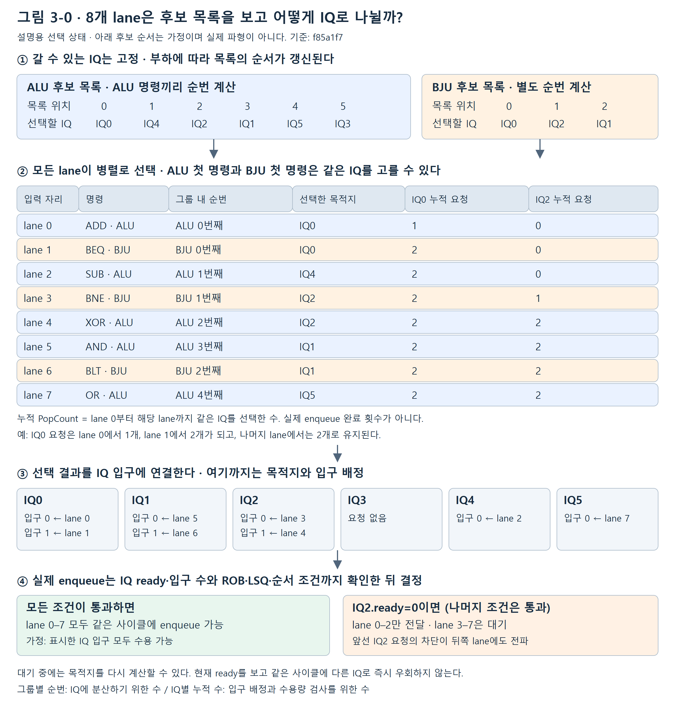
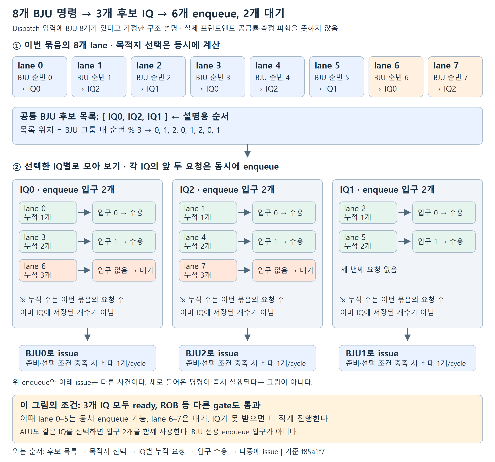
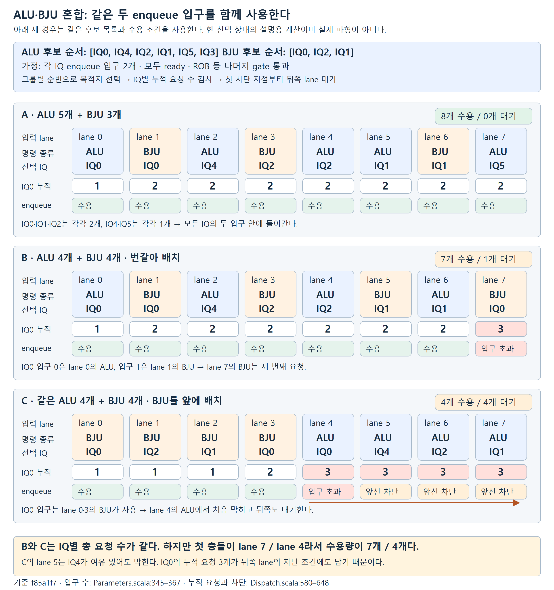
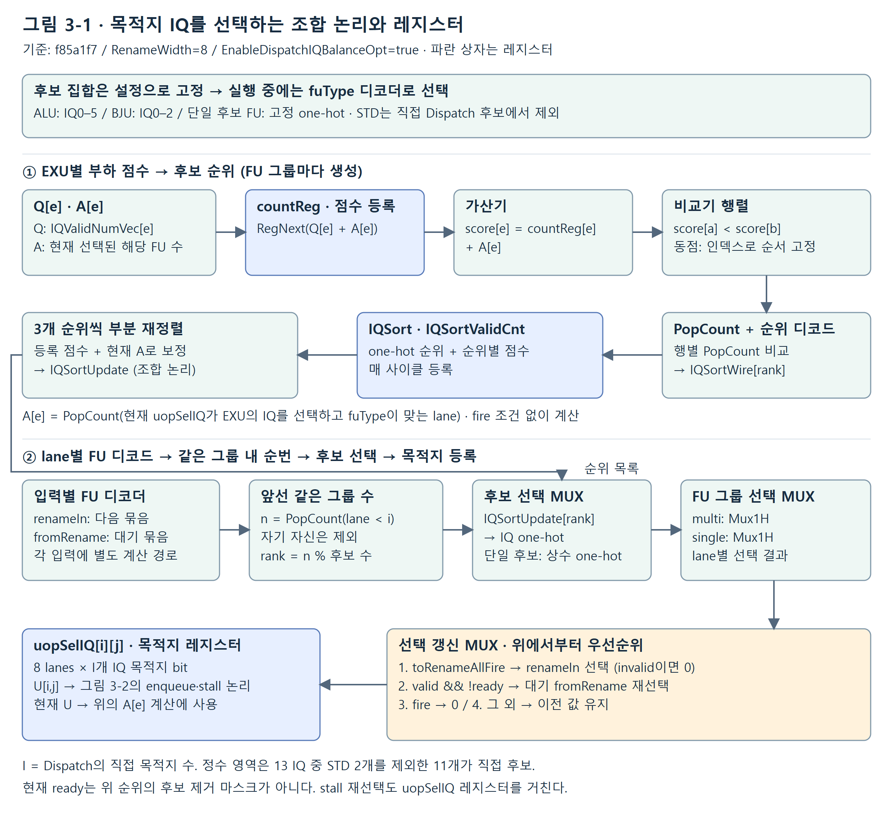
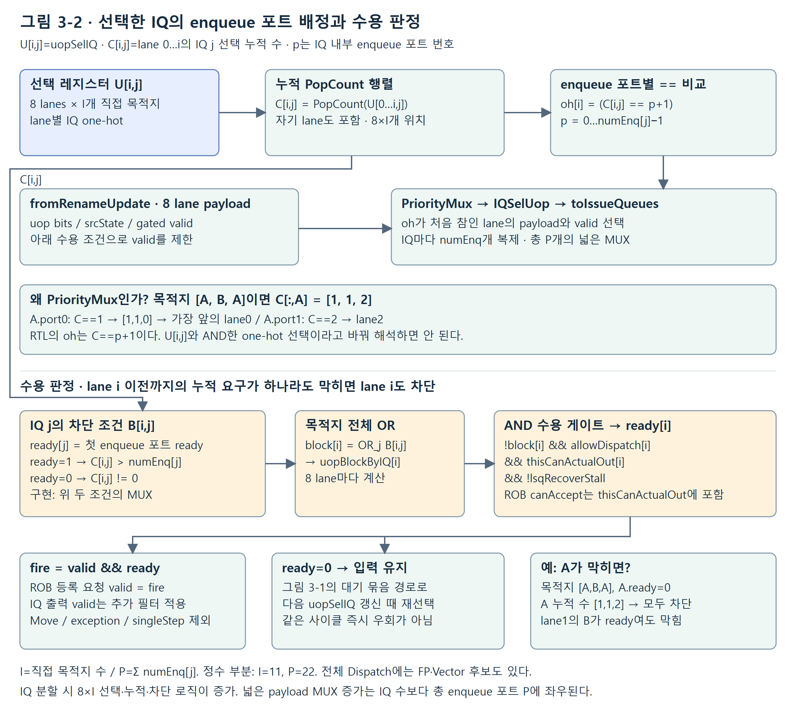

# Issue Queue Study

명령이 IQ에 들어가 실행될 때까지의 흐름을 여섯 질문으로 살펴봅니다. 먼저 전체 구조를 보고, 명령 분배·의존성·실패 사례를 거쳐 처리량을 제한하는 조건을 설명합니다.

XiangShan Kunminghu V3 · DefaultConfig(1)<br>
기준 커밋: f85a1f71da8c1522035744c71e2cb266bfed1a7d<br>
예제의 순위·중재 승리·입력 상태는 설명용 가정입니다. 실제 cycle trace와 성능 측정 결과는 포함하지 않습니다.

<a id="contents"></a>

## 읽는 순서

1. [명령은 왜 IQ에서 기다릴까?](#q1)
2. [13개 IQ는 어디로 명령을 보낼까?](#q2)
3. [8개 lane은 IQ에 어떻게 나뉘고, 언제 대기할까?](#q3)
4. [기다리던 명령은 언제 선택 후보가 될까?](#q4)
5. [선택했는데 PRF 포트를 얻지 못하면?](#q5)
6. [ALU가 남아 있는데도 왜 멈출까?](#q6)

[참고 자료: 상세 조건과 소스 근거](#references)

<a id="q1"></a>

## 1. 명령은 왜 IQ에서 기다릴까?


**그림 1.** 기능 흐름을 단순화한 그림. 화살표는 cycle 단위가 아니다. 예상 wakeup 경로는 참고 D에서 설명한다.

[SVG 원본](assets/issue-queue-study/figure-01.svg)

**명령열 예제**

```text
U0: add x5, x1, x2
```

```text
U1: sub x6, x5, x3
```

U1은 IQ에 들어간 뒤 U0가 만드는 x5의 준비 정보를 기다릴 수 있다.

**핵심 결론**

IQ는 미준비 명령을 보관하고, 실행 후보가 된 명령을 선택한다.

### 내 수정 사항

**변경 내용**

- 기존 동작: (작성)
- 수정한 동작: (작성)

**변경 이유**

- 해결하려는 문제·설계 의도: (작성)

**검증 결과**

- 검증 방법·조건: (작성)
- 확인된 결과: (작성)
- 미확인 사항·추가 검증: (작성)

[상세 조건·소스 근거 ↗](#ref-position)

[목차로 돌아가기](#contents)

<a id="q2"></a>

## 2. 13개 IQ는 어디로 명령을 보낼까?


**그림 2.** 중간의 DataPath·BypassNetwork 생략. 메모리 IQ는 Int Region, 실행 본체는 MemBlock에 있다.

[SVG 원본](assets/issue-queue-study/figure-02.svg)

**명령열 예제**

```text
IQ0: add x5, x1, x2 → ALU0
```

```text
IQ0: beq x3, x4, L → BJU0
```

서로 다른 두 명령이 조건을 만족하면 두 출력을 함께 사용할 수 있다.

**핵심 결론**

13개 IQ에 16개 발행 경로가 있다. IQ에 들어간 뒤의 실행 목적지는 고정된다.

### 내 수정 사항

**변경 내용**

- 기존 동작: (작성)
- 수정한 동작: (작성)

**변경 이유**

- 해결하려는 문제·설계 의도: (작성)

**검증 결과**

- 검증 방법·조건: (작성)
- 확인된 결과: (작성)
- 미확인 사항·추가 검증: (작성)

[상세 조건·소스 근거 ↗](#ref-topology)

[목차로 돌아가기](#contents)

<a id="q3"></a>

## 3. 8개 lane은 IQ에 어떻게 나뉘고, 언제 대기할까?


**그림 3.** A: 설명용 후보 순위. 현재 occupancy를 즉시 정렬한 RTL 파형이 아니다.

[SVG 원본](assets/issue-queue-study/figure-03.svg)

**명령열 예제**

```text
A0…A7: add x10…x17, x1, x2
```

순서대로 IQ4, IQ0, IQ5, IQ2, IQ1, IQ3, IQ4, IQ0를 선택한다.<br>
IQ4·IQ0에 두 개씩 enqueue되어도 각 ALU 출력의 issue 폭은 하나다.

**핵심 결론**

실행 가능한 후보를 먼저 정하고, 같은 FU 그룹의 명령을 후보 순위에 따라 나눈다.


### 8개 lane과 ALU·BJU 후보 목록으로 먼저 이해하기



**그림 3-0.** ALU 5개와 BJU 3개가 섞인 설명용 입력 묶음. 후보 순서는 가정이다. 모든 lane은 같은 선택 상태를 보고 병렬로 계산하며, 앞선 lane의 실제 enqueue가 끝날 때까지 기다려 다음 목적지를 정하는 방식이 아니다.

[SVG 원본](assets/issue-queue-study/figure-03c-eight-lanes.svg)

**후보 목록의 역할:** ALU와 BJU는 각자 갈 수 있는 후보 목록을 사용한다. 같은 그룹의 첫 명령은 목록 위치 0, 둘째는 위치 1을 고른다. 갈 수 있는 IQ 집합은 고정이고 부하에 따른 순서가 등록·보정된다. 그룹 간 고정 우선순위를 뜻하지 않으며, ALU와 BJU가 같은 IQ를 선택할 수 있다.

**누적 PopCount의 의미:** lane 0부터 현재 lane까지 같은 IQ를 선택한 명령 수다. 그림에서 IQ0 누적 요청은 `[1,2,2,2,2,2,2,2]`, IQ2는 `[0,0,0,1,2,2,2,2]`이다. IQ 안에 이미 들어 있는 명령 수나 실제 enqueue 완료 횟수와 구분한다. IQ0의 첫 요청인 lane 0을 입구 0에, 둘째 요청인 lane 1을 입구 1에 연결하는 데 사용한다. 세 번째 요청이 생기면 입구 2개를 초과하므로 차단 조건이 된다. 이 누적 계산도 병렬 조합 논리다.

**목적지 선택과 실제 enqueue는 다르다:** 그림의 모든 IQ가 요청을 받을 수 있고 나머지 gate가 허용하면 8개 모두 동시에 들어갈 수 있다. IQ2만 ready가 아니면 첫 IQ2 요청인 lane 3부터 뒤쪽 lane까지 막힌다. 따라서 lane 0–2는 진행하고 lane 3–7은 대기한다는 예다. IQ ready 외에도 ROB 수용, 필요한 LSQ 조건, 순서 제약 등을 통과해야 한다. 고정 사이클 지연을 나타낸 그림은 아니다.

### BJU 후보는 3개인데 8개 lane이 모두 BJU라면?



**예제 그림 — BJU 요청 집중.** Dispatch 입력에 BJU 명령 8개가 있다고 가정한다. 실제 프런트엔드가 매 사이클 분기 8개를 공급한다는 뜻은 아니다. 후보 목록은 설명을 위해 `[IQ0, IQ2, IQ1]`로 가정하고, 세 IQ의 ready와 ROB 등 다른 수용 조건이 모두 통과한 선택 상태를 그렸다.

[SVG 원본](assets/issue-queue-study/figure-03d-bju-eight-lanes.svg)

그림은 위에서 아래로 다음 세 질문에 답한다.

1. **어디로 보낼까?** 같은 BJU 그룹의 순번을 후보 수 3으로 나눈 나머지를 사용한다. lane 0–7의 목적지는 `[IQ0, IQ2, IQ1, IQ0, IQ2, IQ1, IQ0, IQ2]`가 된다. 모두 첫 후보를 고르는 것이 아니다.
2. **이번 사이클에 들어갈 수 있나?** 각 IQ에는 enqueue 입구가 2개다. IQ0는 lane 0·3, IQ2는 lane 1·4, IQ1은 lane 2·5를 동시에 받을 수 있다. lane 6은 IQ0의 세 번째 요청, lane 7은 IQ2의 세 번째 요청이라 입구 수를 넘는다. 따라서 이 조건에서는 앞의 6개는 enqueue, 뒤의 2개는 대기한다.
3. **그럼 바로 실행되나?** enqueue는 IQ에 받아 두는 사건이다. 이후 operand 준비와 issue 선택·수용 조건을 만족해야 연결된 BJU로 나간다. 각 IQ에 BJU 명령 2개가 들어가도 해당 BJU로 한 사이클에 두 개를 issue하는 것은 아니다.

**누적 PopCount를 숫자로 읽기**

| lane | 선택 IQ | IQ0 누적 요청 | IQ2 누적 요청 | IQ1 누적 요청 | 이번 예의 결과 |
| --- | --- | ---: | ---: | ---: | --- |
| 0 | IQ0 | 1 | 0 | 0 | IQ0 입구 0 |
| 1 | IQ2 | 1 | 1 | 0 | IQ2 입구 0 |
| 2 | IQ1 | 1 | 1 | 1 | IQ1 입구 0 |
| 3 | IQ0 | 2 | 1 | 1 | IQ0 입구 1 |
| 4 | IQ2 | 2 | 2 | 1 | IQ2 입구 1 |
| 5 | IQ1 | 2 | 2 | 2 | IQ1 입구 1 |
| 6 | IQ0 | 3 | 2 | 2 | 요청 수 초과 → 대기 |
| 7 | IQ2 | 3 | 3 | 2 | 요청 수 초과·앞선 차단 → 대기 |

입구 번호는 0부터 센다. 위 표의 누적 요청은 **현재 입력 묶음에 대한 조합 계산**이며, 앞선 명령의 실제 enqueue 완료를 기다려 하나씩 증가시키는 카운터가 아니다.

**핵심 결론:** 8은 입력 lane 수, 3은 BJU 목적지 후보 수, 2는 IQ 하나의 enqueue 입구 수다. 서로 다른 수다. 이 예의 최대 6개 수용은 `3개 IQ × 2개 입구`와 나머지 gate 통과라는 조건에서 나온다. ALU 명령이 섞이면 같은 IQ의 두 입구를 함께 사용하고, IQ ready가 내려가면 더 적게 진행할 수 있다. 미수용 lane의 다음 사이클 목적지·수용 결과는 그때 갱신된 선택과 ready에 따라 달라진다.

입구 수와 ALU·BJU의 공유 구성은 Parameters.scala:345–367, 후보 배정은 Dispatch.scala:446–579, 누적 요청과 차단은 Dispatch.scala:580–648을 기준으로 했다. 상세 소스는 뒤의 참고 C에 모았다.

### ALU와 BJU가 섞이면 무엇이 달라질까?



**예제 그림 — ALU·BJU 혼합 비교.** 세 경우 모두 같은 설명용 후보 목록을 사용한다. ALU는 `[IQ0, IQ4, IQ2, IQ1, IQ5, IQ3]`, BJU는 `[IQ0, IQ2, IQ1]`이다. 각 IQ의 enqueue 입구는 2개이며 모두 ready, ROB 등 다른 gate도 통과한다고 가정한다. 각 행은 별개의 입력 묶음 사례이며 연속 사이클 파형이 아니다.

[SVG 원본](assets/issue-queue-study/figure-03e-mixed-dispatch-comparison.svg)

**그림 읽는 방법**

각 lane 칸의 위쪽은 명령 종류와 선택 IQ, 가운데는 그 lane까지의 **IQ0 누적 요청 수**, 아래쪽은 실제 수용 여부다. 파란 명령 칸은 ALU, 연한 주황 명령 칸은 BJU다. 결과 칸의 초록은 수용, 빨강은 처음 입구 수를 넘은 지점, 노랑은 앞선 요청이 막혀 함께 대기하는 lane이다. IQ0 수만 강조했지만 실제 회로는 모든 직접 목적지 IQ의 누적 수를 검사한다.

**A — ALU 5개 + BJU 3개: 8개 수용**

목적지는 `[IQ0, IQ0, IQ4, IQ2, IQ2, IQ1, IQ1, IQ5]`다. IQ0·IQ1·IQ2에 두 개씩, IQ4·IQ5에 하나씩 간다. 어느 IQ도 입구 2개를 초과하지 않아 8개 모두 같은 사이클에 enqueue할 수 있다. 공유 IQ의 두 입구는 ALU 하나와 BJU 하나를 함께 받는다.

**B — ALU 4개 + BJU 4개, 번갈아 배치: 7개 수용**

목적지는 `[IQ0, IQ0, IQ4, IQ2, IQ2, IQ1, IQ1, IQ0]`다. IQ0 입구 0에 lane 0의 ALU, 입구 1에 lane 1의 BJU가 연결된다. lane 7의 네 번째 BJU는 후보 목록을 한 바퀴 돌아 IQ0를 선택한다. 그때 IQ0 누적 요청이 3이므로 lane 7만 대기한다.

**C — 같은 ALU 4개 + BJU 4개, BJU를 앞에 배치: 4개 수용**

목적지는 `[IQ0, IQ2, IQ1, IQ0, IQ0, IQ4, IQ2, IQ1]`다. IQ0의 두 입구를 lane 0·3의 BJU가 사용한다. lane 4의 첫 ALU도 자기 후보 목록의 첫 IQ0를 선택하므로 세 번째 요청이 되어 막힌다. lane 5–7의 목적지 자체에는 입구가 남아 있어도, 그 위치까지의 IQ0 누적 요청이 계속 3이므로 함께 막힌다. 그림의 화살표는 이 차단 범위를 나타낸다.

| 경우 | IQ0 / IQ1 / IQ2 / IQ3 / IQ4 / IQ5 총 요청 수 | 처음 차단되는 lane | 실제 enqueue |
| --- | --- | --- | --- |
| A: 5 ALU + 3 BJU | 2 / 2 / 2 / 0 / 1 / 1 | 없음 | 8개 |
| B: 4 ALU + 4 BJU, 교차 | 3 / 2 / 2 / 0 / 1 / 0 | lane 7 | 7개 |
| C: 4 ALU + 4 BJU, BJU 먼저 | 3 / 2 / 2 / 0 / 1 / 0 | lane 4 | 4개 |

**핵심 결론:** ALU·BJU는 후보 목록과 그룹 내 순번을 따로 사용하지만, 같은 IQ를 선택한 뒤에는 enqueue 입구를 공유한다. 전체 IQ의 남은 공간만으로 진행량을 계산할 수 없다. **목적지의 겹침과 입력 순서상 첫 차단 위치**가 함께 중요하다. 이 수치는 위 후보 순서와 조건을 고정한 구조 계산이며 일반적인 평균 처리량·IPC 측정값이 아니다.

소스 대응: Dispatch.scala:515–579의 그룹별 순번·목적지 선택, 580–585의 IQ별 누적 PopCount, 594–596의 ready/valid 조건, 641–648의 IQ별 차단 OR. 각 IQ의 두 enqueue 입구와 ALU·BJU 공유 구성은 Parameters.scala:345–367을 따른다.

### Dispatch 내부 논리로 보면 어떻게 연결될까?

그림 3의 분배를 실제 비교기·PopCount·MUX·레지스터로 펼치면 아래 두 단계가 된다. **목적지 선택과 해당 목적지의 수용 판정은 별도 경로**다. 이 그림은 기준 커밋의 현재 구현이며, IQ를 분할한 변경안은 아니다.



**그림 3-1.** FU 후보 선택 → 부하 순위 → lane별 그룹 순번 → `uopSelIQ` 등록. 파란 상자는 실제 레지스터 경계다. 고정된 전체 파이프라인 사이클 수를 뜻하지 않는다.

[SVG 원본](assets/issue-queue-study/figure-03a-dispatch-selection.svg)

- **실행 가능한 후보:** 설정에서 FU별 EXU·IQ 후보를 정한다. 실행 중에는 `fuType`을 디코드해서 해당 후보 그룹을 선택한다.
- **부하 순위:** EXU별 지표 Q와 현재 선택 수 A로 점수를 만든다. 비교기 행렬과 PopCount가 순위를 만들고, 등록된 순위는 3개씩 나누어 보정한다. 매 lane마다 현재 빈칸 수를 새로 비교하는 구조와는 다르다.
- **묶음 내 분산:** 같은 FU 그룹의 앞선 valid lane 수를 n이라 하면 후보 순위의 `n % 후보 수` 위치를 선택한다. 단일 후보 FU는 고정 목적지로 간다.
- **목적지 유지·갱신:** 다음 묶음을 받을 때 새 선택을 등록한다. 막힌 lane은 유지 중인 `fromRename`으로 목적지를 재계산해 갱신한다. 현재 사이클의 ready를 보고 즉시 다른 IQ로 우회하는 조합 경로는 없다.



**그림 3-2.** `uopSelIQ` → 누적 개수 → enqueue 포트별 PriorityMux. 아래 경로는 IQ·ROB·LSQ·순서 조건으로 ready와 IQ valid를 제한한다. 그림의 11개 목적지와 22개 enqueue 포트는 **정수 영역 기여분**이며 전체 Dispatch의 합계가 아니다.

[SVG 원본](assets/issue-queue-study/figure-03b-dispatch-enqueue.svg)

**작은 명령열로 따라가기**

`U0: add x10,x1,x2`, `U1: xor x11,x3,x4`, `U2: sub x12,x5,x6`의 목적지가 A, B, A로 이미 정해졌다고 가정한다. A·B는 설명용 IQ 이름이며 실제 후보 순위와 무관하다.

| lane | 선택 IQ | A 선택 누적 수 | A의 enqueue 포트 선택 | A.ready=0일 때 |
| --- | --- | --- | --- | --- |
| 0 · U0 | A | 1 | port0의 첫 번째 일치 → U0 | 차단 |
| 1 · U1 | B | 1 | port0 비교는 일치하지만 PriorityMux에서 뒤 순서 | 앞선 A 요청 때문에 차단 |
| 2 · U2 | A | 2 | port1의 첫 번째 일치 → U2 | 차단 |

A가 2개 enqueue 포트를 가지며 모든 gate가 허용하면 A.port0은 U0, A.port1은 U2를 받는다. B의 포트 선택은 B의 별도 누적 수로 결정한다. A가 ready가 아니면 A의 누적 요구가 있는 뒤쪽 lane도 막힌다. 따라서 **B에 빈자리가 있다는 사실만으로 U1이 진행하지는 않는다.**

**핵심 결론 — IQ 분할 비용이 생기는 위치**

직접 목적지 수를 I, 총 enqueue 포트 수를 P라 하면 `uopSelIQ`는 8×I개의 선언된 bit이며, 누적 PopCount와 차단 판정도 8×I 위치에 생성된다. 넓은 uop 선택 MUX는 P개다. EXU 수와 FU 후보 수가 그대로라면 부하 순위 비교기가 IQ 수에 비례해 무조건 늘어나는 것은 아니다. **추가 목적지의 선택·수용 회로와 총 enqueue 포트 수를 각각 계산해야 한다.** 이는 RTL 구조량이고 합성 후 gate 수·면적·지연 측정값은 아니다.


### 내 수정 사항

**변경 내용**

- 기존 동작: (작성)
- 수정한 동작: (작성)

**변경 이유**

- 해결하려는 문제·설계 의도: (작성)

**검증 결과**

- 검증 방법·조건: (작성)
- 확인된 결과: (작성)
- 미확인 사항·추가 검증: (작성)

[상세 조건·소스 근거 ↗](#ref-dispatch)

[목차로 돌아가기](#contents)

<a id="q4"></a>

## 4. 기다리던 명령은 언제 선택 후보가 될까?


**그림 4.** A: x5의 physical destination을 p41로 가정. 사건 순서이며 고정 latency 표가 아니다.

[SVG 원본](assets/issue-queue-study/figure-04.svg)

**명령열 예제**

```text
U0: add x5, x1, x2 / U1: sub x6, x5, x3
```

```text
U2: xor x7, x8, x9 // U0와 독립
```

U1은 x5의 준비 정보를 기다린다. U2는 조건이 맞으면 U1보다 먼저 선택될 수 있다.

**핵심 결론**

source 준비는 선택의 시작 조건이다. busy·FU·선택 우선순위와 operand 수용도 필요하다.

### 내 수정 사항

**변경 내용**

- 기존 동작: (작성)
- 수정한 동작: (작성)

**변경 이유**

- 해결하려는 문제·설계 의도: (작성)

**검증 결과**

- 검증 방법·조건: (작성)
- 확인된 결과: (작성)
- 미확인 사항·추가 검증: (작성)

[상세 조건·소스 근거 ↗](#ref-ready)

[목차로 돌아가기](#contents)

<a id="q5"></a>

## 5. 선택했는데 PRF 포트를 얻지 못하면?


**그림 5.** A: 두 요청 모두 PRF 필요, V가 중재 승리. bank(p5)=bank(p9)=1. 재시도 간격은 가변.

[SVG 원본](assets/issue-queue-study/figure-05.svg)

**명령열 예제**

```text
U: add x10, x2, x3 → IQ3 / ALU3, psrc1=p5
```

```text
V: ld x11, 0(x4) → IQ6 / LDU0, psrc0=p9
```

U는 실패 응답을 받아 같은 IQ에서 재선택된다. Rename·ROB 할당은 유지된다.

**핵심 결론**

IQ 선택 뒤에도 발행이 실패할 수 있다. 보존된 entry가 실패 응답을 받아 재시도한다.

### 내 수정 사항

**변경 내용**

- 기존 동작: (작성)
- 수정한 동작: (작성)

**변경 이유**

- 해결하려는 문제·설계 의도: (작성)

**검증 결과**

- 검증 방법·조건: (작성)
- 확인된 결과: (작성)
- 미확인 사항·추가 검증: (작성)

[상세 조건·소스 근거 ↗](#ref-retry)

[목차로 돌아가기](#contents)

<a id="q6"></a>

## 6. ALU가 남아 있는데도 왜 멈출까?


**그림 6.** A: Q3의 후보 순위를 사용. IQ0 미수용 외의 gate는 허용한다고 가정한다.

[SVG 원본](assets/issue-queue-study/figure-06.svg)

**명령열 예제**

```text
A0…A3: add x10…x13, x1, x2
```

A0만 통과하고 A1–A3는 대기한다. 다음 선택에서 목적지가 달라질 수 있지만,<br>
그 cycle 안에 다른 빈 IQ로 즉시 우회하는 동작은 아니다.

**핵심 결론**

처리량은 배치·IQ 수용·고정 발행 경로·operand 공급이 함께 결정한다.

### 내 수정 사항

**변경 내용**

- 기존 동작: (작성)
- 수정한 동작: (작성)

**변경 이유**

- 해결하려는 문제·설계 의도: (작성)

**검증 결과**

- 검증 방법·조건: (작성)
- 확인된 결과: (작성)
- 미확인 사항·추가 검증: (작성)

[상세 조건·소스 근거 ↗](#ref-bottleneck)

[목차로 돌아가기](#contents)

<a id="references"></a>

## 참고 자료: 상세 조건과 소스 근거

본문은 설명 흐름을 위한 축약이다. 아래 조건과 고정 커밋의 링크를 함께 읽는다. 예제의 명령 배치·중재 승리·wakeup 시점은 명시한 가정이며, 실제 cycle trace가 아니다.

[A. 단계 경계와 용어](#ref-position)[B. 13개 IQ의 전체 대응](#ref-topology)[C. 후보·점수·분배식](#ref-dispatch)[D. 준비·선택·wakeup 조건](#ref-ready)[E. PRF 충돌부터 재발행까지](#ref-retry)[F. 정지·재선택·확장 검토](#ref-bottleneck)

<a id="ref-position"></a>

### A. 단계 경계와 용어

[본문 1절로 돌아가기](#q1)

Dispatch는 source가 미준비여도 자원이 허용하면 IQ에 넣는다. IQ는 operand 값 전체를 보관하는 PRF가 아니다. 선택 뒤에도 operand 공급과 실행기 수용이 필요하다는 점만 먼저 설명한다.

**F · 소스 사실.** IQ select는 deqBeforeDly에서 선택하고 deqDelay에 등록한다. 다음 OG0에서 read grant, writeback 충돌, forward cancel을 검사한다. OG1은 PRF 데이터·bypass를 선택하고 downstream 수용을 확인한다. EXU 입력에도 별도 register 경계가 있다.

OG1의 일반 정수 finalSuccess는 IQ의 해당 시도를 마치는 조건이다. 연산 결과의 writeback, ROB 완료, architectural commit과는 서로 다른 사건이다. 본문 1절 그림은 기능 연결을 나타내며 cycle 합산용이 아니다.

#### 소스 근거

- [Region.scala:40–65](https://github.com/OpenXiangShan/XiangShan/blob/f85a1f71da8c1522035744c71e2cb266bfed1a7d/src/main/scala/xiangshan/backend/Region.scala#L40-L65)
- [Region.scala:475–525](https://github.com/OpenXiangShan/XiangShan/blob/f85a1f71da8c1522035744c71e2cb266bfed1a7d/src/main/scala/xiangshan/backend/Region.scala#L475-L525)
- [Region.scala:536–575](https://github.com/OpenXiangShan/XiangShan/blob/f85a1f71da8c1522035744c71e2cb266bfed1a7d/src/main/scala/xiangshan/backend/Region.scala#L536-L575)
- [Region.scala:43–59](https://github.com/OpenXiangShan/XiangShan/blob/f85a1f71da8c1522035744c71e2cb266bfed1a7d/src/main/scala/xiangshan/backend/Region.scala#L43-L59)
- [DataPath.scala:51–64](https://github.com/OpenXiangShan/XiangShan/blob/f85a1f71da8c1522035744c71e2cb266bfed1a7d/src/main/scala/xiangshan/backend/datapath/DataPath.scala#L51-L64)
- [DataPath.scala:287–307](https://github.com/OpenXiangShan/XiangShan/blob/f85a1f71da8c1522035744c71e2cb266bfed1a7d/src/main/scala/xiangshan/backend/datapath/DataPath.scala#L287-L307)
- [Regfile.scala:314–326](https://github.com/OpenXiangShan/XiangShan/blob/f85a1f71da8c1522035744c71e2cb266bfed1a7d/src/main/scala/xiangshan/backend/regfile/Regfile.scala#L314-L326)
- [RegCache.scala:42–58](https://github.com/OpenXiangShan/XiangShan/blob/f85a1f71da8c1522035744c71e2cb266bfed1a7d/src/main/scala/xiangshan/backend/regcache/RegCache.scala#L42-L58)
- [IssueQueue.scala:895–925](https://github.com/OpenXiangShan/XiangShan/blob/f85a1f71da8c1522035744c71e2cb266bfed1a7d/src/main/scala/xiangshan/backend/issue/IssueQueue.scala#L895-L925)
- [DataPath.scala:519–549](https://github.com/OpenXiangShan/XiangShan/blob/f85a1f71da8c1522035744c71e2cb266bfed1a7d/src/main/scala/xiangshan/backend/datapath/DataPath.scala#L519-L549)
- [DataPath.scala:604–643](https://github.com/OpenXiangShan/XiangShan/blob/f85a1f71da8c1522035744c71e2cb266bfed1a7d/src/main/scala/xiangshan/backend/datapath/DataPath.scala#L604-L643)
- [Region.scala:509–559](https://github.com/OpenXiangShan/XiangShan/blob/f85a1f71da8c1522035744c71e2cb266bfed1a7d/src/main/scala/xiangshan/backend/Region.scala#L509-L559)
- [NewPipelineConnect.scala:41–51](https://github.com/OpenXiangShan/XiangShan/blob/f85a1f71da8c1522035744c71e2cb266bfed1a7d/src/main/scala/xiangshan/backend/datapath/NewPipelineConnect.scala#L41-L51)

<a id="ref-topology"></a>

### B. 13개 IQ의 전체 대응

[본문 2절로 돌아가기](#q2)

BJU는 두 번째 ALU가 아니다. IQ0의 ADD 두 개를 ALU0와 BJU0에 나눠 보낼 수 없다. ALU0라는 EXU 내부에는 여러 FU가 있으나 dequeue 수는 그대로다.

| IQ | 개별 entry 구성 | 개별 enq / deq | 목적지 |
| --- | --- | --- | --- |
| 0, 1, 2 | 18 = 2 + 6 + 10 | 2 / 2 | 각 ALU0/1/2 및 BJU0/1/2 |
| 3, 4, 5 | 20 = 2 + 6 + 12 | 2 / 1 | 각 ALU3/4/5 |
| 6, 7, 8 | 20 = 2 + 6 + 12 | 2 / 1 | 각 LDU0/1/2 |
| 9, 10 | 16 = 2 + 2 + 12 | 2 / 1 | 각 STA0/1 |
| 11, 12 | 16 = 2 + 2 + 12 | 2 / 1 | 각 STD0/1 |

**C · 소스 구성에서 계산.** 238 entries, 26 enqueue 위치, 16 dequeue 위치. enqueue 위치의 합은 8-wide Dispatch가 매 cycle 수용하는 명령 수가 아니다. entry 구성은 enqueue + simple + complex 순서다.

**F.** IQ0–2의 ALU/BJU 출력은 서로 다른 FU 집합에서 서로 다른 uop를 선택한다. 하나의 uop를 두 출력에 복제하는 구조가 아니다. 메모리 경로 7개는 ExuBlock의 로컬 EXU 9개와 실행 위치가 다르다.

#### 소스 근거

- [Parameters.scala:342–452](https://github.com/OpenXiangShan/XiangShan/blob/f85a1f71da8c1522035744c71e2cb266bfed1a7d/src/main/scala/xiangshan/Parameters.scala#L342-L452)
- [Region.scala:40–56](https://github.com/OpenXiangShan/XiangShan/blob/f85a1f71da8c1522035744c71e2cb266bfed1a7d/src/main/scala/xiangshan/backend/Region.scala#L40-L56)
- [IssueBlockParams.scala:165–165](https://github.com/OpenXiangShan/XiangShan/blob/f85a1f71da8c1522035744c71e2cb266bfed1a7d/src/main/scala/xiangshan/backend/issue/IssueBlockParams.scala#L165-L165)
- [IssueBlockParams.scala:346–354](https://github.com/OpenXiangShan/XiangShan/blob/f85a1f71da8c1522035744c71e2cb266bfed1a7d/src/main/scala/xiangshan/backend/issue/IssueBlockParams.scala#L346-L354)
- [ExuBlock.scala:19–45](https://github.com/OpenXiangShan/XiangShan/blob/f85a1f71da8c1522035744c71e2cb266bfed1a7d/src/main/scala/xiangshan/backend/exu/ExuBlock.scala#L19-L45)
- [Region.scala:475–549](https://github.com/OpenXiangShan/XiangShan/blob/f85a1f71da8c1522035744c71e2cb266bfed1a7d/src/main/scala/xiangshan/backend/Region.scala#L475-L549)
- [Entries.scala:46–61](https://github.com/OpenXiangShan/XiangShan/blob/f85a1f71da8c1522035744c71e2cb266bfed1a7d/src/main/scala/xiangshan/backend/issue/Entries.scala#L46-L61)
- [Entries.scala:115–145](https://github.com/OpenXiangShan/XiangShan/blob/f85a1f71da8c1522035744c71e2cb266bfed1a7d/src/main/scala/xiangshan/backend/issue/Entries.scala#L115-L145)
- [Parameters.scala:342–446](https://github.com/OpenXiangShan/XiangShan/blob/f85a1f71da8c1522035744c71e2cb266bfed1a7d/src/main/scala/xiangshan/Parameters.scala#L342-L446)
- [IssueBlockParams.scala:167–173](https://github.com/OpenXiangShan/XiangShan/blob/f85a1f71da8c1522035744c71e2cb266bfed1a7d/src/main/scala/xiangshan/backend/issue/IssueBlockParams.scala#L167-L173)
- [Entries.scala:23–52](https://github.com/OpenXiangShan/XiangShan/blob/f85a1f71da8c1522035744c71e2cb266bfed1a7d/src/main/scala/xiangshan/backend/issue/Entries.scala#L23-L52)
- [EntryBundles.scala:26–44](https://github.com/OpenXiangShan/XiangShan/blob/f85a1f71da8c1522035744c71e2cb266bfed1a7d/src/main/scala/xiangshan/backend/issue/EntryBundles.scala#L26-L44)
- [EntryBundles.scala:303–314](https://github.com/OpenXiangShan/XiangShan/blob/f85a1f71da8c1522035744c71e2cb266bfed1a7d/src/main/scala/xiangshan/backend/issue/EntryBundles.scala#L303-L314)
- [EntryBundles.scala:475–477](https://github.com/OpenXiangShan/XiangShan/blob/f85a1f71da8c1522035744c71e2cb266bfed1a7d/src/main/scala/xiangshan/backend/issue/EntryBundles.scala#L475-L477)
- [IssueQueue.scala:425–467](https://github.com/OpenXiangShan/XiangShan/blob/f85a1f71da8c1522035744c71e2cb266bfed1a7d/src/main/scala/xiangshan/backend/issue/IssueQueue.scala#L425-L467)
- [IssueQueue.scala:534–588](https://github.com/OpenXiangShan/XiangShan/blob/f85a1f71da8c1522035744c71e2cb266bfed1a7d/src/main/scala/xiangshan/backend/issue/IssueQueue.scala#L534-L588)
- [FuBusyTableWrite.scala:12–60](https://github.com/OpenXiangShan/XiangShan/blob/f85a1f71da8c1522035744c71e2cb266bfed1a7d/src/main/scala/xiangshan/backend/issue/FuBusyTableWrite.scala#L12-L60)
- [FuBusyTableRead.scala:7–37](https://github.com/OpenXiangShan/XiangShan/blob/f85a1f71da8c1522035744c71e2cb266bfed1a7d/src/main/scala/xiangshan/backend/issue/FuBusyTableRead.scala#L7-L37)
- [IssueQueue.scala:604–620](https://github.com/OpenXiangShan/XiangShan/blob/f85a1f71da8c1522035744c71e2cb266bfed1a7d/src/main/scala/xiangshan/backend/issue/IssueQueue.scala#L604-L620)
- [Entries.scala:32–44](https://github.com/OpenXiangShan/XiangShan/blob/f85a1f71da8c1522035744c71e2cb266bfed1a7d/src/main/scala/xiangshan/backend/issue/Entries.scala#L32-L44)
- [Entries.scala:148–152](https://github.com/OpenXiangShan/XiangShan/blob/f85a1f71da8c1522035744c71e2cb266bfed1a7d/src/main/scala/xiangshan/backend/issue/Entries.scala#L148-L152)
- [Entries.scala:252–255](https://github.com/OpenXiangShan/XiangShan/blob/f85a1f71da8c1522035744c71e2cb266bfed1a7d/src/main/scala/xiangshan/backend/issue/Entries.scala#L252-L255)
- [EntryBundles.scala:210–240](https://github.com/OpenXiangShan/XiangShan/blob/f85a1f71da8c1522035744c71e2cb266bfed1a7d/src/main/scala/xiangshan/backend/issue/EntryBundles.scala#L210-L240)
- [EntryBundles.scala:453–461](https://github.com/OpenXiangShan/XiangShan/blob/f85a1f71da8c1522035744c71e2cb266bfed1a7d/src/main/scala/xiangshan/backend/issue/EntryBundles.scala#L453-L461)
- [IssueQueue.scala:895–925](https://github.com/OpenXiangShan/XiangShan/blob/f85a1f71da8c1522035744c71e2cb266bfed1a7d/src/main/scala/xiangshan/backend/issue/IssueQueue.scala#L895-L925)

<a id="ref-dispatch"></a>

### C. 후보·점수·분배식

[본문 3절로 돌아가기](#q3)

먼저 FU eligibility가 IQ 후보를 제한한다. 점수는 lane별 대기량의 추정치이고 등록·보정된다. 최종 ready와 누적 enqueue 개수 검사는 별도다. 여덟 ADD의 동시 수용은 모든 gate가 열렸을 때의 조건부 사례다.

| 명령 종류 | 후보 IQ |
| --- | --- |
| ADD / XOR 등 AluCfg | 0–5 |
| 조건분기 | 0–2 |
| MUL / DIV | 4–5 / 1 |
| CSR · Fence · Link / I2f / Bku · VSet | 0 / 2 / 3 |
| Scalar load / store 주소 | 6–8 / 9–10 |

**F.** 기준 설정은 EnableDispatchIQBalanceOpt=true. lane별 점수는 IQ 전체 빈칸 수와 같지 않다. Q는 해당 dequeue FU에 맞는 valid count에서 capped issued count와 OG1-final의 deqBeforeDly.valid 예상 출구를 뺀 값이다. 선택 중인 A를 더해 Qreg=RegNext(Q+A), score=Qreg+A를 만든다. A는 fire만 세는 값이 아니다.

전역 순위를 등록하고 저장된 순위를 3개씩 나눠 보정한다. updateInterval=3은 이 segment 크기다. 같은 FU 그룹 앞선 valid 명령 수 k에 대해 orderedCandidates\[k % N\]을 선택한다. 현재 ready는 순위에서 후보를 제거하는 mask가 아니다.

**A/C · 본문 3절.** 순위 \[4,0,5,2,1,3\]을 가정하면 k=0…7의 목적지는 \[4,0,5,2,1,3,4,0\]다. 모든 IQ ready와 ROB·LSQ·순서 gate 통과를 가정한다.

**Store 예외 경로.** STD는 독립 Dispatch 후보가 아니다. STA0의 enqueue는 STD0로, STA1은 STD1로 복제한다. 선택 pair의 ready는 staReady && stdReady && vstdReady이며 주소·데이터 issue는 이후 별도로 진행된다.


#### 그림 3-1·3-2와 RTL의 대응

| 그림의 논리 | 실제 신호·소스 위치 | 해석할 때의 조건 |
| --- | --- | --- |
| FU별 후보 집합 | Dispatch.scala:53–102, `needMultiExu`, `needSingleIQ` | Scala 설정 전개로 연결을 정한다. STD·VSTD는 직접 후보에서 제외한다. |
| 선택 수와 점수 | Dispatch.scala:432–445, `needAppendIQValidNumVec`, `issueQueueCountReg` | A는 현재 선택된 lane 수이며 fire로 제한하지 않는다. |
| 비교·순위 레지스터·부분 재정렬 | Dispatch.scala:446–512, `compareMatrix`, `IQSort`, `IQSortUpdate` | 후보 EXU 그룹별 구성. 3개씩 보정한 결과가 전체 후보의 새로운 전역 정렬과 같다고 가정하지 않는다. |
| FU 디코드·앞선 같은 그룹 수 | Dispatch.scala:515–560, `fuTypeOH`, `popFuTypeOH` | 자신은 제외한다. 다음 묶음과 대기 묶음에 각각 계산한다. |
| 목적지 갱신 | Dispatch.scala:561–579, `uopSelIQ` | allFire 갱신 → blocked 재선택 → fire clear → hold 우선순위. 기준 설정에서 balance opt 활성. |
| IQ별 누적 수 | Dispatch.scala:580–585, `uopSelIQMatrix` | 자신을 포함한다. FU 그룹의 앞선 lane 수와 다른 계산이다. |
| 포트별 데이터 MUX | Dispatch.scala:611–639, `IQSelUop` | `oh=(C==p+1)`를 PriorityMux에 넣는다. payload와 valid가 같은 우선순위를 따른다. |
| 차단 행렬 | Dispatch.scala:641–648, `uopBlockMatrix` | ready=1이면 포트 수 초과, ready=0이면 누적 요청 존재 시 차단. |
| ready·IQ valid | Dispatch.scala:594–596 | IQ valid에는 move·exception·singleStep 제외 조건이 추가된다. |
| ROB 수용·등록 | Dispatch.scala:885–892 | `thisCanActualOut`에 ROB canAccept 포함. ROB req.valid는 fromRename.fire. |

선택 레지스터와 정렬 레지스터의 경계만 표시했다. 예제는 하나의 선택 상태에서 조합 논리가 무엇을 산출하는지 보여주며, 명령 수신부터 IQ 진입까지의 고정 사이클 수나 실제 측정 파형을 주장하지 않는다. `toRenameAllFire`는 모든 lane이 invalid이거나 fire일 때 참이다(Dispatch.scala:165).


#### 소스 근거

- [Dispatch.scala:53–108](https://github.com/OpenXiangShan/XiangShan/blob/f85a1f71da8c1522035744c71e2cb266bfed1a7d/src/main/scala/xiangshan/backend/dispatch/Dispatch.scala#L53-L108)
- [Dispatch.scala:551–579](https://github.com/OpenXiangShan/XiangShan/blob/f85a1f71da8c1522035744c71e2cb266bfed1a7d/src/main/scala/xiangshan/backend/dispatch/Dispatch.scala#L551-L579)
- [Dispatch.scala:611–633](https://github.com/OpenXiangShan/XiangShan/blob/f85a1f71da8c1522035744c71e2cb266bfed1a7d/src/main/scala/xiangshan/backend/dispatch/Dispatch.scala#L611-L633)
- [Parameters.scala:342–446](https://github.com/OpenXiangShan/XiangShan/blob/f85a1f71da8c1522035744c71e2cb266bfed1a7d/src/main/scala/xiangshan/Parameters.scala#L342-L446)
- [Parameters.scala:121–128](https://github.com/OpenXiangShan/XiangShan/blob/f85a1f71da8c1522035744c71e2cb266bfed1a7d/src/main/scala/xiangshan/Parameters.scala#L121-L128)
- [Configs.scala:498–515](https://github.com/OpenXiangShan/XiangShan/blob/f85a1f71da8c1522035744c71e2cb266bfed1a7d/src/main/scala/top/Configs.scala#L498-L515)
- [IssueQueue.scala:1000–1059](https://github.com/OpenXiangShan/XiangShan/blob/f85a1f71da8c1522035744c71e2cb266bfed1a7d/src/main/scala/xiangshan/backend/issue/IssueQueue.scala#L1000-L1059)
- [Region.scala:828–828](https://github.com/OpenXiangShan/XiangShan/blob/f85a1f71da8c1522035744c71e2cb266bfed1a7d/src/main/scala/xiangshan/backend/Region.scala#L828-L828)
- [Backend.scala:240–245](https://github.com/OpenXiangShan/XiangShan/blob/f85a1f71da8c1522035744c71e2cb266bfed1a7d/src/main/scala/xiangshan/backend/Backend.scala#L240-L245)
- [CtrlBlock.scala:807–807](https://github.com/OpenXiangShan/XiangShan/blob/f85a1f71da8c1522035744c71e2cb266bfed1a7d/src/main/scala/xiangshan/backend/CtrlBlock.scala#L807-L807)
- [Dispatch.scala:432–445](https://github.com/OpenXiangShan/XiangShan/blob/f85a1f71da8c1522035744c71e2cb266bfed1a7d/src/main/scala/xiangshan/backend/dispatch/Dispatch.scala#L432-L445)
- [Dispatch.scala:446–579](https://github.com/OpenXiangShan/XiangShan/blob/f85a1f71da8c1522035744c71e2cb266bfed1a7d/src/main/scala/xiangshan/backend/dispatch/Dispatch.scala#L446-L579)
- [Dispatch.scala:515–583](https://github.com/OpenXiangShan/XiangShan/blob/f85a1f71da8c1522035744c71e2cb266bfed1a7d/src/main/scala/xiangshan/backend/dispatch/Dispatch.scala#L515-L583)
- [Dispatch.scala:611–648](https://github.com/OpenXiangShan/XiangShan/blob/f85a1f71da8c1522035744c71e2cb266bfed1a7d/src/main/scala/xiangshan/backend/dispatch/Dispatch.scala#L611-L648)
- [Parameters.scala:345–446](https://github.com/OpenXiangShan/XiangShan/blob/f85a1f71da8c1522035744c71e2cb266bfed1a7d/src/main/scala/xiangshan/Parameters.scala#L345-L446)
- [Dispatch.scala:53–56](https://github.com/OpenXiangShan/XiangShan/blob/f85a1f71da8c1522035744c71e2cb266bfed1a7d/src/main/scala/xiangshan/backend/dispatch/Dispatch.scala#L53-L56)
- [Region.scala:123–131](https://github.com/OpenXiangShan/XiangShan/blob/f85a1f71da8c1522035744c71e2cb266bfed1a7d/src/main/scala/xiangshan/backend/Region.scala#L123-L131)
- [Region.scala:268–310](https://github.com/OpenXiangShan/XiangShan/blob/f85a1f71da8c1522035744c71e2cb266bfed1a7d/src/main/scala/xiangshan/backend/Region.scala#L268-L310)

<a id="ref-ready"></a>

### D. 준비·선택·wakeup 조건

[본문 4절로 돌아가기](#q4)

본문에서는 source readiness의 역할에 집중한다. 실제 선택은 partition 우선순위와 partition 내부 age를 적용한다. complex entry의 same-cycle wakeup bypass와 speculative wakeup 취소는 참고에서 분리한다.

**F.** Status.canIssue는 srcReady && !issued && !blocked에서 시작하며 valid·flush와 FU/WB busy mask를 더 검사한다. 현재 정수 구성의 일반 선택은 complex, simple, enqueue partition 우선순위를 적용하고 각 partition 안에서 age를 사용한다. 전체 IQ에서 언제나 가장 오래된 uop 하나를 고르는 모델은 정확하지 않다.

Complex entry는 같은 cycle의 IQ wakeup을 canIssueBypass로 반영할 수 있다. Simple entry에는 같은 조합 bypass 선택이 없다. 따라서 readiness가 실제 결과 전달보다 앞설 수 있으며, 예상 wakeup이 취소되면 준비 상태나 소비자의 시도도 되돌려야 한다.

**A · 본문 4절.** x5→p41은 설명용 rename 결과다. U2가 먼저 선택되는 사례는 source 준비, 실행 경로, busy, age와 operand 수용이 모두 허용될 때만 성립한다. 그림의 사건 간격은 실제 cycle 수를 뜻하지 않는다.

#### 소스 근거

- [Entries.scala:46–61](https://github.com/OpenXiangShan/XiangShan/blob/f85a1f71da8c1522035744c71e2cb266bfed1a7d/src/main/scala/xiangshan/backend/issue/Entries.scala#L46-L61)
- [Entries.scala:115–145](https://github.com/OpenXiangShan/XiangShan/blob/f85a1f71da8c1522035744c71e2cb266bfed1a7d/src/main/scala/xiangshan/backend/issue/Entries.scala#L115-L145)
- [Parameters.scala:342–446](https://github.com/OpenXiangShan/XiangShan/blob/f85a1f71da8c1522035744c71e2cb266bfed1a7d/src/main/scala/xiangshan/Parameters.scala#L342-L446)
- [IssueBlockParams.scala:167–173](https://github.com/OpenXiangShan/XiangShan/blob/f85a1f71da8c1522035744c71e2cb266bfed1a7d/src/main/scala/xiangshan/backend/issue/IssueBlockParams.scala#L167-L173)
- [Entries.scala:23–52](https://github.com/OpenXiangShan/XiangShan/blob/f85a1f71da8c1522035744c71e2cb266bfed1a7d/src/main/scala/xiangshan/backend/issue/Entries.scala#L23-L52)
- [EntryBundles.scala:26–44](https://github.com/OpenXiangShan/XiangShan/blob/f85a1f71da8c1522035744c71e2cb266bfed1a7d/src/main/scala/xiangshan/backend/issue/EntryBundles.scala#L26-L44)
- [EntryBundles.scala:303–314](https://github.com/OpenXiangShan/XiangShan/blob/f85a1f71da8c1522035744c71e2cb266bfed1a7d/src/main/scala/xiangshan/backend/issue/EntryBundles.scala#L303-L314)
- [EntryBundles.scala:475–477](https://github.com/OpenXiangShan/XiangShan/blob/f85a1f71da8c1522035744c71e2cb266bfed1a7d/src/main/scala/xiangshan/backend/issue/EntryBundles.scala#L475-L477)
- [IssueQueue.scala:425–467](https://github.com/OpenXiangShan/XiangShan/blob/f85a1f71da8c1522035744c71e2cb266bfed1a7d/src/main/scala/xiangshan/backend/issue/IssueQueue.scala#L425-L467)
- [IssueQueue.scala:534–588](https://github.com/OpenXiangShan/XiangShan/blob/f85a1f71da8c1522035744c71e2cb266bfed1a7d/src/main/scala/xiangshan/backend/issue/IssueQueue.scala#L534-L588)
- [FuBusyTableWrite.scala:12–60](https://github.com/OpenXiangShan/XiangShan/blob/f85a1f71da8c1522035744c71e2cb266bfed1a7d/src/main/scala/xiangshan/backend/issue/FuBusyTableWrite.scala#L12-L60)
- [FuBusyTableRead.scala:7–37](https://github.com/OpenXiangShan/XiangShan/blob/f85a1f71da8c1522035744c71e2cb266bfed1a7d/src/main/scala/xiangshan/backend/issue/FuBusyTableRead.scala#L7-L37)
- [IssueQueue.scala:604–620](https://github.com/OpenXiangShan/XiangShan/blob/f85a1f71da8c1522035744c71e2cb266bfed1a7d/src/main/scala/xiangshan/backend/issue/IssueQueue.scala#L604-L620)
- [Entries.scala:32–44](https://github.com/OpenXiangShan/XiangShan/blob/f85a1f71da8c1522035744c71e2cb266bfed1a7d/src/main/scala/xiangshan/backend/issue/Entries.scala#L32-L44)
- [Entries.scala:148–152](https://github.com/OpenXiangShan/XiangShan/blob/f85a1f71da8c1522035744c71e2cb266bfed1a7d/src/main/scala/xiangshan/backend/issue/Entries.scala#L148-L152)
- [Entries.scala:252–255](https://github.com/OpenXiangShan/XiangShan/blob/f85a1f71da8c1522035744c71e2cb266bfed1a7d/src/main/scala/xiangshan/backend/issue/Entries.scala#L252-L255)
- [EntryBundles.scala:210–240](https://github.com/OpenXiangShan/XiangShan/blob/f85a1f71da8c1522035744c71e2cb266bfed1a7d/src/main/scala/xiangshan/backend/issue/EntryBundles.scala#L210-L240)
- [EntryBundles.scala:453–461](https://github.com/OpenXiangShan/XiangShan/blob/f85a1f71da8c1522035744c71e2cb266bfed1a7d/src/main/scala/xiangshan/backend/issue/EntryBundles.scala#L453-L461)
- [IssueQueue.scala:895–925](https://github.com/OpenXiangShan/XiangShan/blob/f85a1f71da8c1522035744c71e2cb266bfed1a7d/src/main/scala/xiangshan/backend/issue/IssueQueue.scala#L895-L925)
- [DataPath.scala:106–118](https://github.com/OpenXiangShan/XiangShan/blob/f85a1f71da8c1522035744c71e2cb266bfed1a7d/src/main/scala/xiangshan/backend/datapath/DataPath.scala#L106-L118)
- [RFReadArbiter.scala:99–104](https://github.com/OpenXiangShan/XiangShan/blob/f85a1f71da8c1522035744c71e2cb266bfed1a7d/src/main/scala/xiangshan/backend/datapath/RFReadArbiter.scala#L99-L104)
- [RFReadArbiter.scala:210–220](https://github.com/OpenXiangShan/XiangShan/blob/f85a1f71da8c1522035744c71e2cb266bfed1a7d/src/main/scala/xiangshan/backend/datapath/RFReadArbiter.scala#L210-L220)
- [DataPath.scala:614–643](https://github.com/OpenXiangShan/XiangShan/blob/f85a1f71da8c1522035744c71e2cb266bfed1a7d/src/main/scala/xiangshan/backend/datapath/DataPath.scala#L614-L643)
- [DataPath.scala:658–664](https://github.com/OpenXiangShan/XiangShan/blob/f85a1f71da8c1522035744c71e2cb266bfed1a7d/src/main/scala/xiangshan/backend/datapath/DataPath.scala#L658-L664)
- [Region.scala:150–164](https://github.com/OpenXiangShan/XiangShan/blob/f85a1f71da8c1522035744c71e2cb266bfed1a7d/src/main/scala/xiangshan/backend/Region.scala#L150-L164)
- [EntryBundles.scala:217–240](https://github.com/OpenXiangShan/XiangShan/blob/f85a1f71da8c1522035744c71e2cb266bfed1a7d/src/main/scala/xiangshan/backend/issue/EntryBundles.scala#L217-L240)
- [EntryBundles.scala:41–44](https://github.com/OpenXiangShan/XiangShan/blob/f85a1f71da8c1522035744c71e2cb266bfed1a7d/src/main/scala/xiangshan/backend/issue/EntryBundles.scala#L41-L44)
- [IssueQueue.scala:425–460](https://github.com/OpenXiangShan/XiangShan/blob/f85a1f71da8c1522035744c71e2cb266bfed1a7d/src/main/scala/xiangshan/backend/issue/IssueQueue.scala#L425-L460)
- [DataPath.scala:658–691](https://github.com/OpenXiangShan/XiangShan/blob/f85a1f71da8c1522035744c71e2cb266bfed1a7d/src/main/scala/xiangshan/backend/datapath/DataPath.scala#L658-L691)
- [DataPath.scala:624–643](https://github.com/OpenXiangShan/XiangShan/blob/f85a1f71da8c1522035744c71e2cb266bfed1a7d/src/main/scala/xiangshan/backend/datapath/DataPath.scala#L624-L643)
- [DataPath.scala:666–685](https://github.com/OpenXiangShan/XiangShan/blob/f85a1f71da8c1522035744c71e2cb266bfed1a7d/src/main/scala/xiangshan/backend/datapath/DataPath.scala#L666-L685)
- [EntryBundles.scala:341–346](https://github.com/OpenXiangShan/XiangShan/blob/f85a1f71da8c1522035744c71e2cb266bfed1a7d/src/main/scala/xiangshan/backend/issue/EntryBundles.scala#L341-L346)
- [EntryBundles.scala:385–389](https://github.com/OpenXiangShan/XiangShan/blob/f85a1f71da8c1522035744c71e2cb266bfed1a7d/src/main/scala/xiangshan/backend/issue/EntryBundles.scala#L385-L389)
- [IssueBlockParams.scala:237–252](https://github.com/OpenXiangShan/XiangShan/blob/f85a1f71da8c1522035744c71e2cb266bfed1a7d/src/main/scala/xiangshan/backend/issue/IssueBlockParams.scala#L237-L252)
- [Region.scala:175–199](https://github.com/OpenXiangShan/XiangShan/blob/f85a1f71da8c1522035744c71e2cb266bfed1a7d/src/main/scala/xiangshan/backend/Region.scala#L175-L199)
- [Region.scala:559–575](https://github.com/OpenXiangShan/XiangShan/blob/f85a1f71da8c1522035744c71e2cb266bfed1a7d/src/main/scala/xiangshan/backend/Region.scala#L559-L575)
- [IssueQueue.scala:117–134](https://github.com/OpenXiangShan/XiangShan/blob/f85a1f71da8c1522035744c71e2cb266bfed1a7d/src/main/scala/xiangshan/backend/issue/IssueQueue.scala#L117-L134)
- [IssueQueue.scala:176–178](https://github.com/OpenXiangShan/XiangShan/blob/f85a1f71da8c1522035744c71e2cb266bfed1a7d/src/main/scala/xiangshan/backend/issue/IssueQueue.scala#L176-L178)
- [IssueQueue.scala:757–766](https://github.com/OpenXiangShan/XiangShan/blob/f85a1f71da8c1522035744c71e2cb266bfed1a7d/src/main/scala/xiangshan/backend/issue/IssueQueue.scala#L757-L766)
- [DataPath.scala:596–600](https://github.com/OpenXiangShan/XiangShan/blob/f85a1f71da8c1522035744c71e2cb266bfed1a7d/src/main/scala/xiangshan/backend/datapath/DataPath.scala#L596-L600)
- [DataPath.scala:625–643](https://github.com/OpenXiangShan/XiangShan/blob/f85a1f71da8c1522035744c71e2cb266bfed1a7d/src/main/scala/xiangshan/backend/datapath/DataPath.scala#L625-L643)
- [DataPath.scala:688–691](https://github.com/OpenXiangShan/XiangShan/blob/f85a1f71da8c1522035744c71e2cb266bfed1a7d/src/main/scala/xiangshan/backend/datapath/DataPath.scala#L688-L691)
- [DataPath.scala:49](https://github.com/OpenXiangShan/XiangShan/blob/f85a1f71da8c1522035744c71e2cb266bfed1a7d/src/main/scala/xiangshan/backend/datapath/DataPath.scala#L49)
- [DataPath.scala:666–691](https://github.com/OpenXiangShan/XiangShan/blob/f85a1f71da8c1522035744c71e2cb266bfed1a7d/src/main/scala/xiangshan/backend/datapath/DataPath.scala#L666-L691)
- [DataPath.scala:701–706](https://github.com/OpenXiangShan/XiangShan/blob/f85a1f71da8c1522035744c71e2cb266bfed1a7d/src/main/scala/xiangshan/backend/datapath/DataPath.scala#L701-L706)
- [IssueQueue.scala:935–961](https://github.com/OpenXiangShan/XiangShan/blob/f85a1f71da8c1522035744c71e2cb266bfed1a7d/src/main/scala/xiangshan/backend/issue/IssueQueue.scala#L935-L961)

<a id="ref-retry"></a>

### E. PRF 충돌부터 재발행까지

[본문 5절로 돌아가기](#q5)

같은 bank만으로 충돌하는 것은 아니다. 같은 logical read port와 같은 bank가 겹친다. 중재 승자는 예제의 가정이고 configured priority 0만으로 고정 승자를 설명하지 않는다. 소비자 cancel과 직접 failed 응답을 구분한다.

1. ALU3 src1과 LDU0 src0은 논리 read port 7을 공유한다. psrc 하위 2bit가 bank를 고르므로 p5와 p9는 모두 bank 1이다.
2. 중재에서 필요한 operand 하나라도 ready를 받지 못하면 rdNotBlock이 내려가고 s0.ready가 0이 될 수 있다. 부분 grant만으로 uop를 수락하지 않는다.
3. og0resp.failed = fromIQ.valid && !fromIQ.ready. Region은 각 dequeue의 직접 응답을 해당 IQ로 돌려준다.
4. entry는 issueTimer와 deqPortIdx로 응답을 고른다. 실패 시 issued를 내리고 valid와 payload를 보존한다.
5. 준비·busy·FU·선택 조건이 다시 맞으면 같은 entry가 재시도한다. 고정 retry cycle은 보장하지 않는다.

**A.** 본문은 V가 승리하는 등록된 중재 상태와 다른 필요한 자원 통과를 가정한다. configured priority 숫자만으로 영구 승자를 정하지 않는다. PRF 충돌 자체가 source 준비 상태를 항상 0으로 만드는 것도 아니다.

**경계.** 일반 정수는 OG1 응답, LDU는 snResp, STA/STD는 별도 memory feedback 단계가 최종 성공을 결정한다. load가 MemBlock에 수락된 뒤의 miss replay와 IQ 재발행은 소유자가 다르다. redirect는 flush 대상 entry를 제거한다.

**소스 주의점.** 이 커밋의 og1Cancel broadcast 식은 valid 게이트와 함께 2-state로 전개하면 0이 되는 것으로 관찰된다. OG1 실패 처리는 직접 og1resp.failed와 wakeup queue flush 연결을 기준으로 설명했다. 최적화 RTL·설계 의도는 추가 검증 대상이다.

#### 소스 근거

- [DataPath.scala:106–118](https://github.com/OpenXiangShan/XiangShan/blob/f85a1f71da8c1522035744c71e2cb266bfed1a7d/src/main/scala/xiangshan/backend/datapath/DataPath.scala#L106-L118)
- [RFReadArbiter.scala:99–104](https://github.com/OpenXiangShan/XiangShan/blob/f85a1f71da8c1522035744c71e2cb266bfed1a7d/src/main/scala/xiangshan/backend/datapath/RFReadArbiter.scala#L99-L104)
- [RFReadArbiter.scala:210–220](https://github.com/OpenXiangShan/XiangShan/blob/f85a1f71da8c1522035744c71e2cb266bfed1a7d/src/main/scala/xiangshan/backend/datapath/RFReadArbiter.scala#L210-L220)
- [DataPath.scala:614–643](https://github.com/OpenXiangShan/XiangShan/blob/f85a1f71da8c1522035744c71e2cb266bfed1a7d/src/main/scala/xiangshan/backend/datapath/DataPath.scala#L614-L643)
- [DataPath.scala:658–664](https://github.com/OpenXiangShan/XiangShan/blob/f85a1f71da8c1522035744c71e2cb266bfed1a7d/src/main/scala/xiangshan/backend/datapath/DataPath.scala#L658-L664)
- [Region.scala:150–164](https://github.com/OpenXiangShan/XiangShan/blob/f85a1f71da8c1522035744c71e2cb266bfed1a7d/src/main/scala/xiangshan/backend/Region.scala#L150-L164)
- [Entries.scala:32–44](https://github.com/OpenXiangShan/XiangShan/blob/f85a1f71da8c1522035744c71e2cb266bfed1a7d/src/main/scala/xiangshan/backend/issue/Entries.scala#L32-L44)
- [Entries.scala:252–255](https://github.com/OpenXiangShan/XiangShan/blob/f85a1f71da8c1522035744c71e2cb266bfed1a7d/src/main/scala/xiangshan/backend/issue/Entries.scala#L252-L255)
- [EntryBundles.scala:217–240](https://github.com/OpenXiangShan/XiangShan/blob/f85a1f71da8c1522035744c71e2cb266bfed1a7d/src/main/scala/xiangshan/backend/issue/EntryBundles.scala#L217-L240)
- [EntryBundles.scala:453–461](https://github.com/OpenXiangShan/XiangShan/blob/f85a1f71da8c1522035744c71e2cb266bfed1a7d/src/main/scala/xiangshan/backend/issue/EntryBundles.scala#L453-L461)
- [EntryBundles.scala:41–44](https://github.com/OpenXiangShan/XiangShan/blob/f85a1f71da8c1522035744c71e2cb266bfed1a7d/src/main/scala/xiangshan/backend/issue/EntryBundles.scala#L41-L44)
- [IssueQueue.scala:425–460](https://github.com/OpenXiangShan/XiangShan/blob/f85a1f71da8c1522035744c71e2cb266bfed1a7d/src/main/scala/xiangshan/backend/issue/IssueQueue.scala#L425-L460)
- [DataPath.scala:658–691](https://github.com/OpenXiangShan/XiangShan/blob/f85a1f71da8c1522035744c71e2cb266bfed1a7d/src/main/scala/xiangshan/backend/datapath/DataPath.scala#L658-L691)
- [DataPath.scala:624–643](https://github.com/OpenXiangShan/XiangShan/blob/f85a1f71da8c1522035744c71e2cb266bfed1a7d/src/main/scala/xiangshan/backend/datapath/DataPath.scala#L624-L643)
- [DataPath.scala:666–685](https://github.com/OpenXiangShan/XiangShan/blob/f85a1f71da8c1522035744c71e2cb266bfed1a7d/src/main/scala/xiangshan/backend/datapath/DataPath.scala#L666-L685)
- [EntryBundles.scala:210–240](https://github.com/OpenXiangShan/XiangShan/blob/f85a1f71da8c1522035744c71e2cb266bfed1a7d/src/main/scala/xiangshan/backend/issue/EntryBundles.scala#L210-L240)
- [EntryBundles.scala:341–346](https://github.com/OpenXiangShan/XiangShan/blob/f85a1f71da8c1522035744c71e2cb266bfed1a7d/src/main/scala/xiangshan/backend/issue/EntryBundles.scala#L341-L346)
- [EntryBundles.scala:385–389](https://github.com/OpenXiangShan/XiangShan/blob/f85a1f71da8c1522035744c71e2cb266bfed1a7d/src/main/scala/xiangshan/backend/issue/EntryBundles.scala#L385-L389)
- [IssueBlockParams.scala:237–252](https://github.com/OpenXiangShan/XiangShan/blob/f85a1f71da8c1522035744c71e2cb266bfed1a7d/src/main/scala/xiangshan/backend/issue/IssueBlockParams.scala#L237-L252)
- [Region.scala:175–199](https://github.com/OpenXiangShan/XiangShan/blob/f85a1f71da8c1522035744c71e2cb266bfed1a7d/src/main/scala/xiangshan/backend/Region.scala#L175-L199)
- [Region.scala:559–575](https://github.com/OpenXiangShan/XiangShan/blob/f85a1f71da8c1522035744c71e2cb266bfed1a7d/src/main/scala/xiangshan/backend/Region.scala#L559-L575)
- [IssueQueue.scala:117–134](https://github.com/OpenXiangShan/XiangShan/blob/f85a1f71da8c1522035744c71e2cb266bfed1a7d/src/main/scala/xiangshan/backend/issue/IssueQueue.scala#L117-L134)
- [IssueQueue.scala:176–178](https://github.com/OpenXiangShan/XiangShan/blob/f85a1f71da8c1522035744c71e2cb266bfed1a7d/src/main/scala/xiangshan/backend/issue/IssueQueue.scala#L176-L178)
- [IssueQueue.scala:757–766](https://github.com/OpenXiangShan/XiangShan/blob/f85a1f71da8c1522035744c71e2cb266bfed1a7d/src/main/scala/xiangshan/backend/issue/IssueQueue.scala#L757-L766)
- [EntryBundles.scala:303–314](https://github.com/OpenXiangShan/XiangShan/blob/f85a1f71da8c1522035744c71e2cb266bfed1a7d/src/main/scala/xiangshan/backend/issue/EntryBundles.scala#L303-L314)
- [DataPath.scala:596–600](https://github.com/OpenXiangShan/XiangShan/blob/f85a1f71da8c1522035744c71e2cb266bfed1a7d/src/main/scala/xiangshan/backend/datapath/DataPath.scala#L596-L600)
- [DataPath.scala:625–643](https://github.com/OpenXiangShan/XiangShan/blob/f85a1f71da8c1522035744c71e2cb266bfed1a7d/src/main/scala/xiangshan/backend/datapath/DataPath.scala#L625-L643)
- [DataPath.scala:688–691](https://github.com/OpenXiangShan/XiangShan/blob/f85a1f71da8c1522035744c71e2cb266bfed1a7d/src/main/scala/xiangshan/backend/datapath/DataPath.scala#L688-L691)
- [DataPath.scala:49](https://github.com/OpenXiangShan/XiangShan/blob/f85a1f71da8c1522035744c71e2cb266bfed1a7d/src/main/scala/xiangshan/backend/datapath/DataPath.scala#L49)
- [DataPath.scala:666–691](https://github.com/OpenXiangShan/XiangShan/blob/f85a1f71da8c1522035744c71e2cb266bfed1a7d/src/main/scala/xiangshan/backend/datapath/DataPath.scala#L666-L691)
- [DataPath.scala:701–706](https://github.com/OpenXiangShan/XiangShan/blob/f85a1f71da8c1522035744c71e2cb266bfed1a7d/src/main/scala/xiangshan/backend/datapath/DataPath.scala#L701-L706)
- [IssueQueue.scala:935–961](https://github.com/OpenXiangShan/XiangShan/blob/f85a1f71da8c1522035744c71e2cb266bfed1a7d/src/main/scala/xiangshan/backend/issue/IssueQueue.scala#L935-L961)

PRF 배선 추가 근거: [Parameters.scala:342–446](https://github.com/OpenXiangShan/XiangShan/blob/f85a1f71da8c1522035744c71e2cb266bfed1a7d/src/main/scala/xiangshan/Parameters.scala#L342-L446) · [RFReadArbiter.scala:194–236](https://github.com/OpenXiangShan/XiangShan/blob/f85a1f71da8c1522035744c71e2cb266bfed1a7d/src/main/scala/xiangshan/backend/datapath/RFReadArbiter.scala#L194-L236)

<a id="ref-bottleneck"></a>

### F. 정지·재선택·확장 검토

[본문 6절로 돌아가기](#q6)

여기서 12–16-wide 확장으로 연결한다. Dispatch 폭만 늘리면 IQ enqueue 한도, 특정 FU 후보 집중, PRF 공유 경쟁이 남는다. 실제 IPC와 임계 경로는 측정해야 하며 본편 예제로 수치를 추정하지 않는다.

**F.** 각 lane i까지의 IQ q 선택 수 C(i,q)를 누적한다. q가 ready이면 C(i,q)&gt;numEnq(q), ready가 아니면 C(i,q)≠0인 경우 해당 lane을 막는다. 이를 모든 IQ에 대해 OR하므로 앞선 lane이 막히면 뒤쪽도 기다릴 수 있다.

기준 정수 IQ의 numEnq는 2다. DIV, DIV, DIV, ADD가 들어오면 IQ1이 ready여도 세 번째 DIV부터 뒤쪽은 enqueue 한도를 넘는다. 본문 6절은 선택 IQ0의 ready가 0인 별도 사례다.

BalanceOpt가 켜져 있고 valid && !ready이면 현재 명령의 후보 선택 register를 다시 계산한다. 다음 cycle에 목적지가 달라질 수 있지만 같은 후보가 다시 선택될 수도 있다. 단일 후보 DIV는 IQ1에 남는다. 아직 IQ에 들어가지 않은 명령의 목적지 재선택과 IQ entry의 OG0 재발행은 다른 단계다.

**12–16-wide 검토.** FU별 후보 집중, IQ당 enqueue 폭, 고정 dequeue 서비스, PRF의 (port,bank) 공유, WB 예약을 함께 확인해야 한다. 측정 지표는 per-lane block 원인, IQ 분포, select 대비 OG0/OG1 성공률, FU 이용률이다. IPC·면적·전력·timing 수치는 본 문서에서 측정하지 않았다.

#### 소스 근거

- [IssueQueue.scala:223–224](https://github.com/OpenXiangShan/XiangShan/blob/f85a1f71da8c1522035744c71e2cb266bfed1a7d/src/main/scala/xiangshan/backend/issue/IssueQueue.scala#L223-L224)
- [IssueQueue.scala:1000–1005](https://github.com/OpenXiangShan/XiangShan/blob/f85a1f71da8c1522035744c71e2cb266bfed1a7d/src/main/scala/xiangshan/backend/issue/IssueQueue.scala#L1000-L1005)
- [IssueQueue.scala:1041–1059](https://github.com/OpenXiangShan/XiangShan/blob/f85a1f71da8c1522035744c71e2cb266bfed1a7d/src/main/scala/xiangshan/backend/issue/IssueQueue.scala#L1041-L1059)
- [EntryBundles.scala:238–240](https://github.com/OpenXiangShan/XiangShan/blob/f85a1f71da8c1522035744c71e2cb266bfed1a7d/src/main/scala/xiangshan/backend/issue/EntryBundles.scala#L238-L240)
- [EntryBundles.scala:575–576](https://github.com/OpenXiangShan/XiangShan/blob/f85a1f71da8c1522035744c71e2cb266bfed1a7d/src/main/scala/xiangshan/backend/issue/EntryBundles.scala#L575-L576)
- [Dispatch.scala:580–596](https://github.com/OpenXiangShan/XiangShan/blob/f85a1f71da8c1522035744c71e2cb266bfed1a7d/src/main/scala/xiangshan/backend/dispatch/Dispatch.scala#L580-L596)
- [Dispatch.scala:611–648](https://github.com/OpenXiangShan/XiangShan/blob/f85a1f71da8c1522035744c71e2cb266bfed1a7d/src/main/scala/xiangshan/backend/dispatch/Dispatch.scala#L611-L648)
- [Dispatch.scala:710–727](https://github.com/OpenXiangShan/XiangShan/blob/f85a1f71da8c1522035744c71e2cb266bfed1a7d/src/main/scala/xiangshan/backend/dispatch/Dispatch.scala#L710-L727)
- [Dispatch.scala:850–894](https://github.com/OpenXiangShan/XiangShan/blob/f85a1f71da8c1522035744c71e2cb266bfed1a7d/src/main/scala/xiangshan/backend/dispatch/Dispatch.scala#L850-L894)
- [Dispatch.scala:170–175](https://github.com/OpenXiangShan/XiangShan/blob/f85a1f71da8c1522035744c71e2cb266bfed1a7d/src/main/scala/xiangshan/backend/dispatch/Dispatch.scala#L170-L175)
- [Dispatch.scala:561–579](https://github.com/OpenXiangShan/XiangShan/blob/f85a1f71da8c1522035744c71e2cb266bfed1a7d/src/main/scala/xiangshan/backend/dispatch/Dispatch.scala#L561-L579)
- [Dispatch.scala:592–596](https://github.com/OpenXiangShan/XiangShan/blob/f85a1f71da8c1522035744c71e2cb266bfed1a7d/src/main/scala/xiangshan/backend/dispatch/Dispatch.scala#L592-L596)
- [CtrlBlock.scala:686–695](https://github.com/OpenXiangShan/XiangShan/blob/f85a1f71da8c1522035744c71e2cb266bfed1a7d/src/main/scala/xiangshan/backend/CtrlBlock.scala#L686-L695)
- [CtrlBlock.scala:766–781](https://github.com/OpenXiangShan/XiangShan/blob/f85a1f71da8c1522035744c71e2cb266bfed1a7d/src/main/scala/xiangshan/backend/CtrlBlock.scala#L766-L781)

### 자료의 범위

소스상의 클래스·생성 변수와 설정을 설명하며 합성 후 RTL instance path를 확정한 자료는 아니다. FP·Vector 전용 동작은 본문에서 다루지 않지만, 공유 ready·WB 조건이 제거된 하드웨어 구성을 가정하지 않는다.

[목차로 돌아가기](#contents)
