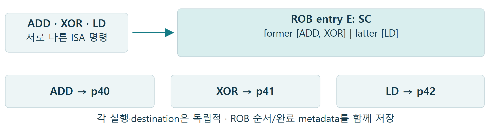
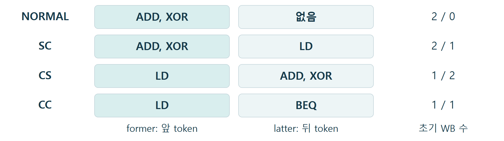
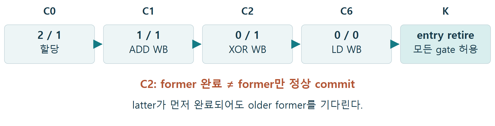
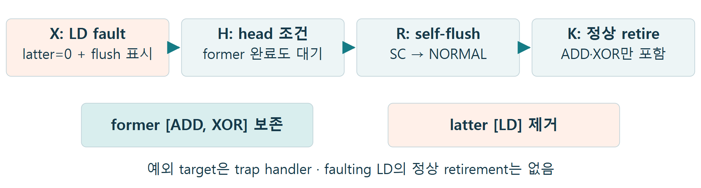
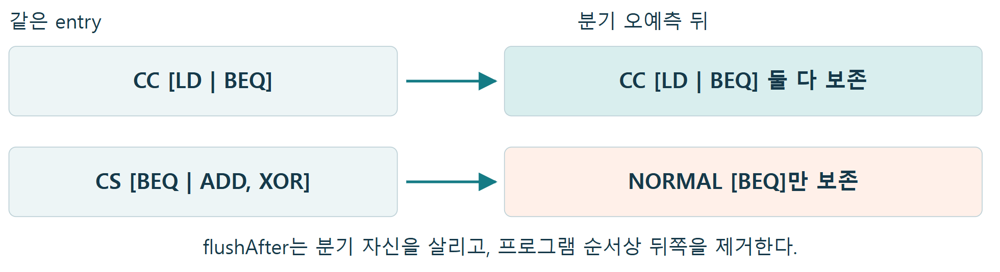
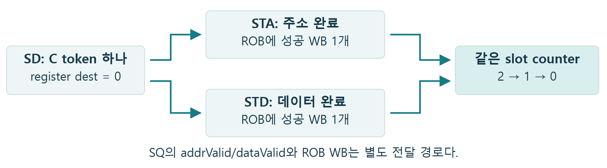
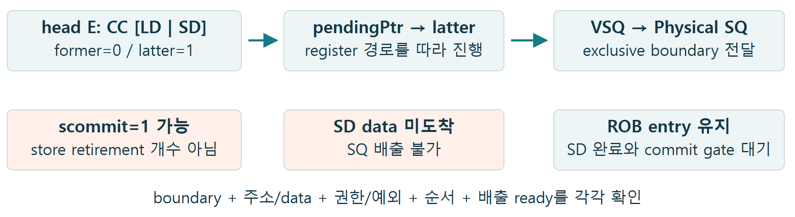
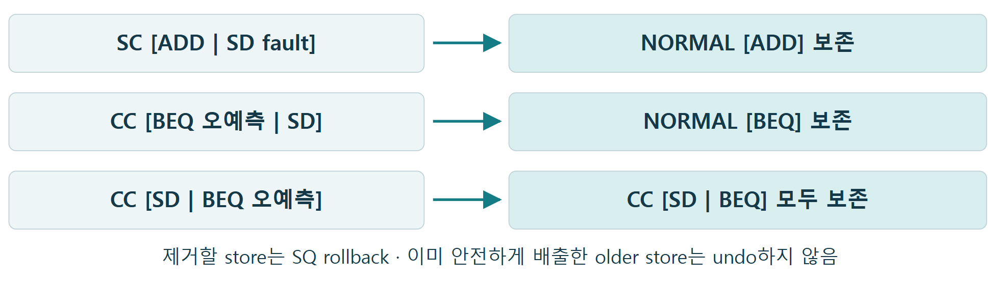

# ROB Compression Study

명령을 묶는 방식부터 완료·commit, 예외·분기 복구와 store 경계까지 여덟 질문으로 살펴봅니다. former/latter는 실행 순서가 아니라 프로그램 순서입니다.

XiangShan Kunminghu V3 · DefaultConfig(1) · 기준 커밋 f85a1f71da8c1522035744c71e2cb266bfed1a7d<br>
F: 소스 사실 / A: 설명용 가정 / C: 계산 / M: 추가 측정. 각 명령열은 독립된 batch 예제이며, cycle·사건도는 실행한 RTL 파형이 아닙니다.

<a id="contents"></a>

## 읽는 순서

1. [ROB Compression은 무엇을 묶는가?](#q1)
2. [NORMAL·SC·CS·CC는 어떻게 만들어지는가?](#q2)
3. [former가 끝나면 먼저 commit할 수 있을까?](#q3)
4. [latter의 load가 예외를 내면 former도 버릴까?](#q4)
5. [latter 분기 오예측도 같은 방식으로 복구할까?](#q5)
6. [store 하나는 슬롯과 완료를 몇 개 차지할까?](#q6)
7. [pendingPtr·scommit·precommit은 실제 commit일까?](#q7)
8. [store가 있는 entry를 복구할 때 무엇을 남길까?](#q8)

[참고 자료: 상세 조건과 소스 근거](#references)

<a id="q1"></a>

## 1. ROB Compression은 무엇을 묶는가?

<a id="fig-1"></a>



**그림 1.** 각 연산의 실행 경로는 생략했다. p40/p41/p42는 설명용 Rename 배치다.

[SVG 원본](assets/rob-compression-study/figure-01.svg)

**명령열 예제**

```text
add x5,x1,x2; xor x6,x3,x4; ld x7,0(x10)
```

세 명령을 같은 Rename batch에 놓으면 \[ADD,XOR\]라는 simple token과 LD라는 complex token을 SC entry 하나에 담을 수 있다. 세 결과와 세 destination mapping은 각각 남는다.

**핵심 결론**

실행을 하나로 합치는 fusion이 아니다. 여러 명령의 ROB 순서·완료 정보를 같은 physical entry에 저장한다.

### 내 수정 사항

**변경 내용**

- 기존 동작: (작성)
- 수정한 동작: (작성)

**변경 이유**

- 해결하려는 문제·설계 의도: (작성)

**검증 결과**

- 검증 방법·조건: (작성)
- 확인된 결과: (작성)
- 미확인 사항·추가 검증: (작성)

[상세 조건·소스 근거 ↗](#ref-1)

[목차로 돌아가기](#contents)

<a id="q2"></a>

## 2. NORMAL·SC·CS·CC는 어떻게 만들어지는가?

<a id="fig-2"></a>



**그림 2.** 각 행은 독립된 batch다. F/L 수치는 fusion·move가 없는 예제의 초기 WB 수다.

[SVG 원본](assets/rob-compression-study/figure-02.svg)

**명령열 예제**

```text
NORMAL: ADD, XOR　 SC: ADD, XOR, LD
```

```text
CS: LD, ADD, XOR　 CC: LD, BEQ
```

연속 simple 명령을 S token 하나로 만든 뒤 인접 token 두 개를 짝짓는다. 단독 S run도 NORMAL이므로 NORMAL이 항상 ISA 명령 하나라는 뜻은 아니다.

**핵심 결론**

former/latter는 프로그램 순서다. S는 simple run, C는 pair 가능한 complex 명령 하나이며, SC는 store-conditional opcode가 아니다.

### 내 수정 사항

**변경 내용**

- 기존 동작: (작성)
- 수정한 동작: (작성)

**변경 이유**

- 해결하려는 문제·설계 의도: (작성)

**검증 결과**

- 검증 방법·조건: (작성)
- 확인된 결과: (작성)
- 미확인 사항·추가 검증: (작성)

[상세 조건·소스 근거 ↗](#ref-2)

[목차로 돌아가기](#contents)

<a id="q3"></a>

## 3. former가 끝나면 먼저 commit할 수 있을까?

<a id="fig-3"></a>



**그림 3.** C0–C6는 가정한 ROB-visible WB 도착 순서다. K는 gate가 허용하는 시점이며 고정 C7이 아니다.

[SVG 원본](assets/rob-compression-study/figure-03.svg)

**명령열 예제**

```text
SC E = [ADD, XOR | LD], 초기 count = 2 / 1
```

C2에 두 ALU가 끝나도 LD가 남으면 E는 점유 상태다. 반대로 LD가 먼저 끝나도 former를 기다린다. 0/0 이후에도 older entry, redirect·walk, 예외, trace 등의 gate가 남는다.

**핵심 결론**

완료는 슬롯별로 추적하지만, 정상 ROB retirement는 entry 단위다. 부분 완료는 반쪽 commit이 아니다.

### 내 수정 사항

**변경 내용**

- 기존 동작: (작성)
- 수정한 동작: (작성)

**변경 이유**

- 해결하려는 문제·설계 의도: (작성)

**검증 결과**

- 검증 방법·조건: (작성)
- 확인된 결과: (작성)
- 미확인 사항·추가 검증: (작성)

[상세 조건·소스 근거 ↗](#ref-3)

[목차로 돌아가기](#contents)

<a id="q4"></a>

## 4. latter의 load가 예외를 내면 former도 버릴까?

<a id="fig-4"></a>



**그림 4.** X/H/R/K는 사건 순서이며 동일 간격 cycle이 아니다. 예외는 Rename 이후 발견된다고 가정한다.

[SVG 원본](assets/rob-compression-study/figure-04.svg)

**명령열 예제**

```text
0x1000 ADD; 0x1004 XOR; 0x1008 LD → SC [ADD,XOR | LD]
```

LD의 page fault를 기록한 뒤 older 작업과 former 완료를 기다린다. head 예외 처리가 latter를 self-flush하면 E는 NORMAL \[ADD,XOR\]로 줄고, 복구 후 두 ALU만 정상 retire한다.

**핵심 결론**

faulting latter와 younger 작업을 제거하고 former를 보존한다. counter=0이 예외 명령의 정상 완료·commit을 뜻하지는 않는다.

### 내 수정 사항

**변경 내용**

- 기존 동작: (작성)
- 수정한 동작: (작성)

**변경 이유**

- 해결하려는 문제·설계 의도: (작성)

**검증 결과**

- 검증 방법·조건: (작성)
- 확인된 결과: (작성)
- 미확인 사항·추가 검증: (작성)

[상세 조건·소스 근거 ↗](#ref-4)

[목차로 돌아가기](#contents)

<a id="q5"></a>

## 5. latter 분기 오예측도 같은 방식으로 복구할까?

<a id="fig-5"></a>



**그림 5.** 해당 redirect가 oldest 후보로 선택되고, 더 오래된 flush가 덮어쓰지 않는 경우다.

[SVG 원본](assets/rob-compression-study/figure-05.svg)

**명령열 예제**

```text
ld x5,0(x10); beq x1,x2,target → CC [LD | BEQ]
```

x5에 의존하지 않는 BEQ가 먼저 해결되어 오예측을 발견할 수 있다. flushAfter는 BEQ 자신과 older LD를 살린다. 반대로 BEQ가 former이면 같은 entry의 latter ADD/XOR는 wrong path로 제거한다.

**핵심 결론**

예외의 self-flush와 분기의 flushAfter를 구분한다. 같은 BEQ라도 former인지 latter인지에 따라 보존 범위가 달라진다.

### 내 수정 사항

**변경 내용**

- 기존 동작: (작성)
- 수정한 동작: (작성)

**변경 이유**

- 해결하려는 문제·설계 의도: (작성)

**검증 결과**

- 검증 방법·조건: (작성)
- 확인된 결과: (작성)
- 미확인 사항·추가 검증: (작성)

[상세 조건·소스 근거 ↗](#ref-5)

[목차로 돌아가기](#contents)

<a id="q6"></a>

## 6. store 하나는 슬롯과 완료를 몇 개 차지할까?

<a id="fig-6"></a>



**그림 6.** ordinary aligned cached SD의 성공 경로다. 두 화살표는 서로 독립된 WB 경로이며 동시 도착을 뜻하지 않는다.

[SVG 원본](assets/rob-compression-study/figure-06.svg)

**명령열 예제**

```text
sd x5,0(x10); ld x6,8(x10) → CC [SD | LD], 초기 2 / 1
```

STD WB가 먼저 오면 1/1, STA WB도 오면 0/1이다. SD는 한 token·한 slot이지만 성공 완료 통보는 두 개다. 주소 재시도는 성공 WB로 세지 않는다.

**핵심 결론**

ISA 명령 수, ROB slot 수, WB 수, register destination 수를 따로 센다. SD는 각각 1개·1개·2개·0개다.

### 내 수정 사항

**변경 내용**

- 기존 동작: (작성)
- 수정한 동작: (작성)

**변경 이유**

- 해결하려는 문제·설계 의도: (작성)

**검증 결과**

- 검증 방법·조건: (작성)
- 확인된 결과: (작성)
- 미확인 사항·추가 검증: (작성)

[상세 조건·소스 근거 ↗](#ref-6)

[목차로 돌아가기](#contents)

<a id="q7"></a>

## 7. pendingPtr·scommit·precommit은 실제 commit일까?

<a id="fig-7"></a>



**그림 7.** head 고정, redirect 없음, STA 완료·STD 지연을 가정한 상태도다. register 지연은 참고 자료에 분리했다.

[SVG 원본](assets/rob-compression-study/figure-07.svg)

**명령열 예제**

```text
CC [LD | SD]: 1/2 → STA WB: 1/1 → LD WB: 0/1
```

former가 끝나면 pendingPtr는 latter 쪽으로 진행할 수 있고 CC early 조건으로 scommit=1도 가능하다. 그러나 SD의 data가 없으면 SQ는 배출하지 못하며 ROB entry도 아직 retire하지 않는다.

**핵심 결론**

메모리 head 진행, SQ precommit·배출, ROB entry retirement는 서로 다른 사건이다. scommit을 retire한 store 개수로 세면 틀린다.

### 내 수정 사항

**변경 내용**

- 기존 동작: (작성)
- 수정한 동작: (작성)

**변경 이유**

- 해결하려는 문제·설계 의도: (작성)

**검증 결과**

- 검증 방법·조건: (작성)
- 확인된 결과: (작성)
- 미확인 사항·추가 검증: (작성)

[상세 조건·소스 근거 ↗](#ref-7)

[목차로 돌아가기](#contents)

<a id="q8"></a>

## 8. store가 있는 entry를 복구할 때 무엇을 남길까?

<a id="fig-8"></a>



**그림 8.** store 자체의 예외와 다른 명령인 BEQ의 오예측을 구분했다. 제거 대상의 SQ 상태도 함께 정리한다.

[SVG 원본](assets/rob-compression-study/figure-08.svg)

**명령열 예제**

```text
sd x5,0(x10); beq x1,x2,target → CC [SD | BEQ]
```

latter BEQ가 오예측해도 older SD는 보존한다. 순서가 \[BEQ | SD\]라면 SD가 wrong path다. \[ADD | SD fault\]에서는 data가 먼저 SQ에 와도 예외 gate가 배출을 막고 SD를 제거한다.

**핵심 결론**

복구 경계는 slot 순서와 redirect level이 결정한다. 보존된 older store를 되감지 않고, faulting·wrong-path store의 배출을 막는다.

### 내 수정 사항

**변경 내용**

- 기존 동작: (작성)
- 수정한 동작: (작성)

**변경 이유**

- 해결하려는 문제·설계 의도: (작성)

**검증 결과**

- 검증 방법·조건: (작성)
- 확인된 결과: (작성)
- 미확인 사항·추가 검증: (작성)

[상세 조건·소스 근거 ↗](#ref-8)

[목차로 돌아가기](#contents)

<a id="references"></a>

## 참고 자료: 상세 조건과 소스 근거

본문의 단순화 조건을 여기서 보완합니다. 현재 구조의 소스는 고정 커밋이며, A절의 과거 구현 비교에는 별도 SHA를 사용합니다.

[A. 저장 단위·구현 이력·압축의 범위](#ref-1)[B. 분류·batch 경계·네 배치](#ref-2)[C. Counter·정상 commit·mapping 회수](#ref-3)[D. Latter 예외·destination/trace·trap 관측](#ref-4)[E. Branch redirect·보존 경계·국소 cycle](#ref-5)[F. Store 배치·두 WB·SQ 준비](#ref-6)[G. Pending 경계·scommit 식·precommit cycle](#ref-7)[H. Store 복구·SQ rollback·검증 경계](#ref-8)

<a id="ref-1"></a>

### A. 저장 단위·구현 이력·압축의 범위

[본문 1절로 돌아가기](#q1)

**F.** 기본 구성은 ROB 160 physical entries, ROB bankNum=8, RenameWidth/CommitWidth=8이다. RAB는 352 mapping records, commit 폭은 8 records/cycle이다. 명령 수·ROB entry 수·mapping 수를 서로 바꾸어 세지 않는다. robBanks는 RegInit Vec의 index%8 grouping이며 SRAM macro 확인 결과가 아니다.

구 구현(c9ac93a1)은 연속 묶음에 같은 robIdx를 배정하고 하나의 uopNum 완료 domain을 사용했다. 후보 bit pattern을 elaboration 때 열거하고 Espresso 조합 decode를 생성했다. 새 구현은 simple-run/complex token, former/latter identity, 분리된 packed counter와 slot-aware recovery를 사용한다. pairing에는 prefix transform을 쓰지만 mask·PopCount·mux 비용은 여전히 남는다.

| committer 날짜(UTC) | 이력 |
| --- | --- |
| 2025-08-27 / 09-04 / 09-22 | a987696b 비활성화 → bf6fdae1 재활성화 → 0306fb2b 재비활성화. 비활성화 사유는 ftqOffset 변경과 fusion/compression 정확성 문제. ROB 160↔224 변경을 동반. |
| 2026-10-10 이후 | 새 CROB/token/완료 상태 및 Config 도입, store offset·ArchEvent 정렬. 초기 실험 용량 120→144와 현재 160을 구분. |
| 2026-10-16 / 10-22 | 144→160 확대와 former self-flush wrap 경계 수정이 현재 기준에 포함. |

**M.** 압축률·IPC·PPA는 측정하지 않았다. ROB 공간 절약이 IQ·PRF·RAB까지 같은 비율로 늘려 주지는 않는다. old raw pattern 열거 4^W/key 3^W는 생성 규모 계산이며 gate 수가 아니다. 12–16-wide 검토에서는 pairing, WB matching, ROB bank/commit line, RAB·RAT 회수 폭과 복구 경계를 함께 평가한다.

#### 소스 근거

- [Parameters.scala:79–86](https://github.com/OpenXiangShan/XiangShan/blob/f85a1f71da8c1522035744c71e2cb266bfed1a7d/src/main/scala/xiangshan/Parameters.scala#L79-L86)
- [Parameters.scala:112–121](https://github.com/OpenXiangShan/XiangShan/blob/f85a1f71da8c1522035744c71e2cb266bfed1a7d/src/main/scala/xiangshan/Parameters.scala#L112-L121)
- [Rob.scala:175–208](https://github.com/OpenXiangShan/XiangShan/blob/f85a1f71da8c1522035744c71e2cb266bfed1a7d/src/main/scala/xiangshan/backend/rob/Rob.scala#L175-L208)
- [Rob.scala:283–340](https://github.com/OpenXiangShan/XiangShan/blob/f85a1f71da8c1522035744c71e2cb266bfed1a7d/src/main/scala/xiangshan/backend/rob/Rob.scala#L283-L340)
- [Rob.scala:188–208](https://github.com/OpenXiangShan/XiangShan/blob/f85a1f71da8c1522035744c71e2cb266bfed1a7d/src/main/scala/xiangshan/backend/rob/Rob.scala#L188-L208)
- [Rob.scala:512–525](https://github.com/OpenXiangShan/XiangShan/blob/f85a1f71da8c1522035744c71e2cb266bfed1a7d/src/main/scala/xiangshan/backend/rob/Rob.scala#L512-L525)
- [Rob.scala:1342–1346](https://github.com/OpenXiangShan/XiangShan/blob/f85a1f71da8c1522035744c71e2cb266bfed1a7d/src/main/scala/xiangshan/backend/rob/Rob.scala#L1342-L1346)
- [RobEnqPtrWrapper.scala:46–64](https://github.com/OpenXiangShan/XiangShan/blob/f85a1f71da8c1522035744c71e2cb266bfed1a7d/src/main/scala/xiangshan/backend/rob/RobEnqPtrWrapper.scala#L46-L64)
- [Rab.scala:255–260](https://github.com/OpenXiangShan/XiangShan/blob/f85a1f71da8c1522035744c71e2cb266bfed1a7d/src/main/scala/xiangshan/backend/rob/Rab.scala#L255-L260)
- [Rob.scala:1387–1410](https://github.com/OpenXiangShan/XiangShan/blob/f85a1f71da8c1522035744c71e2cb266bfed1a7d/src/main/scala/xiangshan/backend/rob/Rob.scala#L1387-L1410)
- [RobBundles.scala:114–174](https://github.com/OpenXiangShan/XiangShan/blob/f85a1f71da8c1522035744c71e2cb266bfed1a7d/src/main/scala/xiangshan/backend/rob/RobBundles.scala#L114-L174)
- [RobBundles.scala:294–373](https://github.com/OpenXiangShan/XiangShan/blob/f85a1f71da8c1522035744c71e2cb266bfed1a7d/src/main/scala/xiangshan/backend/rob/RobBundles.scala#L294-L373)
- [Rob.scala:1547–1558](https://github.com/OpenXiangShan/XiangShan/blob/f85a1f71da8c1522035744c71e2cb266bfed1a7d/src/main/scala/xiangshan/backend/rob/Rob.scala#L1547-L1558)
- [Rab.scala:112–150](https://github.com/OpenXiangShan/XiangShan/blob/f85a1f71da8c1522035744c71e2cb266bfed1a7d/src/main/scala/xiangshan/backend/rob/Rab.scala#L112-L150)
- [Rab.scala:188–214](https://github.com/OpenXiangShan/XiangShan/blob/f85a1f71da8c1522035744c71e2cb266bfed1a7d/src/main/scala/xiangshan/backend/rob/Rab.scala#L188-L214)
- [Rob.scala:1521–1545](https://github.com/OpenXiangShan/XiangShan/blob/f85a1f71da8c1522035744c71e2cb266bfed1a7d/src/main/scala/xiangshan/backend/rob/Rob.scala#L1521-L1545)
- [Rob.scala:465–488](https://github.com/OpenXiangShan/XiangShan/blob/f85a1f71da8c1522035744c71e2cb266bfed1a7d/src/main/scala/xiangshan/backend/rob/Rob.scala#L465-L488)
- [Rab.scala:142–159](https://github.com/OpenXiangShan/XiangShan/blob/f85a1f71da8c1522035744c71e2cb266bfed1a7d/src/main/scala/xiangshan/backend/rob/Rab.scala#L142-L159)
- [Rab.scala:205–260](https://github.com/OpenXiangShan/XiangShan/blob/f85a1f71da8c1522035744c71e2cb266bfed1a7d/src/main/scala/xiangshan/backend/rob/Rab.scala#L205-L260)
- [Rob.scala:488–489](https://github.com/OpenXiangShan/XiangShan/blob/f85a1f71da8c1522035744c71e2cb266bfed1a7d/src/main/scala/xiangshan/backend/rob/Rob.scala#L488-L489)
- [Rename.scala:277–289](https://github.com/OpenXiangShan/XiangShan/blob/f85a1f71da8c1522035744c71e2cb266bfed1a7d/src/main/scala/xiangshan/backend/rename/Rename.scala#L277-L289)
- [RenameTable.scala:148–166](https://github.com/OpenXiangShan/XiangShan/blob/f85a1f71da8c1522035744c71e2cb266bfed1a7d/src/main/scala/xiangshan/backend/rename/RenameTable.scala#L148-L166)
- [RenameTable.scala:250–263](https://github.com/OpenXiangShan/XiangShan/blob/f85a1f71da8c1522035744c71e2cb266bfed1a7d/src/main/scala/xiangshan/backend/rename/RenameTable.scala#L250-L263)
- [Rename.scala:884–885](https://github.com/OpenXiangShan/XiangShan/blob/f85a1f71da8c1522035744c71e2cb266bfed1a7d/src/main/scala/xiangshan/backend/rename/Rename.scala#L884-L885)
- [Rename.scala:140–145](https://github.com/OpenXiangShan/XiangShan/blob/f85a1f71da8c1522035744c71e2cb266bfed1a7d/src/main/scala/xiangshan/backend/rename/Rename.scala#L140-L145)
- [Rename.scala:476–491](https://github.com/OpenXiangShan/XiangShan/blob/f85a1f71da8c1522035744c71e2cb266bfed1a7d/src/main/scala/xiangshan/backend/rename/Rename.scala#L476-L491)
- [Rename.scala:884–891](https://github.com/OpenXiangShan/XiangShan/blob/f85a1f71da8c1522035744c71e2cb266bfed1a7d/src/main/scala/xiangshan/backend/rename/Rename.scala#L884-L891)
- [StdFreeList.scala:35–93](https://github.com/OpenXiangShan/XiangShan/blob/f85a1f71da8c1522035744c71e2cb266bfed1a7d/src/main/scala/xiangshan/backend/rename/freelist/StdFreeList.scala#L35-L93)
- [StdFreeList.scala:95–108](https://github.com/OpenXiangShan/XiangShan/blob/f85a1f71da8c1522035744c71e2cb266bfed1a7d/src/main/scala/xiangshan/backend/rename/freelist/StdFreeList.scala#L95-L108)
- [Rename.scala:283–289](https://github.com/OpenXiangShan/XiangShan/blob/f85a1f71da8c1522035744c71e2cb266bfed1a7d/src/main/scala/xiangshan/backend/rename/Rename.scala#L283-L289)
- [CtrlBlock.scala:158–166](https://github.com/OpenXiangShan/XiangShan/blob/f85a1f71da8c1522035744c71e2cb266bfed1a7d/src/main/scala/xiangshan/backend/CtrlBlock.scala#L158-L166)
- [Rob.scala:333–340](https://github.com/OpenXiangShan/XiangShan/blob/f85a1f71da8c1522035744c71e2cb266bfed1a7d/src/main/scala/xiangshan/backend/rob/Rob.scala#L333-L340)
- [Rob.scala:1608–1673](https://github.com/OpenXiangShan/XiangShan/blob/f85a1f71da8c1522035744c71e2cb266bfed1a7d/src/main/scala/xiangshan/backend/rob/Rob.scala#L1608-L1673)
- [Rab.scala:134–150](https://github.com/OpenXiangShan/XiangShan/blob/f85a1f71da8c1522035744c71e2cb266bfed1a7d/src/main/scala/xiangshan/backend/rob/Rab.scala#L134-L150)
- [StdFreeList.scala:43–66](https://github.com/OpenXiangShan/XiangShan/blob/f85a1f71da8c1522035744c71e2cb266bfed1a7d/src/main/scala/xiangshan/backend/rename/freelist/StdFreeList.scala#L43-L66)
- [ExeUnit.scala:470–484](https://github.com/OpenXiangShan/XiangShan/blob/f85a1f71da8c1522035744c71e2cb266bfed1a7d/src/main/scala/xiangshan/backend/exu/ExeUnit.scala#L470-L484)
- [WbArbiter.scala:40–78](https://github.com/OpenXiangShan/XiangShan/blob/f85a1f71da8c1522035744c71e2cb266bfed1a7d/src/main/scala/xiangshan/backend/datapath/WbArbiter.scala#L40-L78)
- [Rob.scala:177–184](https://github.com/OpenXiangShan/XiangShan/blob/f85a1f71da8c1522035744c71e2cb266bfed1a7d/src/main/scala/xiangshan/backend/rob/Rob.scala#L177-L184)
- [RobDeqPtrWrapper.scala:59–94](https://github.com/OpenXiangShan/XiangShan/blob/f85a1f71da8c1522035744c71e2cb266bfed1a7d/src/main/scala/xiangshan/backend/rob/RobDeqPtrWrapper.scala#L59-L94)
- [Rab.scala:205–214](https://github.com/OpenXiangShan/XiangShan/blob/f85a1f71da8c1522035744c71e2cb266bfed1a7d/src/main/scala/xiangshan/backend/rob/Rab.scala#L205-L214)
- [ExeUnit.scala:60–177](https://github.com/OpenXiangShan/XiangShan/blob/f85a1f71da8c1522035744c71e2cb266bfed1a7d/src/main/scala/xiangshan/backend/exu/ExeUnit.scala#L60-L177)
- [Alu.scala:175–439](https://github.com/OpenXiangShan/XiangShan/blob/f85a1f71da8c1522035744c71e2cb266bfed1a7d/src/main/scala/xiangshan/backend/fu/Alu.scala#L175-L439)
- [Bku.scala:321–361](https://github.com/OpenXiangShan/XiangShan/blob/f85a1f71da8c1522035744c71e2cb266bfed1a7d/src/main/scala/xiangshan/backend/fu/Bku.scala#L321-L361)
- [SRT16Divider.scala:39–109](https://github.com/OpenXiangShan/XiangShan/blob/f85a1f71da8c1522035744c71e2cb266bfed1a7d/src/main/scala/xiangshan/backend/fu/SRT16Divider.scala#L39-L109)
- [NewCSR.scala:1090–1157](https://github.com/OpenXiangShan/XiangShan/blob/f85a1f71da8c1522035744c71e2cb266bfed1a7d/src/main/scala/xiangshan/backend/fu/NewCSR/NewCSR.scala#L1090-L1157)
- [Fence.scala:36–99](https://github.com/OpenXiangShan/XiangShan/blob/f85a1f71da8c1522035744c71e2cb266bfed1a7d/src/main/scala/xiangshan/backend/fu/Fence.scala#L36-L99)
- [WbArbiter.scala:223–251](https://github.com/OpenXiangShan/XiangShan/blob/f85a1f71da8c1522035744c71e2cb266bfed1a7d/src/main/scala/xiangshan/backend/datapath/WbArbiter.scala#L223-L251)
- [WbArbiter.scala:297–379](https://github.com/OpenXiangShan/XiangShan/blob/f85a1f71da8c1522035744c71e2cb266bfed1a7d/src/main/scala/xiangshan/backend/datapath/WbArbiter.scala#L297-L379)
- [RFWBConflictChecker.scala:114–130](https://github.com/OpenXiangShan/XiangShan/blob/f85a1f71da8c1522035744c71e2cb266bfed1a7d/src/main/scala/xiangshan/backend/datapath/RFWBConflictChecker.scala#L114-L130)
- [Rob.scala:1439–1558](https://github.com/OpenXiangShan/XiangShan/blob/f85a1f71da8c1522035744c71e2cb266bfed1a7d/src/main/scala/xiangshan/backend/rob/Rob.scala#L1439-L1558)
- [RobBundles.scala:68–174](https://github.com/OpenXiangShan/XiangShan/blob/f85a1f71da8c1522035744c71e2cb266bfed1a7d/src/main/scala/xiangshan/backend/rob/RobBundles.scala#L68-L174)
- [Rob.scala:1084–1134](https://github.com/OpenXiangShan/XiangShan/blob/f85a1f71da8c1522035744c71e2cb266bfed1a7d/src/main/scala/xiangshan/backend/rob/Rob.scala#L1084-L1134)
- [RobDeqPtrWrapper.scala:59–101](https://github.com/OpenXiangShan/XiangShan/blob/f85a1f71da8c1522035744c71e2cb266bfed1a7d/src/main/scala/xiangshan/backend/rob/RobDeqPtrWrapper.scala#L59-L101)
- [Rab.scala:120–150](https://github.com/OpenXiangShan/XiangShan/blob/f85a1f71da8c1522035744c71e2cb266bfed1a7d/src/main/scala/xiangshan/backend/rob/Rab.scala#L120-L150)
- [93e52a34](https://github.com/OpenXiangShan/XiangShan/commit/93e52a345dfe4c55495c310dd22614eeddc95cb4)
- [a987696b](https://github.com/OpenXiangShan/XiangShan/commit/a987696bece1a5bc58dee153b3436d66a9ffd54b)
- [bf6fdae1](https://github.com/OpenXiangShan/XiangShan/commit/bf6fdae1dca032735766e49ab7837463c17096ec)
- [0306fb2b](https://github.com/OpenXiangShan/XiangShan/commit/0306fb2bad7f82bceb45ae46ec78449b9c77e803)
- [5bad1364](https://github.com/OpenXiangShan/XiangShan/commit/5bad13640d8816ced36bf33555bfc709f1043a0f)
- [e446b65f](https://github.com/OpenXiangShan/XiangShan/commit/e446b65fe2f2718bc0830fc296a9c43f978cce50)
- [321029df](https://github.com/OpenXiangShan/XiangShan/commit/321029dfa27edbaf15b487f875e00cffea8d20ef)
- [df993b25](https://github.com/OpenXiangShan/XiangShan/commit/df993b2527ddaa1c6291cdaf7dd44724a3ae669b)
- [893e1580](https://github.com/OpenXiangShan/XiangShan/commit/893e1580b705d81f113c30c7a05734e09a08050e)
- [361607eb](https://github.com/OpenXiangShan/XiangShan/commit/361607eb2fd014f376e0bd2faffec4522d144294)
- [c9ac93a1 · Rename.scala:174–211](https://github.com/OpenXiangShan/XiangShan/blob/c9ac93a188250144a0f09e884122fb018cc5f70b/src/main/scala/xiangshan/backend/rename/Rename.scala#L174-L211)
- [c9ac93a1 · CompressUnit.scala:41–111](https://github.com/OpenXiangShan/XiangShan/blob/c9ac93a188250144a0f09e884122fb018cc5f70b/src/main/scala/xiangshan/backend/rename/CompressUnit.scala#L41-L111)
- [c9ac93a1 · Rename.scala:341–391](https://github.com/OpenXiangShan/XiangShan/blob/c9ac93a188250144a0f09e884122fb018cc5f70b/src/main/scala/xiangshan/backend/rename/Rename.scala#L341-L391)
- [c9ac93a1 · RobBundles.scala:46–88](https://github.com/OpenXiangShan/XiangShan/blob/c9ac93a188250144a0f09e884122fb018cc5f70b/src/main/scala/xiangshan/backend/rob/RobBundles.scala#L46-L88)
- [c9ac93a1 · FuType.scala:138](https://github.com/OpenXiangShan/XiangShan/blob/c9ac93a188250144a0f09e884122fb018cc5f70b/src/main/scala/xiangshan/backend/fu/FuType.scala#L138)
- [c9ac93a1 · DecodeUnit.scala:144–196](https://github.com/OpenXiangShan/XiangShan/blob/c9ac93a188250144a0f09e884122fb018cc5f70b/src/main/scala/xiangshan/backend/decode/DecodeUnit.scala#L144-L196)
- [DecodeStage.scala:163–170](https://github.com/OpenXiangShan/XiangShan/blob/f85a1f71da8c1522035744c71e2cb266bfed1a7d/src/main/scala/xiangshan/backend/vector/Decoder/DecodeStage.scala#L163-L170)
- [CompressUnit.scala:92–160](https://github.com/OpenXiangShan/XiangShan/blob/f85a1f71da8c1522035744c71e2cb266bfed1a7d/src/main/scala/xiangshan/backend/rename/CompressUnit.scala#L92-L160)
- [CompressUnit.scala:162–215](https://github.com/OpenXiangShan/XiangShan/blob/f85a1f71da8c1522035744c71e2cb266bfed1a7d/src/main/scala/xiangshan/backend/rename/CompressUnit.scala#L162-L215)
- [CompressUnit.scala:253–345](https://github.com/OpenXiangShan/XiangShan/blob/f85a1f71da8c1522035744c71e2cb266bfed1a7d/src/main/scala/xiangshan/backend/rename/CompressUnit.scala#L253-L345)
- [Rename.scala:291–340](https://github.com/OpenXiangShan/XiangShan/blob/f85a1f71da8c1522035744c71e2cb266bfed1a7d/src/main/scala/xiangshan/backend/rename/Rename.scala#L291-L340)
- [Rename.scala:493–541](https://github.com/OpenXiangShan/XiangShan/blob/f85a1f71da8c1522035744c71e2cb266bfed1a7d/src/main/scala/xiangshan/backend/rename/Rename.scala#L493-L541)
- [7bf8896f](https://github.com/OpenXiangShan/XiangShan/commit/7bf8896f79d6ac9c9a4542a615414e7b31746650)
- [8a0898d4](https://github.com/OpenXiangShan/XiangShan/commit/8a0898d42642dd7c22d7e069ca8a9d027ad096e4)
- [Parameters.scala:84–88](https://github.com/OpenXiangShan/XiangShan/blob/f85a1f71da8c1522035744c71e2cb266bfed1a7d/src/main/scala/xiangshan/Parameters.scala#L84-L88)
- [CSRCustom.scala:113–122](https://github.com/OpenXiangShan/XiangShan/blob/f85a1f71da8c1522035744c71e2cb266bfed1a7d/src/main/scala/xiangshan/backend/fu/NewCSR/CSRCustom.scala#L113-L122)
- [Rename.scala:291–319](https://github.com/OpenXiangShan/XiangShan/blob/f85a1f71da8c1522035744c71e2cb266bfed1a7d/src/main/scala/xiangshan/backend/rename/Rename.scala#L291-L319)
- [CompressUnit.scala:253–295](https://github.com/OpenXiangShan/XiangShan/blob/f85a1f71da8c1522035744c71e2cb266bfed1a7d/src/main/scala/xiangshan/backend/rename/CompressUnit.scala#L253-L295)
- [Rename.scala:338–341](https://github.com/OpenXiangShan/XiangShan/blob/f85a1f71da8c1522035744c71e2cb266bfed1a7d/src/main/scala/xiangshan/backend/rename/Rename.scala#L338-L341)
- [Rob.scala:1478–1496](https://github.com/OpenXiangShan/XiangShan/blob/f85a1f71da8c1522035744c71e2cb266bfed1a7d/src/main/scala/xiangshan/backend/rob/Rob.scala#L1478-L1496)
- [Rob.scala:1528–1545](https://github.com/OpenXiangShan/XiangShan/blob/f85a1f71da8c1522035744c71e2cb266bfed1a7d/src/main/scala/xiangshan/backend/rob/Rob.scala#L1528-L1545)
- [RobBundles.scala:355–361](https://github.com/OpenXiangShan/XiangShan/blob/f85a1f71da8c1522035744c71e2cb266bfed1a7d/src/main/scala/xiangshan/backend/rob/RobBundles.scala#L355-L361)

<a id="ref-2"></a>

### B. 분류·batch 경계·네 배치

[본문 2절로 돌아가기](#q2)

**F.** Decode.simple은 canRobCompress, runtime high-density CSR bit와 제외 조건으로 결정된다. ADD/XOR/SUB 예제는 S, LD/SD/BJU는 S가 아니며 noCompress 조건에 걸리지 않을 때 C다. complex가 반드시 여러 uop인 것은 아니다. FENCE·CSR·AMO·CBO, vector·split·waitForward·blockBackward, 미리 알려진 예외/trigger/flush 등은 standalone 경계를 만든다.

연속 S는 한 run으로 합쳐져 별도 SS type을 만들지 않는다. pairing은 현재 Rename vector 안에서 계산한다. 이전 batch의 남은 token을 다음 cycle의 token과 이어 붙이는 누적 상태로 설명하지 않는다. 보류된 동일 batch의 backpressure는 별도다.

EnableRobCompression은 Config이고 HIGH\_DENSITY\_ROB\_COMPRESSION\_ENABLE은 runtime CSR bit다. 후자만 꺼도 C+C pairing이 남을 수 있다. singleStep 또는 Config off가 forceNoCompress를 만든다. fusion member의 architectural accounting은 actualValid와 별도로 유지된다.

**A/C.** 본문의 각 예제는 서로 독립된 같은-batch 명령열, 압축 on·high-density on·singleStep off, 32-bit 정수 명령, fusion/move/split/초기 예외 없음, destination은 x0 아님을 가정한다. 8-lane 예: ADD,XOR,LD,BEQ,ADD,SUB,LD,BEQ → \[S,C,C,S,C,C\] → SC/CS/CC 세 entry.

#### 소스 근거

- [CanRobCompressField.scala:11–48](https://github.com/OpenXiangShan/XiangShan/blob/f85a1f71da8c1522035744c71e2cb266bfed1a7d/src/main/scala/xiangshan/backend/vector/Decoder/DecodeFields/SimpleDecodeChannel/CanRobCompressField.scala#L11-L48)
- [DecodeStage.scala:163–190](https://github.com/OpenXiangShan/XiangShan/blob/f85a1f71da8c1522035744c71e2cb266bfed1a7d/src/main/scala/xiangshan/backend/vector/Decoder/DecodeStage.scala#L163-L190)
- [CompressUnit.scala:90–160](https://github.com/OpenXiangShan/XiangShan/blob/f85a1f71da8c1522035744c71e2cb266bfed1a7d/src/main/scala/xiangshan/backend/rename/CompressUnit.scala#L90-L160)
- [Rename.scala:291–319](https://github.com/OpenXiangShan/XiangShan/blob/f85a1f71da8c1522035744c71e2cb266bfed1a7d/src/main/scala/xiangshan/backend/rename/Rename.scala#L291-L319)
- [NumWbField.scala:20–44](https://github.com/OpenXiangShan/XiangShan/blob/f85a1f71da8c1522035744c71e2cb266bfed1a7d/src/main/scala/xiangshan/backend/vector/Decoder/DecodeFields/SimpleDecodeChannel/NumWbField.scala#L20-L44)
- [CompressUnit.scala:150–203](https://github.com/OpenXiangShan/XiangShan/blob/f85a1f71da8c1522035744c71e2cb266bfed1a7d/src/main/scala/xiangshan/backend/rename/CompressUnit.scala#L150-L203)
- [CompressUnit.scala:253–295](https://github.com/OpenXiangShan/XiangShan/blob/f85a1f71da8c1522035744c71e2cb266bfed1a7d/src/main/scala/xiangshan/backend/rename/CompressUnit.scala#L253-L295)
- [Rename.scala:288–304](https://github.com/OpenXiangShan/XiangShan/blob/f85a1f71da8c1522035744c71e2cb266bfed1a7d/src/main/scala/xiangshan/backend/rename/Rename.scala#L288-L304)
- [Rename.scala:334–341](https://github.com/OpenXiangShan/XiangShan/blob/f85a1f71da8c1522035744c71e2cb266bfed1a7d/src/main/scala/xiangshan/backend/rename/Rename.scala#L334-L341)
- [CompressUnit.scala:40–52](https://github.com/OpenXiangShan/XiangShan/blob/f85a1f71da8c1522035744c71e2cb266bfed1a7d/src/main/scala/xiangshan/backend/rename/CompressUnit.scala#L40-L52)
- [CompressUnit.scala:106–111](https://github.com/OpenXiangShan/XiangShan/blob/f85a1f71da8c1522035744c71e2cb266bfed1a7d/src/main/scala/xiangshan/backend/rename/CompressUnit.scala#L106-L111)
- [CompressUnit.scala:156–203](https://github.com/OpenXiangShan/XiangShan/blob/f85a1f71da8c1522035744c71e2cb266bfed1a7d/src/main/scala/xiangshan/backend/rename/CompressUnit.scala#L156-L203)
- [CompressUnit.scala:279–316](https://github.com/OpenXiangShan/XiangShan/blob/f85a1f71da8c1522035744c71e2cb266bfed1a7d/src/main/scala/xiangshan/backend/rename/CompressUnit.scala#L279-L316)
- [Rename.scala:493–540](https://github.com/OpenXiangShan/XiangShan/blob/f85a1f71da8c1522035744c71e2cb266bfed1a7d/src/main/scala/xiangshan/backend/rename/Rename.scala#L493-L540)
- [CompressUnit.scala:320–344](https://github.com/OpenXiangShan/XiangShan/blob/f85a1f71da8c1522035744c71e2cb266bfed1a7d/src/main/scala/xiangshan/backend/rename/CompressUnit.scala#L320-L344)
- [Rename.scala:321–341](https://github.com/OpenXiangShan/XiangShan/blob/f85a1f71da8c1522035744c71e2cb266bfed1a7d/src/main/scala/xiangshan/backend/rename/Rename.scala#L321-L341)
- [RobBundles.scala:294–316](https://github.com/OpenXiangShan/XiangShan/blob/f85a1f71da8c1522035744c71e2cb266bfed1a7d/src/main/scala/xiangshan/backend/rob/RobBundles.scala#L294-L316)
- [RobBundles.scala:371–373](https://github.com/OpenXiangShan/XiangShan/blob/f85a1f71da8c1522035744c71e2cb266bfed1a7d/src/main/scala/xiangshan/backend/rob/RobBundles.scala#L371-L373)
- [Rob.scala:1528–1544](https://github.com/OpenXiangShan/XiangShan/blob/f85a1f71da8c1522035744c71e2cb266bfed1a7d/src/main/scala/xiangshan/backend/rob/Rob.scala#L1528-L1544)

<a id="ref-3"></a>

### C. Counter·정상 commit·mapping 회수

[본문 3절로 돌아가기](#q3)

**F.** NORMAL은 former count와 latter=0으로 decode한다. SC/CS/CC는 두 count를 uopState에 pack한다. WB는 entry value와 isFormer로 PopCount한 뒤 saturating decrement한다. count는 ISA 명령 수나 PRF write 수가 아니다. 예외 needFlush WB가 count를 clear할 수 있으므로 slotNeedFlushMask와 ExceptionGen도 확인한다.

정상 retirement는 io.commits.isCommit && commitValid다. ordered prefix, valid, idle, 양쪽 완료 및 global gate가 필요하다. redirect/walk, head flush, WFI, critical error, trace block 등이 막을 수 있다. 마지막 WB와 commit view forwarding이 있어 무조건 +1 cycle을 더하지 않는다.

ROB가 commitSize를 RAB에 전달하면 mapping record가 architectural RAT로 순서대로 반영된다. old-pdest는 alias·동일 batch 중복을 확인한 뒤 회수된다. ROB commit과 FreeList 반환은 같은 순간으로 그리지 않는다. hasCommitted는 부분 line commit의 중복 retirement를 막으며, compressed entry를 반쪽씩 retire하는 표시가 아니다.

| redirect 대상 | self: 자신도 제거 | after: 자신은 보존 |
| --- | --- | --- |
| former | E 전체 제거 | former만 보존 → NORMAL |
| latter | former만 보존 → NORMAL | 두 슬롯 보존, type 유지 |

redirectClearsLatter = compressed && ((isFormer && !flushItself) || (!isFormer && flushItself)). former-only 보존은 정상 반쪽 commit이 아니라 entry 내용을 줄이는 복구다.

#### 소스 근거

- [RobBundles.scala:68–112](https://github.com/OpenXiangShan/XiangShan/blob/f85a1f71da8c1522035744c71e2cb266bfed1a7d/src/main/scala/xiangshan/backend/rob/RobBundles.scala#L68-L112)
- [RobBundles.scala:159–174](https://github.com/OpenXiangShan/XiangShan/blob/f85a1f71da8c1522035744c71e2cb266bfed1a7d/src/main/scala/xiangshan/backend/rob/RobBundles.scala#L159-L174)
- [Rob.scala:1435–1518](https://github.com/OpenXiangShan/XiangShan/blob/f85a1f71da8c1522035744c71e2cb266bfed1a7d/src/main/scala/xiangshan/backend/rob/Rob.scala#L1435-L1518)
- [Rob.scala:1547–1558](https://github.com/OpenXiangShan/XiangShan/blob/f85a1f71da8c1522035744c71e2cb266bfed1a7d/src/main/scala/xiangshan/backend/rob/Rob.scala#L1547-L1558)
- [Rob.scala:1608–1673](https://github.com/OpenXiangShan/XiangShan/blob/f85a1f71da8c1522035744c71e2cb266bfed1a7d/src/main/scala/xiangshan/backend/rob/Rob.scala#L1608-L1673)
- [ExceptionGen.scala:80–149](https://github.com/OpenXiangShan/XiangShan/blob/f85a1f71da8c1522035744c71e2cb266bfed1a7d/src/main/scala/xiangshan/backend/rob/ExceptionGen.scala#L80-L149)
- [Rob.scala:1474–1515](https://github.com/OpenXiangShan/XiangShan/blob/f85a1f71da8c1522035744c71e2cb266bfed1a7d/src/main/scala/xiangshan/backend/rob/Rob.scala#L1474-L1515)
- [Rob.scala:1551–1595](https://github.com/OpenXiangShan/XiangShan/blob/f85a1f71da8c1522035744c71e2cb266bfed1a7d/src/main/scala/xiangshan/backend/rob/Rob.scala#L1551-L1595)
- [Rob.scala:768–787](https://github.com/OpenXiangShan/XiangShan/blob/f85a1f71da8c1522035744c71e2cb266bfed1a7d/src/main/scala/xiangshan/backend/rob/Rob.scala#L768-L787)
- [Rob.scala:1371–1410](https://github.com/OpenXiangShan/XiangShan/blob/f85a1f71da8c1522035744c71e2cb266bfed1a7d/src/main/scala/xiangshan/backend/rob/Rob.scala#L1371-L1410)
- [Rob.scala:1478–1496](https://github.com/OpenXiangShan/XiangShan/blob/f85a1f71da8c1522035744c71e2cb266bfed1a7d/src/main/scala/xiangshan/backend/rob/Rob.scala#L1478-L1496)
- [Rob.scala:1528–1545](https://github.com/OpenXiangShan/XiangShan/blob/f85a1f71da8c1522035744c71e2cb266bfed1a7d/src/main/scala/xiangshan/backend/rob/Rob.scala#L1528-L1545)
- [RobEnqPtrWrapper.scala:52–61](https://github.com/OpenXiangShan/XiangShan/blob/f85a1f71da8c1522035744c71e2cb266bfed1a7d/src/main/scala/xiangshan/backend/rob/RobEnqPtrWrapper.scala#L52-L61)
- [Rob.scala:283–340](https://github.com/OpenXiangShan/XiangShan/blob/f85a1f71da8c1522035744c71e2cb266bfed1a7d/src/main/scala/xiangshan/backend/rob/Rob.scala#L283-L340)
- [Rob.scala:1117–1139](https://github.com/OpenXiangShan/XiangShan/blob/f85a1f71da8c1522035744c71e2cb266bfed1a7d/src/main/scala/xiangshan/backend/rob/Rob.scala#L1117-L1139)
- [RobDeqPtrWrapper.scala:59–101](https://github.com/OpenXiangShan/XiangShan/blob/f85a1f71da8c1522035744c71e2cb266bfed1a7d/src/main/scala/xiangshan/backend/rob/RobDeqPtrWrapper.scala#L59-L101)
- [Rob.scala:1393–1409](https://github.com/OpenXiangShan/XiangShan/blob/f85a1f71da8c1522035744c71e2cb266bfed1a7d/src/main/scala/xiangshan/backend/rob/Rob.scala#L1393-L1409)
- [Rob.scala:531–546](https://github.com/OpenXiangShan/XiangShan/blob/f85a1f71da8c1522035744c71e2cb266bfed1a7d/src/main/scala/xiangshan/backend/rob/Rob.scala#L531-L546)
- [Rob.scala:1084–1134](https://github.com/OpenXiangShan/XiangShan/blob/f85a1f71da8c1522035744c71e2cb266bfed1a7d/src/main/scala/xiangshan/backend/rob/Rob.scala#L1084-L1134)
- [Rob.scala:768–791](https://github.com/OpenXiangShan/XiangShan/blob/f85a1f71da8c1522035744c71e2cb266bfed1a7d/src/main/scala/xiangshan/backend/rob/Rob.scala#L768-L791)
- [Rob.scala:851–907](https://github.com/OpenXiangShan/XiangShan/blob/f85a1f71da8c1522035744c71e2cb266bfed1a7d/src/main/scala/xiangshan/backend/rob/Rob.scala#L851-L907)
- [Rob.scala:1108–1118](https://github.com/OpenXiangShan/XiangShan/blob/f85a1f71da8c1522035744c71e2cb266bfed1a7d/src/main/scala/xiangshan/backend/rob/Rob.scala#L1108-L1118)
- [NumWbField.scala:20–49](https://github.com/OpenXiangShan/XiangShan/blob/f85a1f71da8c1522035744c71e2cb266bfed1a7d/src/main/scala/xiangshan/backend/vector/Decoder/DecodeFields/SimpleDecodeChannel/NumWbField.scala#L20-L49)
- [DecodeStage.scala:190–190](https://github.com/OpenXiangShan/XiangShan/blob/f85a1f71da8c1522035744c71e2cb266bfed1a7d/src/main/scala/xiangshan/backend/vector/Decoder/DecodeStage.scala#L190-L190)
- [Rename.scala:414–421](https://github.com/OpenXiangShan/XiangShan/blob/f85a1f71da8c1522035744c71e2cb266bfed1a7d/src/main/scala/xiangshan/backend/rename/Rename.scala#L414-L421)
- [Rename.scala:493–540](https://github.com/OpenXiangShan/XiangShan/blob/f85a1f71da8c1522035744c71e2cb266bfed1a7d/src/main/scala/xiangshan/backend/rename/Rename.scala#L493-L540)
- [Rob.scala:1547–1550](https://github.com/OpenXiangShan/XiangShan/blob/f85a1f71da8c1522035744c71e2cb266bfed1a7d/src/main/scala/xiangshan/backend/rob/Rob.scala#L1547-L1550)
- [RobBundles.scala:68–99](https://github.com/OpenXiangShan/XiangShan/blob/f85a1f71da8c1522035744c71e2cb266bfed1a7d/src/main/scala/xiangshan/backend/rob/RobBundles.scala#L68-L99)
- [RobBundles.scala:170–173](https://github.com/OpenXiangShan/XiangShan/blob/f85a1f71da8c1522035744c71e2cb266bfed1a7d/src/main/scala/xiangshan/backend/rob/RobBundles.scala#L170-L173)
- [Rob.scala:1458–1516](https://github.com/OpenXiangShan/XiangShan/blob/f85a1f71da8c1522035744c71e2cb266bfed1a7d/src/main/scala/xiangshan/backend/rob/Rob.scala#L1458-L1516)
- [Rob.scala:1551–1575](https://github.com/OpenXiangShan/XiangShan/blob/f85a1f71da8c1522035744c71e2cb266bfed1a7d/src/main/scala/xiangshan/backend/rob/Rob.scala#L1551-L1575)
- [Rob.scala:1671–1672](https://github.com/OpenXiangShan/XiangShan/blob/f85a1f71da8c1522035744c71e2cb266bfed1a7d/src/main/scala/xiangshan/backend/rob/Rob.scala#L1671-L1672)
- [Rob.scala:1113–1134](https://github.com/OpenXiangShan/XiangShan/blob/f85a1f71da8c1522035744c71e2cb266bfed1a7d/src/main/scala/xiangshan/backend/rob/Rob.scala#L1113-L1134)
- [Rob.scala:1201–1216](https://github.com/OpenXiangShan/XiangShan/blob/f85a1f71da8c1522035744c71e2cb266bfed1a7d/src/main/scala/xiangshan/backend/rob/Rob.scala#L1201-L1216)
- [Rob.scala:1234–1264](https://github.com/OpenXiangShan/XiangShan/blob/f85a1f71da8c1522035744c71e2cb266bfed1a7d/src/main/scala/xiangshan/backend/rob/Rob.scala#L1234-L1264)
- [Rob.scala:1608–1672](https://github.com/OpenXiangShan/XiangShan/blob/f85a1f71da8c1522035744c71e2cb266bfed1a7d/src/main/scala/xiangshan/backend/rob/Rob.scala#L1608-L1672)
- [Rob.scala:1218–1264](https://github.com/OpenXiangShan/XiangShan/blob/f85a1f71da8c1522035744c71e2cb266bfed1a7d/src/main/scala/xiangshan/backend/rob/Rob.scala#L1218-L1264)
- [RobBundles.scala:302–317](https://github.com/OpenXiangShan/XiangShan/blob/f85a1f71da8c1522035744c71e2cb266bfed1a7d/src/main/scala/xiangshan/backend/rob/RobBundles.scala#L302-L317)
- [RobBundles.scala:355–357](https://github.com/OpenXiangShan/XiangShan/blob/f85a1f71da8c1522035744c71e2cb266bfed1a7d/src/main/scala/xiangshan/backend/rob/RobBundles.scala#L355-L357)
- [Rob.scala:268–280](https://github.com/OpenXiangShan/XiangShan/blob/f85a1f71da8c1522035744c71e2cb266bfed1a7d/src/main/scala/xiangshan/backend/rob/Rob.scala#L268-L280)
- [Rob.scala:1375–1409](https://github.com/OpenXiangShan/XiangShan/blob/f85a1f71da8c1522035744c71e2cb266bfed1a7d/src/main/scala/xiangshan/backend/rob/Rob.scala#L1375-L1409)
- [Rob.scala:1568–1575](https://github.com/OpenXiangShan/XiangShan/blob/f85a1f71da8c1522035744c71e2cb266bfed1a7d/src/main/scala/xiangshan/backend/rob/Rob.scala#L1568-L1575)
- [Rename.scala:338–341](https://github.com/OpenXiangShan/XiangShan/blob/f85a1f71da8c1522035744c71e2cb266bfed1a7d/src/main/scala/xiangshan/backend/rename/Rename.scala#L338-L341)

<a id="ref-4"></a>

### D. Latter 예외·destination/trace·trap 관측

[본문 4절로 돌아가기](#q4)

**F.** latter 예외 WB는 count를 0으로 정리하고 슬롯 flush 표시를 남긴다. ExceptionGen의 가장 오래된 예외가 해당 head 슬롯과 맞아야 처리된다. former가 미완료이면 기다리며, older 예외가 생기면 older가 우선이다. head completion의 등록 이력 및 flush/idle gate가 있어 예외 WB 직후 즉시 trap이라고 단정하지 않는다.

ROB flushOut 다음 CtrlBlock의 s1\_robFlushRedirect 경로를 거쳐 latter+self가 적용된다. E는 valid former를 보존하고 다음 allocation frontier는 E+1이다. SC→NORMAL, latter count 제거, realDestSize 3→2, trace는 formerTraceBlockInPipe로 보정한다. RAB/snapshot 또는 architectural 기준의 walk가 surviving mapping을 복구한다. p40/p41은 보존 대상, faulting p42는 제외 대상이며 PRF 전체 내용을 되감는 것이 아니다.

직선 32-bit 예제의 fault PC는 entry 기준 0x1000 + formerLen 8 bytes = 0x1008이다. RVC·FTQ·predTaken 경계에 무조건 PC+4를 적용하지 않는다. 예외 target은 CSR trap 경로다. load miss의 local replay 또는 memory-order self-flush 재시작과 구분한다.

Difftest 경로의 diffTrapPending은 latter trap 관측을 surviving former의 실제 retirement와 정렬한다. 하드웨어 CSR trap 처리가 former commit까지 기다린다는 뜻은 아니다. recovery 종료에는 ROB walkFinished, rab.walkEnd, vtypeBuffer.walkEnd와 남은 gate를 확인한다.

#### 소스 근거

- [CompressUnit.scala:90–140](https://github.com/OpenXiangShan/XiangShan/blob/f85a1f71da8c1522035744c71e2cb266bfed1a7d/src/main/scala/xiangshan/backend/rename/CompressUnit.scala#L90-L140)
- [ExceptionGen.scala:98–130](https://github.com/OpenXiangShan/XiangShan/blob/f85a1f71da8c1522035744c71e2cb266bfed1a7d/src/main/scala/xiangshan/backend/rob/ExceptionGen.scala#L98-L130)
- [Rob.scala:768–787](https://github.com/OpenXiangShan/XiangShan/blob/f85a1f71da8c1522035744c71e2cb266bfed1a7d/src/main/scala/xiangshan/backend/rob/Rob.scala#L768-L787)
- [Rob.scala:849–919](https://github.com/OpenXiangShan/XiangShan/blob/f85a1f71da8c1522035744c71e2cb266bfed1a7d/src/main/scala/xiangshan/backend/rob/Rob.scala#L849-L919)
- [Rob.scala:1113–1134](https://github.com/OpenXiangShan/XiangShan/blob/f85a1f71da8c1522035744c71e2cb266bfed1a7d/src/main/scala/xiangshan/backend/rob/Rob.scala#L1113-L1134)
- [Rob.scala:1271–1275](https://github.com/OpenXiangShan/XiangShan/blob/f85a1f71da8c1522035744c71e2cb266bfed1a7d/src/main/scala/xiangshan/backend/rob/Rob.scala#L1271-L1275)
- [Rob.scala:1478–1516](https://github.com/OpenXiangShan/XiangShan/blob/f85a1f71da8c1522035744c71e2cb266bfed1a7d/src/main/scala/xiangshan/backend/rob/Rob.scala#L1478-L1516)
- [Rob.scala:268–280](https://github.com/OpenXiangShan/XiangShan/blob/f85a1f71da8c1522035744c71e2cb266bfed1a7d/src/main/scala/xiangshan/backend/rob/Rob.scala#L268-L280)
- [Rob.scala:1224–1256](https://github.com/OpenXiangShan/XiangShan/blob/f85a1f71da8c1522035744c71e2cb266bfed1a7d/src/main/scala/xiangshan/backend/rob/Rob.scala#L1224-L1256)
- [Rob.scala:1375–1409](https://github.com/OpenXiangShan/XiangShan/blob/f85a1f71da8c1522035744c71e2cb266bfed1a7d/src/main/scala/xiangshan/backend/rob/Rob.scala#L1375-L1409)
- [Rob.scala:1528–1544](https://github.com/OpenXiangShan/XiangShan/blob/f85a1f71da8c1522035744c71e2cb266bfed1a7d/src/main/scala/xiangshan/backend/rob/Rob.scala#L1528-L1544)
- [Rename.scala:338–341](https://github.com/OpenXiangShan/XiangShan/blob/f85a1f71da8c1522035744c71e2cb266bfed1a7d/src/main/scala/xiangshan/backend/rename/Rename.scala#L338-L341)
- [Rob.scala:229–242](https://github.com/OpenXiangShan/XiangShan/blob/f85a1f71da8c1522035744c71e2cb266bfed1a7d/src/main/scala/xiangshan/backend/rob/Rob.scala#L229-L242)
- [Rob.scala:855–898](https://github.com/OpenXiangShan/XiangShan/blob/f85a1f71da8c1522035744c71e2cb266bfed1a7d/src/main/scala/xiangshan/backend/rob/Rob.scala#L855-L898)
- [CtrlBlock.scala:127–144](https://github.com/OpenXiangShan/XiangShan/blob/f85a1f71da8c1522035744c71e2cb266bfed1a7d/src/main/scala/xiangshan/backend/CtrlBlock.scala#L127-L144)
- [CtrlBlock.scala:881–881](https://github.com/OpenXiangShan/XiangShan/blob/f85a1f71da8c1522035744c71e2cb266bfed1a7d/src/main/scala/xiangshan/backend/CtrlBlock.scala#L881-L881)
- [Rob.scala:937–961](https://github.com/OpenXiangShan/XiangShan/blob/f85a1f71da8c1522035744c71e2cb266bfed1a7d/src/main/scala/xiangshan/backend/rob/Rob.scala#L937-L961)
- [Rob.scala:1125–1125](https://github.com/OpenXiangShan/XiangShan/blob/f85a1f71da8c1522035744c71e2cb266bfed1a7d/src/main/scala/xiangshan/backend/rob/Rob.scala#L1125-L1125)
- [NewCSR.scala:1654–1670](https://github.com/OpenXiangShan/XiangShan/blob/f85a1f71da8c1522035744c71e2cb266bfed1a7d/src/main/scala/xiangshan/backend/fu/NewCSR/NewCSR.scala#L1654-L1670)
- [CtrlBlock.scala:879–880](https://github.com/OpenXiangShan/XiangShan/blob/f85a1f71da8c1522035744c71e2cb266bfed1a7d/src/main/scala/xiangshan/backend/CtrlBlock.scala#L879-L880)

<a id="ref-5"></a>

### E. Branch redirect·보존 경계·국소 cycle

[본문 5절로 돌아가기](#q5)

**F.** BranchUnit은 mispredict에 flushAfter와 입력 robIdx를 사용한다. Region kill-filter/oldest 선택, RedirectGenerator의 메모리 후보 비교를 거친다. branch redirect는 ROB head 도달을 기다리는 precise exception 경로와 다르다. 더 오래된 flush가 있으면 해당 후보가 선택되지 않을 수 있다.

CC \[LD|BEQ\]의 latter branch는 1/1→1/0이어도 LD와 함께 보존한다. LD의 local replay는 계속될 수 있고, 완료·복구·global gate 해제 뒤 둘을 같이 retire한다. CS \[BEQ|ADD,XOR\]는 former+after이므로 NORMAL BEQ로 줄고 realDestSize는 BEQ의 0으로 보정한다. 이미 기록된 wrong-path ALU PRF 값은 architectural retirement가 아니다.

**국소 register 관계.** B0를 Region WB 후보 관측점으로 잡으면, 경쟁과 상위 flush 없이 선택될 때 B1/B2의 등록 경로를 따라 전달된다. 이 기준점은 FU issue나 ROB mispredict WB 수신 시점과 같지 않다. ROB misPredBlockCounter의 111→011→001→000은 새 pulse 없이 bit0가 set인 세 cycle을 block하지만, 전체 branch penalty가 3 cycle이라는 뜻은 아니다.

**M.** branch/load violation oldest 경쟁, 두 slot 동시 WB+redirect, wrap, cross-FTQ/RVC/fusion, 복구 도중 재redirect, 마지막 WB와 commit 동시성은 추가 RTL 검증 대상이다.

#### 소스 근거

- [BranchUnit.scala:50–67](https://github.com/OpenXiangShan/XiangShan/blob/f85a1f71da8c1522035744c71e2cb266bfed1a7d/src/main/scala/xiangshan/backend/fu/wrapper/BranchUnit.scala#L50-L67)
- [Region.scala:813–826](https://github.com/OpenXiangShan/XiangShan/blob/f85a1f71da8c1522035744c71e2cb266bfed1a7d/src/main/scala/xiangshan/backend/Region.scala#L813-L826)
- [RedirectGenerator.scala:27–60](https://github.com/OpenXiangShan/XiangShan/blob/f85a1f71da8c1522035744c71e2cb266bfed1a7d/src/main/scala/xiangshan/backend/ctrlblock/RedirectGenerator.scala#L27-L60)
- [CtrlBlock.scala:145–146](https://github.com/OpenXiangShan/XiangShan/blob/f85a1f71da8c1522035744c71e2cb266bfed1a7d/src/main/scala/xiangshan/backend/CtrlBlock.scala#L145-L146)
- [CtrlBlock.scala:381–385](https://github.com/OpenXiangShan/XiangShan/blob/f85a1f71da8c1522035744c71e2cb266bfed1a7d/src/main/scala/xiangshan/backend/CtrlBlock.scala#L381-L385)
- [RobBundles.scala:355–357](https://github.com/OpenXiangShan/XiangShan/blob/f85a1f71da8c1522035744c71e2cb266bfed1a7d/src/main/scala/xiangshan/backend/rob/RobBundles.scala#L355-L357)
- [Rob.scala:268–280](https://github.com/OpenXiangShan/XiangShan/blob/f85a1f71da8c1522035744c71e2cb266bfed1a7d/src/main/scala/xiangshan/backend/rob/Rob.scala#L268-L280)
- [Rob.scala:1478–1496](https://github.com/OpenXiangShan/XiangShan/blob/f85a1f71da8c1522035744c71e2cb266bfed1a7d/src/main/scala/xiangshan/backend/rob/Rob.scala#L1478-L1496)
- [Rob.scala:1536–1544](https://github.com/OpenXiangShan/XiangShan/blob/f85a1f71da8c1522035744c71e2cb266bfed1a7d/src/main/scala/xiangshan/backend/rob/Rob.scala#L1536-L1544)
- [Rob.scala:1568–1604](https://github.com/OpenXiangShan/XiangShan/blob/f85a1f71da8c1522035744c71e2cb266bfed1a7d/src/main/scala/xiangshan/backend/rob/Rob.scala#L1568-L1604)
- [Rob.scala:1113–1134](https://github.com/OpenXiangShan/XiangShan/blob/f85a1f71da8c1522035744c71e2cb266bfed1a7d/src/main/scala/xiangshan/backend/rob/Rob.scala#L1113-L1134)
- [RobBundles.scala:170–173](https://github.com/OpenXiangShan/XiangShan/blob/f85a1f71da8c1522035744c71e2cb266bfed1a7d/src/main/scala/xiangshan/backend/rob/RobBundles.scala#L170-L173)
- [Rob.scala:1084–1118](https://github.com/OpenXiangShan/XiangShan/blob/f85a1f71da8c1522035744c71e2cb266bfed1a7d/src/main/scala/xiangshan/backend/rob/Rob.scala#L1084-L1118)
- [RobBundles.scala:305–317](https://github.com/OpenXiangShan/XiangShan/blob/f85a1f71da8c1522035744c71e2cb266bfed1a7d/src/main/scala/xiangshan/backend/rob/RobBundles.scala#L305-L317)
- [Rob.scala:1568–1575](https://github.com/OpenXiangShan/XiangShan/blob/f85a1f71da8c1522035744c71e2cb266bfed1a7d/src/main/scala/xiangshan/backend/rob/Rob.scala#L1568-L1575)

<a id="ref-6"></a>

### F. Store 배치·두 WB·SQ 준비

[본문 6절로 돌아가기](#q6)

| 배치 | 초기 F/L WB | 설명 |
| --- | --- | --- |
| NORMAL \[SD\] | 2/0 | store 한 token |
| SC \[ADD,XOR\|SD\] | 2/2 | former S run + latter store |
| CS \[SD\|ADD,XOR\] | 2/2 | former store + latter S run |
| CC \[SD\|LD\] / \[LD\|SD\] | 2/1 / 1/2 | slot 위치가 반대 |
| CC \[SD0\|SD1\] | 2/2 | 두 sqIdx, WB 4개, register destination 0개 |

**F.** STA는 주소/TLB와 S2 권한·예외 확인을 거치며 ordinary cached 성공 completion은 S3 조건과 RAWTotalDelayCycles 전달 경로를 따른다. STD는 legal physical SQ window와 중재 조건을 만족하는 scalar 성공 경로에서 SQ data와 ROB WB를 보낸다. illegal issue·TLB miss·replay를 성공 WB로 세지 않는다. STA/STD issue 분리는 CompressUnit이 배제하는 Decode split 조건과 다르다.

SQ는 addrValid && dataValid뿐 아니라 !waitStoreS2, !hasException과 순서 경계를 검사한다. 예외 WB가 ROB count를 clear했다고 SQ 주소/data가 정상 준비되었다고 역추론하지 않는다. 같은 slot의 두 WB가 동시에 오면 2 감소가 가능하다.

**A.** 본문의 SD는 aligned 8-byte, cached ordinary memory, physical SQ request 한 개다. MMIO/NC/CBO/unaligned/vector에는 같은 cycle 예를 그대로 적용하지 않는다.

#### 소스 근거

- [CanRobCompressField.scala:27–42](https://github.com/OpenXiangShan/XiangShan/blob/f85a1f71da8c1522035744c71e2cb266bfed1a7d/src/main/scala/xiangshan/backend/vector/Decoder/DecodeFields/SimpleDecodeChannel/CanRobCompressField.scala#L27-L42)
- [NumWbField.scala:20–44](https://github.com/OpenXiangShan/XiangShan/blob/f85a1f71da8c1522035744c71e2cb266bfed1a7d/src/main/scala/xiangshan/backend/vector/Decoder/DecodeFields/SimpleDecodeChannel/NumWbField.scala#L20-L44)
- [DecodeStage.scala:163–190](https://github.com/OpenXiangShan/XiangShan/blob/f85a1f71da8c1522035744c71e2cb266bfed1a7d/src/main/scala/xiangshan/backend/vector/Decoder/DecodeStage.scala#L163-L190)
- [CompressUnit.scala:106–147](https://github.com/OpenXiangShan/XiangShan/blob/f85a1f71da8c1522035744c71e2cb266bfed1a7d/src/main/scala/xiangshan/backend/rename/CompressUnit.scala#L106-L147)
- [CompressUnit.scala:253–312](https://github.com/OpenXiangShan/XiangShan/blob/f85a1f71da8c1522035744c71e2cb266bfed1a7d/src/main/scala/xiangshan/backend/rename/CompressUnit.scala#L253-L312)
- [Dispatch.scala:53–55](https://github.com/OpenXiangShan/XiangShan/blob/f85a1f71da8c1522035744c71e2cb266bfed1a7d/src/main/scala/xiangshan/backend/dispatch/Dispatch.scala#L53-L55)
- [Rename.scala:414–421](https://github.com/OpenXiangShan/XiangShan/blob/f85a1f71da8c1522035744c71e2cb266bfed1a7d/src/main/scala/xiangshan/backend/rename/Rename.scala#L414-L421)
- [Rename.scala:493–540](https://github.com/OpenXiangShan/XiangShan/blob/f85a1f71da8c1522035744c71e2cb266bfed1a7d/src/main/scala/xiangshan/backend/rename/Rename.scala#L493-L540)
- [NewStoreUnit.scala:741–813](https://github.com/OpenXiangShan/XiangShan/blob/f85a1f71da8c1522035744c71e2cb266bfed1a7d/src/main/scala/xiangshan/mem/pipeline/NewStoreUnit.scala#L741-L813)
- [StdExeUnit.scala:47–85](https://github.com/OpenXiangShan/XiangShan/blob/f85a1f71da8c1522035744c71e2cb266bfed1a7d/src/main/scala/xiangshan/mem/pipeline/StdExeUnit.scala#L47-L85)
- [NewStoreQueue.scala:149–162](https://github.com/OpenXiangShan/XiangShan/blob/f85a1f71da8c1522035744c71e2cb266bfed1a7d/src/main/scala/xiangshan/mem/lsqueue/NewStoreQueue.scala#L149-L162)
- [NewStoreQueue.scala:1683–1701](https://github.com/OpenXiangShan/XiangShan/blob/f85a1f71da8c1522035744c71e2cb266bfed1a7d/src/main/scala/xiangshan/mem/lsqueue/NewStoreQueue.scala#L1683-L1701)
- [NewStoreQueue.scala:1764–1802](https://github.com/OpenXiangShan/XiangShan/blob/f85a1f71da8c1522035744c71e2cb266bfed1a7d/src/main/scala/xiangshan/mem/lsqueue/NewStoreQueue.scala#L1764-L1802)
- [NewStoreQueue.scala:1843–1851](https://github.com/OpenXiangShan/XiangShan/blob/f85a1f71da8c1522035744c71e2cb266bfed1a7d/src/main/scala/xiangshan/mem/lsqueue/NewStoreQueue.scala#L1843-L1851)
- [Rob.scala:1474–1516](https://github.com/OpenXiangShan/XiangShan/blob/f85a1f71da8c1522035744c71e2cb266bfed1a7d/src/main/scala/xiangshan/backend/rob/Rob.scala#L1474-L1516)
- [Rob.scala:1549–1565](https://github.com/OpenXiangShan/XiangShan/blob/f85a1f71da8c1522035744c71e2cb266bfed1a7d/src/main/scala/xiangshan/backend/rob/Rob.scala#L1549-L1565)
- [NewStoreQueue.scala:1995–2007](https://github.com/OpenXiangShan/XiangShan/blob/f85a1f71da8c1522035744c71e2cb266bfed1a7d/src/main/scala/xiangshan/mem/lsqueue/NewStoreQueue.scala#L1995-L2007)

<a id="ref-7"></a>

### G. Pending 경계·scommit 식·precommit cycle

[본문 7절로 돌아가기](#q7)

**F.** valid compressed head에서 former=0, latter≠0이고 latter가 제거되지 않으면 pendingPtrIsFormer는 false로 전환된다. flag와 출력 pendingPtrReg는 별도 register다. 실제 entry commit 또는 head/latter 제거는 former로 reset하며, latter 제거 redirect cycle에는 출력도 deqPtr.asFormer로 즉시 보정한다.

` scommit(t+1) = (isCommit && newStCommit) || (isCC(head.type) && head.entryHasStore && formerCount==0 && latterCount!=0) `

newStCommit은 store 포함 non-vector entry 존재의 OR다. early term에는 별도 isCommit/valid/redirect gate가 쓰여 있지 않다. 유지되면 여러 cycle 1일 수 있으며 store retirement 개수·credit이 아니다. SC/CS에는 이 CC-only term이 없지만 pendingPtr/precommit은 가능하다. LSQWrapper의 SQ head 연결은 pendingPtr다. scommit은 LoadQueue/Uncache bundle 경로이며 조사한 UncacheEntry request 조건은 slot 순서 비교다. scommit→SQ committed 직접 화살표를 그리지 않는다.

| 국소 시점 | 조건부 진행 |
| --- | --- |
| P0 | ROB가 former=0/latter&gt;0을 이미 관측. flag=former, head 고정, redirect 없음. |
| P1–P2 | flag와 pendingPtr 출력 register를 거쳐 latter 경계 진행. |
| P3–P4 | VSQ가 head를 latch하고 해당 allocated slot의 exclusive end-sqIdx 경계를 등록해 전달. |
| P5–P6 | P5에 Physical SQ가 경계를 register하고 commitVec gate 검사. 통과하면 P6 이후 committed·배출 후보. ready가 막히면 대기. |

P는 STA WB부터의 전체 latency가 아니다. q20 한 칸의 store boundary는 q21이며 before(boundary)가 후보가 된다. Physical SQ gate는 (before valid precommit boundary || before retiredPtr) && ptr!=physicalQueueUpper && !hasException && !waitStoreS2 && allValid이고 젊은 lane은 older commitVec를 따른다. Sbuffer ready/fire와 Dcache drain은 이후 별도다.

CC \[SD|LD\]에서 former SD가 안전하게 precommit·배출되어도 latter LD가 남으면 ROB entry는 유지될 수 있다. 반대로 CC \[LD|SD\]의 data가 늦으면 pending 경계와 scommit=1이 있어도 SQ 배출은 막힌다. VSQ의 retired라는 이름도 전체 ROB entry retirement와 동일시하지 않는다.

#### 소스 근거

- [Rob.scala:1113–1134](https://github.com/OpenXiangShan/XiangShan/blob/f85a1f71da8c1522035744c71e2cb266bfed1a7d/src/main/scala/xiangshan/backend/rob/Rob.scala#L1113-L1134)
- [Rob.scala:1200–1264](https://github.com/OpenXiangShan/XiangShan/blob/f85a1f71da8c1522035744c71e2cb266bfed1a7d/src/main/scala/xiangshan/backend/rob/Rob.scala#L1200-L1264)
- [LSQWrapper.scala:203–239](https://github.com/OpenXiangShan/XiangShan/blob/f85a1f71da8c1522035744c71e2cb266bfed1a7d/src/main/scala/xiangshan/mem/lsqueue/LSQWrapper.scala#L203-L239)
- [VirtualStoreQueue.scala:254–331](https://github.com/OpenXiangShan/XiangShan/blob/f85a1f71da8c1522035744c71e2cb266bfed1a7d/src/main/scala/xiangshan/mem/lsqueue/VirtualStoreQueue.scala#L254-L331)
- [NewStoreQueue.scala:1995–2011](https://github.com/OpenXiangShan/XiangShan/blob/f85a1f71da8c1522035744c71e2cb266bfed1a7d/src/main/scala/xiangshan/mem/lsqueue/NewStoreQueue.scala#L1995-L2011)
- [NewStoreQueue.scala:1233–1256](https://github.com/OpenXiangShan/XiangShan/blob/f85a1f71da8c1522035744c71e2cb266bfed1a7d/src/main/scala/xiangshan/mem/lsqueue/NewStoreQueue.scala#L1233-L1256)
- [Rob.scala:1209–1216](https://github.com/OpenXiangShan/XiangShan/blob/f85a1f71da8c1522035744c71e2cb266bfed1a7d/src/main/scala/xiangshan/backend/rob/Rob.scala#L1209-L1216)
- [Rob.scala:1259–1264](https://github.com/OpenXiangShan/XiangShan/blob/f85a1f71da8c1522035744c71e2cb266bfed1a7d/src/main/scala/xiangshan/backend/rob/Rob.scala#L1259-L1264)
- [LSQWrapper.scala:211–211](https://github.com/OpenXiangShan/XiangShan/blob/f85a1f71da8c1522035744c71e2cb266bfed1a7d/src/main/scala/xiangshan/mem/lsqueue/LSQWrapper.scala#L211-L211)
- [LSQWrapper.scala:235–239](https://github.com/OpenXiangShan/XiangShan/blob/f85a1f71da8c1522035744c71e2cb266bfed1a7d/src/main/scala/xiangshan/mem/lsqueue/LSQWrapper.scala#L235-L239)
- [LoadQueue.scala:270–270](https://github.com/OpenXiangShan/XiangShan/blob/f85a1f71da8c1522035744c71e2cb266bfed1a7d/src/main/scala/xiangshan/mem/lsqueue/LoadQueue.scala#L270-L270)
- [LoadQueueUncache.scala:122–132](https://github.com/OpenXiangShan/XiangShan/blob/f85a1f71da8c1522035744c71e2cb266bfed1a7d/src/main/scala/xiangshan/mem/lsqueue/LoadQueueUncache.scala#L122-L132)
- [NewStoreQueue.scala:2162–2169](https://github.com/OpenXiangShan/XiangShan/blob/f85a1f71da8c1522035744c71e2cb266bfed1a7d/src/main/scala/xiangshan/mem/lsqueue/NewStoreQueue.scala#L2162-L2169)
- [Rob.scala:1218–1256](https://github.com/OpenXiangShan/XiangShan/blob/f85a1f71da8c1522035744c71e2cb266bfed1a7d/src/main/scala/xiangshan/backend/rob/Rob.scala#L1218-L1256)
- [VirtualStoreQueue.scala:137–145](https://github.com/OpenXiangShan/XiangShan/blob/f85a1f71da8c1522035744c71e2cb266bfed1a7d/src/main/scala/xiangshan/mem/lsqueue/VirtualStoreQueue.scala#L137-L145)
- [VirtualStoreQueue.scala:236–270](https://github.com/OpenXiangShan/XiangShan/blob/f85a1f71da8c1522035744c71e2cb266bfed1a7d/src/main/scala/xiangshan/mem/lsqueue/VirtualStoreQueue.scala#L236-L270)
- [VirtualStoreQueue.scala:282–331](https://github.com/OpenXiangShan/XiangShan/blob/f85a1f71da8c1522035744c71e2cb266bfed1a7d/src/main/scala/xiangshan/mem/lsqueue/VirtualStoreQueue.scala#L282-L331)
- [VirtualStoreQueue.scala:328–331](https://github.com/OpenXiangShan/XiangShan/blob/f85a1f71da8c1522035744c71e2cb266bfed1a7d/src/main/scala/xiangshan/mem/lsqueue/VirtualStoreQueue.scala#L328-L331)
- [NewStoreQueue.scala:1634–1636](https://github.com/OpenXiangShan/XiangShan/blob/f85a1f71da8c1522035744c71e2cb266bfed1a7d/src/main/scala/xiangshan/mem/lsqueue/NewStoreQueue.scala#L1634-L1636)
- [NewStoreQueue.scala:1995–2016](https://github.com/OpenXiangShan/XiangShan/blob/f85a1f71da8c1522035744c71e2cb266bfed1a7d/src/main/scala/xiangshan/mem/lsqueue/NewStoreQueue.scala#L1995-L2016)
- [NewStoreUnit.scala:774–813](https://github.com/OpenXiangShan/XiangShan/blob/f85a1f71da8c1522035744c71e2cb266bfed1a7d/src/main/scala/xiangshan/mem/pipeline/NewStoreUnit.scala#L774-L813)
- [StdExeUnit.scala:66–85](https://github.com/OpenXiangShan/XiangShan/blob/f85a1f71da8c1522035744c71e2cb266bfed1a7d/src/main/scala/xiangshan/mem/pipeline/StdExeUnit.scala#L66-L85)
- [NewStoreQueue.scala:1683–1701](https://github.com/OpenXiangShan/XiangShan/blob/f85a1f71da8c1522035744c71e2cb266bfed1a7d/src/main/scala/xiangshan/mem/lsqueue/NewStoreQueue.scala#L1683-L1701)
- [NewStoreQueue.scala:1792–1802](https://github.com/OpenXiangShan/XiangShan/blob/f85a1f71da8c1522035744c71e2cb266bfed1a7d/src/main/scala/xiangshan/mem/lsqueue/NewStoreQueue.scala#L1792-L1802)
- [NewStoreQueue.scala:1843–1851](https://github.com/OpenXiangShan/XiangShan/blob/f85a1f71da8c1522035744c71e2cb266bfed1a7d/src/main/scala/xiangshan/mem/lsqueue/NewStoreQueue.scala#L1843-L1851)
- [NewStoreQueue.scala:1995–2007](https://github.com/OpenXiangShan/XiangShan/blob/f85a1f71da8c1522035744c71e2cb266bfed1a7d/src/main/scala/xiangshan/mem/lsqueue/NewStoreQueue.scala#L1995-L2007)
- [Rob.scala:1234–1264](https://github.com/OpenXiangShan/XiangShan/blob/f85a1f71da8c1522035744c71e2cb266bfed1a7d/src/main/scala/xiangshan/backend/rob/Rob.scala#L1234-L1264)
- [VirtualStoreQueue.scala:254–290](https://github.com/OpenXiangShan/XiangShan/blob/f85a1f71da8c1522035744c71e2cb266bfed1a7d/src/main/scala/xiangshan/mem/lsqueue/VirtualStoreQueue.scala#L254-L290)
- [NewStoreUnit.scala:735–748](https://github.com/OpenXiangShan/XiangShan/blob/f85a1f71da8c1522035744c71e2cb266bfed1a7d/src/main/scala/xiangshan/mem/pipeline/NewStoreUnit.scala#L735-L748)
- [NewStoreQueue.scala:967–995](https://github.com/OpenXiangShan/XiangShan/blob/f85a1f71da8c1522035744c71e2cb266bfed1a7d/src/main/scala/xiangshan/mem/lsqueue/NewStoreQueue.scala#L967-L995)
- [NewStoreQueue.scala:1025–1052](https://github.com/OpenXiangShan/XiangShan/blob/f85a1f71da8c1522035744c71e2cb266bfed1a7d/src/main/scala/xiangshan/mem/lsqueue/NewStoreQueue.scala#L1025-L1052)

<a id="ref-8"></a>

### H. Store 복구·SQ rollback·검증 경계

[본문 8절로 돌아가기](#q8)

**F.** latter store fault는 former를 남기고 NORMAL로 보정한다. SD는 destination이 없으므로 SC \[ADD|SD\]의 realDestSize는 ADD의 1이 남는다. former SD fault는 E 전체를 제거한다. CC \[SD0|SD1 fault\]는 SD0를 보존하며 이미 안전하게 배출한 older store를 younger 예외 때문에 되감지 않는다.

CC \[BEQ|SD\]의 former+after는 SD 제거, CC \[SD|BEQ\]의 latter+after는 둘 다 보존이다. latter 제거 때 pendingPtr의 즉시 former bypass가 stale head를 막는다. VSQ는 redirectReg 동안 precommit valid를 억제하며 older records release가 필요하면 release→walk를 거친다.

| 국소 시점 | 복구 동작 |
| --- | --- |
| Q | Backend redirect. head latter 제거면 pendingPtr 즉시 former 보정. |
| P0 | VSQ redirectReg.valid: slot-aware needCancel. Q 이후 가변 release 대기가 있을 수 있음. |
| P1 | needCancelRegValid: cancel count, virtual tail rollback, retained record capture. |
| P2 | 마지막 retained end-sqIdx 또는 empty일 때 retirePtrNext 선택. |
| P3 | exclusive recovered tail 전달·Physical SQ register, enqueue 제어. |
| P4 | 유지 범위 밖 준비 상태 제거·ready pointer 보정. |

이 P0–P4는 VSQ/SQ 국소 register 관계다. trap·branch 전체 복구 시간, ROB/RAB walk 완료, 외부 memory 반영 시간과 합치지 않는다.

**M.** WB·redirect·STD write·S2 exception·precommit 동시성, 두 store와 wrap, 이미 release된 former, recovery 중 재redirect를 검증해야 한다. faulting/wrong-path store의 Sbuffer fire 부재와 surviving store의 중복 write 부재는 difftest/formal 확인 대상이다. 본 문서는 기존 고정 소스 조사 자료를 재구성했으며 RTL waveform·formal·IPC/PPA 또는 실제 Confluence 렌더링을 측정한 결과가 아니다.

#### 소스 근거

- [NewStoreQueue.scala:1775–1802](https://github.com/OpenXiangShan/XiangShan/blob/f85a1f71da8c1522035744c71e2cb266bfed1a7d/src/main/scala/xiangshan/mem/lsqueue/NewStoreQueue.scala#L1775-L1802)
- [NewStoreQueue.scala:1995–2007](https://github.com/OpenXiangShan/XiangShan/blob/f85a1f71da8c1522035744c71e2cb266bfed1a7d/src/main/scala/xiangshan/mem/lsqueue/NewStoreQueue.scala#L1995-L2007)
- [Rob.scala:768–787](https://github.com/OpenXiangShan/XiangShan/blob/f85a1f71da8c1522035744c71e2cb266bfed1a7d/src/main/scala/xiangshan/backend/rob/Rob.scala#L768-L787)
- [Rob.scala:853–919](https://github.com/OpenXiangShan/XiangShan/blob/f85a1f71da8c1522035744c71e2cb266bfed1a7d/src/main/scala/xiangshan/backend/rob/Rob.scala#L853-L919)
- [Rob.scala:1478–1516](https://github.com/OpenXiangShan/XiangShan/blob/f85a1f71da8c1522035744c71e2cb266bfed1a7d/src/main/scala/xiangshan/backend/rob/Rob.scala#L1478-L1516)
- [Rob.scala:1536–1544](https://github.com/OpenXiangShan/XiangShan/blob/f85a1f71da8c1522035744c71e2cb266bfed1a7d/src/main/scala/xiangshan/backend/rob/Rob.scala#L1536-L1544)
- [Rob.scala:1551–1575](https://github.com/OpenXiangShan/XiangShan/blob/f85a1f71da8c1522035744c71e2cb266bfed1a7d/src/main/scala/xiangshan/backend/rob/Rob.scala#L1551-L1575)
- [RobBundles.scala:355–357](https://github.com/OpenXiangShan/XiangShan/blob/f85a1f71da8c1522035744c71e2cb266bfed1a7d/src/main/scala/xiangshan/backend/rob/RobBundles.scala#L355-L357)
- [BranchUnit.scala:55–67](https://github.com/OpenXiangShan/XiangShan/blob/f85a1f71da8c1522035744c71e2cb266bfed1a7d/src/main/scala/xiangshan/backend/fu/wrapper/BranchUnit.scala#L55-L67)
- [RobBundles.scala:302–317](https://github.com/OpenXiangShan/XiangShan/blob/f85a1f71da8c1522035744c71e2cb266bfed1a7d/src/main/scala/xiangshan/backend/rob/RobBundles.scala#L302-L317)
- [Rob.scala:268–280](https://github.com/OpenXiangShan/XiangShan/blob/f85a1f71da8c1522035744c71e2cb266bfed1a7d/src/main/scala/xiangshan/backend/rob/Rob.scala#L268-L280)
- [Rob.scala:1224–1256](https://github.com/OpenXiangShan/XiangShan/blob/f85a1f71da8c1522035744c71e2cb266bfed1a7d/src/main/scala/xiangshan/backend/rob/Rob.scala#L1224-L1256)
- [Rob.scala:1568–1575](https://github.com/OpenXiangShan/XiangShan/blob/f85a1f71da8c1522035744c71e2cb266bfed1a7d/src/main/scala/xiangshan/backend/rob/Rob.scala#L1568-L1575)
- [Rob.scala:1253–1256](https://github.com/OpenXiangShan/XiangShan/blob/f85a1f71da8c1522035744c71e2cb266bfed1a7d/src/main/scala/xiangshan/backend/rob/Rob.scala#L1253-L1256)
- [VirtualStoreQueue.scala:137–145](https://github.com/OpenXiangShan/XiangShan/blob/f85a1f71da8c1522035744c71e2cb266bfed1a7d/src/main/scala/xiangshan/mem/lsqueue/VirtualStoreQueue.scala#L137-L145)
- [VirtualStoreQueue.scala:236–251](https://github.com/OpenXiangShan/XiangShan/blob/f85a1f71da8c1522035744c71e2cb266bfed1a7d/src/main/scala/xiangshan/mem/lsqueue/VirtualStoreQueue.scala#L236-L251)
- [VirtualStoreQueue.scala:287–294](https://github.com/OpenXiangShan/XiangShan/blob/f85a1f71da8c1522035744c71e2cb266bfed1a7d/src/main/scala/xiangshan/mem/lsqueue/VirtualStoreQueue.scala#L287-L294)
- [VirtualStoreQueue.scala:328–331](https://github.com/OpenXiangShan/XiangShan/blob/f85a1f71da8c1522035744c71e2cb266bfed1a7d/src/main/scala/xiangshan/mem/lsqueue/VirtualStoreQueue.scala#L328-L331)
- [VirtualStoreQueue.scala:184–184](https://github.com/OpenXiangShan/XiangShan/blob/f85a1f71da8c1522035744c71e2cb266bfed1a7d/src/main/scala/xiangshan/mem/lsqueue/VirtualStoreQueue.scala#L184-L184)
- [VirtualStoreQueue.scala:218–251](https://github.com/OpenXiangShan/XiangShan/blob/f85a1f71da8c1522035744c71e2cb266bfed1a7d/src/main/scala/xiangshan/mem/lsqueue/VirtualStoreQueue.scala#L218-L251)
- [VirtualStoreQueue.scala:333–386](https://github.com/OpenXiangShan/XiangShan/blob/f85a1f71da8c1522035744c71e2cb266bfed1a7d/src/main/scala/xiangshan/mem/lsqueue/VirtualStoreQueue.scala#L333-L386)
- [NewStoreQueue.scala:1634–1656](https://github.com/OpenXiangShan/XiangShan/blob/f85a1f71da8c1522035744c71e2cb266bfed1a7d/src/main/scala/xiangshan/mem/lsqueue/NewStoreQueue.scala#L1634-L1656)
- [NewStoreQueue.scala:1698–1701](https://github.com/OpenXiangShan/XiangShan/blob/f85a1f71da8c1522035744c71e2cb266bfed1a7d/src/main/scala/xiangshan/mem/lsqueue/NewStoreQueue.scala#L1698-L1701)
- [NewStoreQueue.scala:1843–1851](https://github.com/OpenXiangShan/XiangShan/blob/f85a1f71da8c1522035744c71e2cb266bfed1a7d/src/main/scala/xiangshan/mem/lsqueue/NewStoreQueue.scala#L1843-L1851)
- [NewStoreQueue.scala:1875–1910](https://github.com/OpenXiangShan/XiangShan/blob/f85a1f71da8c1522035744c71e2cb266bfed1a7d/src/main/scala/xiangshan/mem/lsqueue/NewStoreQueue.scala#L1875-L1910)

[목차로 돌아가기](#contents)
